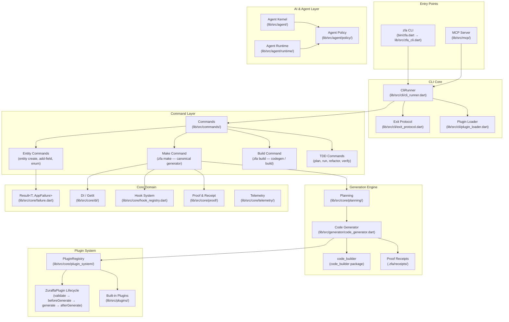
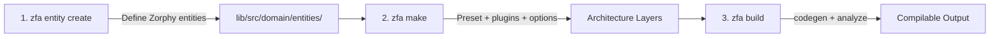

**Zuraffa** is an AI-first Clean Architecture framework for Flutter and Dart. It standardizes code generation around a single canonical workflow — `zfa entity create` → `zfa make` → `zfa build` — so that AI agents and developers produce consistent, type-safe architecture from intent rather than hand-written boilerplate. Zuraffa is currently at version **7.2.0**, requires the Dart SDK `^3.11.0`, and depends on `zorphy` / `zorphy_annotation` for immutable, typed entity generation. It ships a plugin ecosystem covering domain, data, presentation, dependency injection, routing, testing, mocking, simulation, and UI contracts. [README.md](README.md#L1-L17) [pubspec.yaml](pubspec.yaml#L1-L17)

The framework's central promise is **trust**. Every artifact produced by `zfa entity create`, `zfa entity add-field`, and `zfa make` carries a **generation receipt** (schema `proof.v1`) that binds the file to the command that produced it, the generator version, the input context, and the SHA-256 digest of the exact bytes written to disk. `zfa proof check` re-derives every digest and fails on any artifact that cannot prove where it came from, while `zfa proof chain` validates receipts, behavior coverage, generated-test integrity, route verifies, usecase verifies, and Xray coverage end-to-end. [README.md](README.md#L193-L253)

---

## What Zuraffa Does

Zuraffa solves the trust problem in AI-assisted development by making the framework the referee rather than the assistant. Specs become the source of truth, generated code becomes a build artifact, and deterministic verdicts replace stochastic guessing. The capabilities below are the surfaces a beginner will touch first; each is expanded in its own Deep Dive page. [VISION.md](VISION.md#L11-L57) [README.md](README.md#L31-L39)

| Capability | Description | Where to read more |
|---|---|---|
| **Entity Generation** | Zorphy-first immutable entities with JSON serialization, sealed classes, inheritance, generics, and enums under a fixed domain root. | [Entity & Zorphy Model](11-entity-and-zorphy-model) |
| **Architecture Generation (`make`)** | Canonical generator producing domain, data, presentation, DI, and test layers from presets (CRUD, feature, module). | [Code Generation Pipeline](9-code-generation-pipeline) |
| **Plugin System** | Extensible generation via `ZuraffaPlugin` lifecycle hooks and `PluginRegistry` orchestration across 35 built-in plugins. | [Plugin System & Manifest](10-plugin-system-and-manifest) |
| **MCP Server** | Structured AI-agent interface exposing the same canonical workflow via tools such as `zuraffa_make`, `zuraffa_entity_create`, `zuraffa_build`. | [Agent & MCP Integration](24-agent-and-mcp-integration) |
| **TDD Cycle** | Spec-driven test-driven development with `zfa tdd plan`, `run`, `refactor`, and `verify` driving each behavior through gen → RED → implement → GREEN. | [TDD & Spec-Driven Loop](16-tdd-and-spec-driven-loop) |
| **Simulation Worlds** | Certified test environments with fake APIs, latency, and failure storms for testing against simulated reality. | [Simulation Worlds](19-simulation-worlds) |
| **State Management & Sync** | Offline-first sync with Hive caching, background synchronization, and a dual-layer state architecture. | [Offline-First Sync](22-offline-first-sync) |
| **Skin Contracts** | UI layer generation with contract-driven layout, route contracts, and adaptive layouts for mobile, tablet, desktop, and macOS. | [Skin & UI Contracts](20-skin-and-ui-contracts) |
| **GraphQL Integration** | Full GraphQL layer with schema introspection, diff, code generation, and caching. | [GraphQL Integration](21-graphql-integration) |
| **Feature Flags** | Runtime and build-time feature gating integrated into routing and generation. | [Feature Flags](23-feature-flags) |
| **Mock Data & Certification** | Deterministic mock data with certified contract tests and per-method receipts. | [Mock Data & Certification](18-mock-data-and-certification) |

[README.md](README.md#L31-L39) [lib/src/plugins](lib/src/plugins)

---

## Fixed Project Layout

Zuraffa v7 assumes a **fixed architecture root** inside every consuming application. This consistency is what enables deterministic generation and agent predictability: every generated file lands at a path the tooling can reason about without configuration. [README.md](README.md#L133-L160) [AGENTS.md](AGENTS.md#L123-L142)

```text
lib/src/
├── data/              # Data layer (datasources, repositories)
├── di/                # Dependency injection wiring
├── domain/
│   ├── entities/      # Zorphy entities (generated)
│   ├── repositories/  # Repository interfaces / implementations
│   └── usecases/      # Business logic (UseCase, StreamUseCase)
└── presentation/      # UI layer (views, presenters, controllers)
```

Entity files must live at `lib/src/domain/entities/{entity_snake}/{entity_snake}.dart` — for example `lib/src/domain/entities/product/product.dart`. [README.md](README.md#L148-L158) [AGENTS.md](AGENTS.md#L127-L135)

---

## Core Systems Architecture

The diagram below shows how Zuraffa's major subsystems interact inside `lib/src`. Entry points flow through the CLI runner into a command layer, which drives a planning and generation engine backed by the plugin system, all sitting on top of core domain services and an AI/agent layer. [lib/src/zfa_cli.dart](lib/src/zfa_cli.dart#L1-L15) [lib/src/cli/cli_runner.dart](lib/src/cli/cli_runner.dart#L59-L181) [lib/src](lib/src)



[lib/src/zfa_cli.dart](lib/src/zfa_cli.dart#L1-L15) [lib/src/cli/cli_runner.dart](lib/src/cli/cli_runner.dart#L59-L181)

---

## Plugin Architecture

Zuraffa adopted a plugin architecture so that every generation layer is independently testable and extensible. The core contract consists of three interfaces, and the 35 built-in plugins in `lib/src/plugins/` cover every generation surface: entity, repository, datasource, usecase, controller, presenter, view, route, service, provider, module, mock, skin, slice, SQLite, state, sync, GraphQL, TDD, CLI, and more. [lib/src/core/plugin_system](lib/src/core/plugin_system) [lib/src/plugins](lib/src/plugins)

| Interface | Role |
|---|---|
| `ZuraffaPlugin` | Defines lifecycle hooks (`validate`, `beforeGenerate`, `generate`, `afterGenerate`, `onError`) and plugin identification. |
| `FileGeneratorPlugin` | Returns `GeneratedFile` results from the `generate` call. |
| `PluginRegistry` | Coordinates lifecycle ordering and execution across all registered plugins. |

[lib/src/core/plugin_system](lib/src/core/plugin_system) [lib/src/plugins](lib/src/plugins)

---

## The Canonical v7 Workflow

Zuraffa v7 standardizes all code generation around **one workflow**. `zfa feature` still exists, but only as a wrapper over the normalized feature preset. The pipeline rule for agents and humans is: create an entity, generate architecture, then finalize build outputs. [README.md](README.md#L77-L115) [AGENTS.md](AGENTS.md#L25-L54)



### Step 1: Create an Entity

Entities are always generated under `lib/src/domain/entities` in v7. [README.md](README.md#L79-L89) [CLI_GUIDE.md](CLI_GUIDE.md)

```bash
zfa entity create -n Product \
  --field id:String \
  --field name:String \
  --field price:double \
  --field description:String?
```

### Step 2: Generate Architecture with `make`

`zfa make` is the primary generation surface. It expands a normalized plan that generates the domain, data, presentation, and test layers. [README.md](README.md#L91-L105) [AGENTS.md](AGENTS.md#L152-L176)

```bash
zfa make Product \
  --preset=crud \
  --methods=get,getList,create,update,delete \
  --with=vpc \
  --state \
  --di \
  --test
```

### Step 3: Build Generated Code

Use `zfa build` instead of calling `build_runner` directly. [README.md](README.md#L107-L115) [AGENTS.md](AGENTS.md#L55-L61)

```bash
zfa build
```

### v7 Command Summary

| Command | Role in v7 |
|---|---|
| `zfa entity create` | Define or evolve Zorphy entities |
| `zfa make` | Canonical architecture generator |
| `zfa build` | Run the codegen / build step |
| `zfa feature scaffold` | Wrapper over `zfa make --preset=feature` |
| `zfa package create` | Scaffold a Zuraffa-native reusable package |
| `zfa package plugin` | Scaffold a federated plugin monorepo |
| `zfa config` | Manage `.zfa.json` project defaults |
| `zfa manifest` | Inspect available plugins and capabilities |
| `zfa doctor` | Inspect tooling and project health |
| `zfa tdd plan / run / refactor / verify` | TDD cycle commands |
| `zfa simulate` | Run simulation worlds |
| `zfa mock create / certify / verify / explain` | Mock data generation and certification |
| `zfa proof check / chain` | Provenance and proof verification |

[README.md](README.md#L117-L131) [AGENTS.md](AGENTS.md#L25-L33)

---

## Configuration & Project Memory

Zuraffa v7 separates **project defaults** from **project memory**. `.zfa.json` holds active project configuration such as plugin defaults and entity-first rules; `.zfa/` is the canonical project-memory model for plans, runs, decisions, blueprints, manifests, receipts, and agent context. [README.md](README.md#L162-L191) [docs/zfa-tdd-guide.md](docs/zfa-tdd-guide.md)

| File | Purpose |
|---|---|
| `.zfa.json` | Active project configuration (plugin defaults, entity-first rules) |
| `.zfa/` | Project memory for plans, runs, decisions, blueprints, manifests, receipts, context |

**Mental model**: `.zfa.json` → *what this project prefers by default*; `.zfa/` → *what has been planned, generated, and decided over time*. [README.md](README.md#L169-L174)

### Canonical `.zfa/` Layout

```text
.zfa/
├── plans/         # Generation plans from zfa make --plan
├── runs/          # Execution logs and results
├── blueprints/    # Architectural blueprints and patterns
├── decisions/     # Architectural decision records (ADRs)
├── manifests/     # Feature manifests
├── receipts/      # Generation receipts (proof.v1 schema)
└── context.json   # Project context and state
```

[README.md](README.md#L176-L189)

---

## Core Design Principles

These principles, articulated in [VISION.md](VISION.md), shape every architectural decision in the framework. [VISION.md](VISION.md#L1-L60)

| Principle | In Practice |
|---|---|
| **Intent is the source code** | Agents write specs; `zfa` compiles intent into architecture. Code becomes a build artifact. [VISION.md](VISION.md#L11-L14) |
| **The framework is the referee** | The TDD cycle generates failing tests first, refuses implementation until RED is verified, and greenlights only on proof. [VISION.md](VISION.md#L15-L18) |
| **Errors are an API** | Exit codes form a protocol: `0` success, `1` test RED, `2` invalid grammar, `3` manifest drift, `4` state conflict. Every error includes a machine-actionable fix line. [VISION.md](VISION.md#L23-L26) |
| **The manifest is a treaty** | `zfa manifest --verify` runs in CI and fails the build if help text, flags, or behavior drift from the contract. [VISION.md](VISION.md#L19-L22) |
| **The repo is long-term memory** | Baselines, golden files, spec history, and decision records are committed. Agents read intent, not code. [VISION.md](VISION.md#L31-L34) |
| **Proof over generation** | Zuraffa's superpower is generating proof, not code — deterministic verdicts replace stochastic guessing. [VISION.md](VISION.md#L49-L55) |

---

## Project Structure (the Zuraffa Framework Itself)

The following table maps the key directories in the Zuraffa repository to their roles. [lib/src](lib/src) [test](test) [docs](docs)

| Directory | Role |
|---|---|
| `bin/` | CLI entry points: `zfa.dart`, `zuraffa.dart`, `zuraffa_mcp_server.dart` |
| `lib/src/` | All framework source code organized by domain area |
| `lib/src/commands/` | CLI command implementations |
| `lib/src/core/` | Core infrastructure: DI, failure handling, planning, plugin system, proof, telemetry |
| `lib/src/plugins/` | Built-in generation plugins (entity, make, route, skin, mock, etc.) |
| `lib/src/agent/` | AI agent kernel, policy, and runtime |
| `lib/src/mcp/` | MCP server implementation with SSE transport |
| `lib/src/simulation/` | Simulation worlds and certified test environments |
| `lib/src/skin/` | Skin contract system for UI layer generation |
| `lib/src/graphql/` | GraphQL integration layer |
| `lib/src/tdd/` | TDD cycle services |
| `test/` | Comprehensive test suite organized by layer |
| `test/integration/` | End-to-end integration tests |
| `test/regression/` | Regression tests for specific issues |
| `docs/` | User-facing documentation (TDD guide, migration guides, package guides) |
| `.specify/` | Spec-driven development specifications and memory |
| `.zread/wiki/` | Wiki documentation (current, drafts, versions) |
| `examples/` | Example packages (todo_tdd, notes_package, pure_dart_server, etc.) |

[lib/src](lib/src) [test](test) [docs](docs)

---

## Key Dependencies

[pubspec.yaml](pubspec.yaml#L1-L101)

| Dependency | Purpose |
|---|---|
| `zorphy` / `zorphy_annotation` | Immutable, typed entity generation |
| `analyzer` | AST analysis for code generation and linting |
| `code_builder` | Programmatic Dart code construction |
| `graphql` / `gql` | GraphQL client and schema tooling |
| `json_serializable` | JSON serialization code generation |
| `hive_ce` | Offline-first local storage |
| `get_it` | Dependency injection container |
| `vm_service` | VM service for skin drive (Flutter debug tap anchor) |
| `nocterm` | Pure-Dart terminal UI engine (TUI plugin) |

[pubspec.yaml](pubspec.yaml#L19-L65)

---

## Exit Codes & Machine Verdicts

Zuraffa exits are a protocol, not a grab-bag of codes. The golden table is asserted against the live CLI by `test/commands/exit_protocol_golden_test.dart` and enforced in CI by `.github/workflows/conformance.yml`. Every non-zero exit ends with a machine-actionable `--> fix:` line. [README.md](README.md#L297-L315)

| Code | Name | Meaning |
|---|---|---|
| 0 | success | GREEN / complete — the operation ran and passed |
| 1 | failure | RED (honest, in-loop) / stopped / audit failure |
| 2 | usage | The operation could not run as invoked |
| 3 | drift | Contract / spec drift — manifest ↔ CLI flag drift, corrupt state evidence |
| 4 | conflict | State conflict — concurrent run ownership, evidence lock inconsistency |

[README.md](README.md#L301-L310)

---

## Next Steps

Now that you understand the overview, follow this reading progression to go deeper. The links use the wiki's exact page slugs. [README.md](README.md#L392-L399)

**Get Started**
- [Quick Start](2-quick-start) — Get your first entity generated and built end-to-end
- [Installation & Environment Setup](3-installation-and-environment-setup) — Install the CLI and configure your environment
- [Canonical CLI Workflow](4-canonical-cli-workflow) — Complete walkthrough of the entity → make → build pipeline
- [Project Layout & Fixed Architecture Root](5-project-layout-and-fixed-architecture-root) — Deep dive into the fixed domain root
- [Configuration & Project Memory](6-configuration-and-project-memory) — Understand `.zfa.json` and `.zfa/` in detail
- [Running Tests & Local CI](7-running-tests-and-local-ci) — Run the test suite and local CI

**Deep Dive starting points**
- [Architecture Overview](8-architecture-overview) — How the framework is structured internally
- [Entity & Zorphy Model](11-entity-and-zorphy-model) — Zorphy-first immutable entities
- [Code Generation Pipeline](9-code-generation-pipeline) — From CLI invocation to generated files

For the AI agent contract and how agents should interact with Zuraffa, see [AGENTS.md](AGENTS.md). For the long-term vision driving feature priorities, see [VISION.md](VISION.md). For the full command reference, see [CLI_GUIDE.md](CLI_GUIDE.md).

---

## Version History

| Version | Date | Key Changes |
|---|---|---|
| 7.2.0 | 2026-10-20 | Repository cleanup; docs bumped to 7.2.0; mutation-test config restored |
| 7.1.0 | 2026-10-12 | "Built with Zuraffa" showcase; provider/usecase/route fixes |
| 7.0.1 | 2026-09-23 | Release 7.0.1 |
| 7.0.0 | 2026-09-15 | Heavy integrations become opt-in companion packages |

[CHANGELOG.md](CHANGELOG.md#L1-L12) [pubspec.yaml](pubspec.yaml#L3-L3)