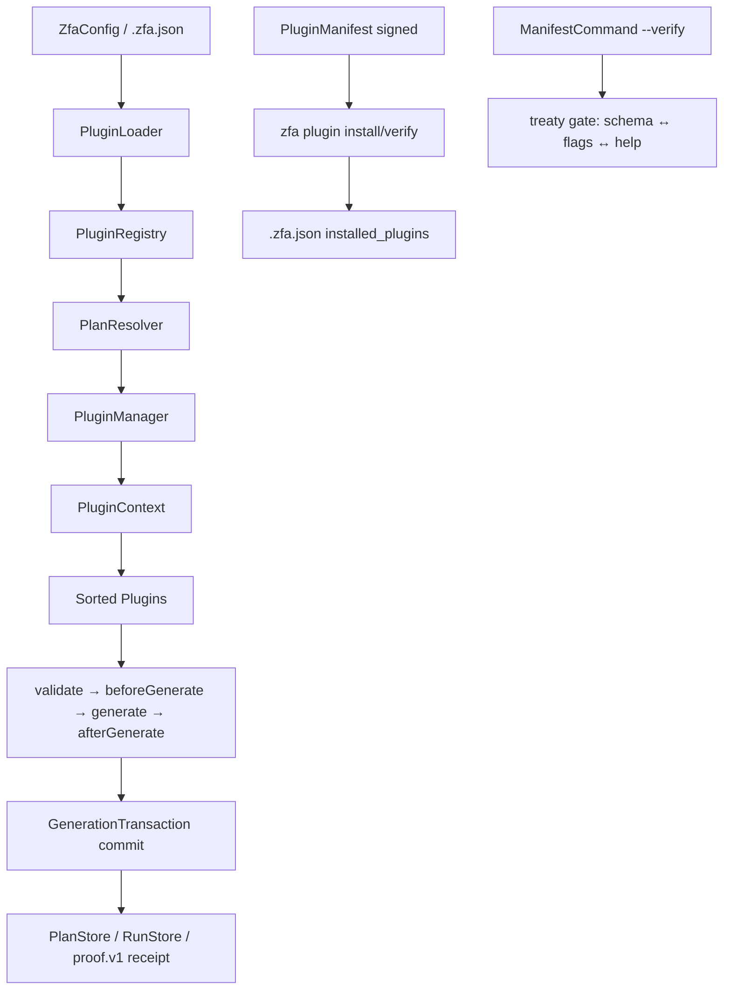

The Zuraffa plugin system is the extension spine of the code generator. Every generated artifact (repository, use case, view, DI registration, routes, tests, etc.) is produced by a **plugin**, each plugin exposes **capabilities** that the kernel interviews before execution, and every capability advertises a signed **manifest** contract that the CLI verifies against its live flag surface. This page documents the plugin interface, lifecycle, registry, plan resolution, configuration, optional-capability gating, feature scoping, and the manifest/treaty machinery that keeps the contract honest.

## Architectural Overview



Sources: [plugin_interface.dart](lib/src/core/plugin_system/plugin_interface.dart#L1-L84), [plugin_registry.dart](lib/src/core/plugin_system/plugin_registry.dart#L1-L116), [plugin_manager.dart](lib/src/core/plugin_system/plugin_manager.dart#L1-L120), [plugin_loader.dart](lib/src/cli/plugin_loader.dart#L1-L246), [plan_resolver.dart](lib/src/core/planning/plan_resolver.dart#L1-L120), [plugin_manifest.dart](lib/src/plugins/registry/plugin_manifest.dart#L1-L122), [manifest_command.dart](lib/src/commands/manifest_command.dart#L1-L120)

## Core Plugin Contract

The base contract is `ZuraffaPlugin`. A plugin must provide `id`, `name`, and `version`; everything else has sensible defaults.

| Member | Purpose |
|---|---|
| `id` | Unique identifier used in plans, config, and CLI (`repository`, `usecase`, `di`, …) |
| `name` | Human-readable name |
| `version` | Semantic version |
| `dependsOn` | Plugin IDs that must run **before** this plugin (forces them active) |
| `runAfter` | Plugin IDs this plugin should follow **if present** (soft ordering) |
| `configSchema` | JSON Schema for plugin configuration (drives CLI flags) |
| `configKey` | `.zfa.json` key that enables the plugin by default |
| `capabilities` | List of `ZuraffaCapability` instances the kernel can invoke |
| `validate` / `beforeGenerate` / `afterGenerate` / `onError` | Lifecycle hooks |

`FileGeneratorPlugin` extends `ZuraffaPlugin` and adds `generate(GeneratorConfig)` plus a default `generateWithContext(PluginContext)` bridge, so every file-producing plugin fits the lifecycle without rewriting its generation body.

Sources: [plugin_interface.dart](lib/src/core/plugin_system/plugin_interface.dart#L1-L84)

## Capabilities

A capability is a single, interviewable action a plugin offers (e.g. `create_usecase`, `create_repository`, `scaffold_feature`). The kernel plans before it executes.

```dart
abstract class ZuraffaCapability {
  String get name;
  String get description;
  JsonSchema get inputSchema;
  JsonSchema get outputSchema;
  Future<EffectReport> plan(Map<String, dynamic> args);
  Future<ExecutionResult> execute(Map<String, dynamic> args);
}
```

- `plan` returns an `EffectReport` (plan id, plugin id, capability name, args, list of `Effect`s, validity). Plans can be saved to the `PlanStore` and reloaded.
- `execute` returns an `ExecutionResult` (success, files, message, data, warnings).
- `Effect` describes a single file-level change: `file`, `action` (`create`/`modify`/`delete`/`skip`), optional `diff` and `previousContent`.

Opt-in feature scoping is provided by `FeatureScopedCapability` (implements `ZuraffaCapability`): a capability declares `supportsFeature(FeatureContract)`. The `PluginLoader` drops a plugin only when **at least one** of its capabilities declares the protocol and refuses the feature; unscoped capabilities always serve every feature.

Sources: [capability.dart](lib/src/core/plugin_system/capability.dart#L1-L154), [plugin_loader.dart](lib/src/cli/plugin_loader.dart#L58-L90)

## Plugin Registry & Lifecycle

`PluginRegistry` is the in-memory catalogue. It supports registration, factory discovery, dependency-aware topological sort, and lifecycle fan-out.

- `register` / `registerAll` / `discover(factories)` — registration entry points; duplicate IDs throw `StateError`.
- `sortPlugins(targets)` — topological sort over `dependsOn` + `runAfter`; detects circular dependencies.
- `getById`, `ofType<T>` — lookup.
- `validateAll`, `beforeGenerateAll`, `afterGenerateAll`, `onErrorAll` — lifecycle fan-out over registered plugins.

`PluginManager.run` executes the full lifecycle in order: revert handling, entity-first preconditions, topological sort, `validate` per plugin, `beforeGenerate` per plugin, `generateWithContext` for each `FileGeneratorPlugin`, feature-ownership stamping, transaction commit, `afterGenerate` per plugin, then project-memory persistence (plan, run artifact, context, proof receipt).

`ValidationResult` is a value object with `success`/`failure`, `reasons`, and `merge` for aggregating across plugins.

Sources: [plugin_registry.dart](lib/src/core/plugin_system/plugin_registry.dart#L1-L116), [plugin_lifecycle.dart](lib/src/core/plugin_system/plugin_lifecycle.dart#L1-L27), [plugin_manager.dart](lib/src/core/plugin_system/plugin_manager.dart#L640-L720)

## Plugin Context

`PluginContext` is the shared execution envelope:

- `core: CoreConfig` — name, project root, output dir, dry-run/force/verbose/revert, active `FeatureContract`.
- `data: Map<String,dynamic>` — plugin-specific validated data.
- `sharedData` — cross-plugin shared values.
- `discovery: DiscoveryEngine` — file discovery without hardcoded paths.
- `fileSystem: FileSystem` — injectable file-system abstraction.

Defensive accessors `get<T>` and `isActive(pluginId)` avoid type-collision crashes when a plugin id collides with a string-typed schema property (notably `service`).

Sources: [plugin_context.dart](lib/src/core/plugin_system/plugin_context.dart#L1-L161)

## Plugin Loader & Configuration

`PluginLoader` builds a `PluginRegistry` from the hardcoded first-party plugin list and applies two filters:

1. **Feature scoping** — `filterForFeature` when a `FeatureContract` is active.
2. **Disabled set** — plugins whose id is in `PluginConfig.disabled` are skipped.

`PluginConfig` loads from `.zfa.json` via `ZfaConfig.disabledPlugins` and owns a **mutable** copy (issue #1586: `ZfaConfig` stores an unmodifiable set). `PluginConfig.save` persists the disabled set back, refusing to overwrite an unparseable `.zfa.json`.

`ZfaConfig` carries `pluginDefaults` (a `Map<String,bool>` of ~20 built-in plugins), `disabledPlugins`, custom presets/aliases, UI defaults, and feature-flag sections. `isPluginEnabledByDefault` drives which plugins are added to every plan. `configKeyForPlugin` maps plugin ids to config keys (`method_append` → `appendByDefault`, `graphql` → `graphqlByDefault`, otherwise `<id>ByDefault`).

Sources: [plugin_loader.dart](lib/src/cli/plugin_loader.dart#L1-L246), [zfa_config.dart](lib/src/config/zfa_config.dart#L1-L290)

## Plan Resolution

`PlanResolver.resolve` computes the active plugin set from:

- Preset expansion (`--preset`, plus custom presets from config).
- Explicit `--with` ids and positional plugin ids.
- Config defaults (`isPluginEnabledByDefault`).
- Plugin aliases (built-in: `data`→repository+datasource, `vpc`→view+presenter+controller, `full-ui`, `quality`, `gql`→graphql; plus custom aliases).
- `--without` / `--no-<plugin>` exclusions.
- `--compile-only` drops `mock`.
- Disabled-plugin filtering and unknown-plugin warnings.

`PluginManager._applyPackageModeFilter` additionally drops app-only plugins (`route`, `view`, `presenter`, `controller`, `app_shell`) when the project carries the package-shape marker.

Sources: [plan_resolver.dart](lib/src/core/planning/plan_resolver.dart#L1-L120), [plugin_alias_resolver.dart](lib/src/core/planning/plugin_alias_resolver.dart#L1-L60), [preset_registry.dart](lib/src/core/planning/preset_registry.dart#L1-L127), [plugin_manager.dart](lib/src/core/plugin_system/plugin_manager.dart#L40-L75)

## Presets

Built-in presets (from `GenerationPreset` and `PresetRegistry`):

| Preset | Plugins |
|---|---|
| `entity-crud` | repository, usecase |
| `vpc` | view, presenter, controller |
| `vpc-state` | view, presenter, controller, state |
| `full-stack` | repository, usecase, view, presenter, controller, di, route, test |
| `data-layer` | repository, datasource |
| `module` | usecase, repository, datasource, view, presenter, controller, state, di, route, test, module |
| `feature` | usecase, repository, datasource, view, presenter, controller, state, di, test |
| `engine` | usecase, service, provider, repository, datasource, mock, di, test |
| `crud` / `read-only` | usecase, repository, datasource, mock, di |
| `service-feature` | service, provider, usecase, view, presenter, controller, state, di, test |
| `adaptive-feature` / `platform-feature` | usecase, repository, datasource, view, presenter, controller, state, di, test, route |

Sources: [presets.dart](lib/src/core/plugin_system/presets.dart#L1-L97), [preset_registry.dart](lib/src/core/planning/preset_registry.dart#L1-L127)

## Optional Capabilities & the Plugin Gate

Heavy capabilities (graphql, storage, observability) are trimmed out of core and live in companion packages. Core carries only the catalog.

- `PluginCatalog.all` lists `graphql → zuraffa_graphql`, `storage → zuraffa_storage`, `observability → zuraffa_observability`.
- `PluginGate.readCapabilities` reads the `capabilities:` section of `.zfa.json`.
- `PluginGate.isEnabled` / `isResolvable` checks enablement and whether the companion package resolves in `.dart_tool/package_config.json`.
- `PluginGate.refusalFor` returns the exact guidance message (or null when usable) ending in a machine-actionable `--> fix:` line.
- `PluginGate.companionEntry` resolves the companion package's `bin/<package>.dart` entrypoint for delegation.

`zfa plugin enable/disable <id>` persists `capabilities.<id>` in `.zfa.json` (additive read-modify-write) and reports resolvability.

Sources: [plugin_catalog.dart](lib/src/plugins/plugin_gate/plugin_catalog.dart#L1-L44), [plugin_gate.dart](lib/src/plugins/plugin_gate/plugin_gate.dart#L1-L189), [plugin_command.dart](lib/src/commands/plugin_command.dart#L1-L260)

## Feature-Scoped Loading

When a typed `FeatureContract` is active (spec 1098), `PluginLoader.buildRegistry` re-resolves the plugin set per feature: a plugin is dropped only when at least one capability declares `FeatureScopedCapability` and refuses the feature. Unscoped plugins are always kept. This lets slice/xray/feature workflows load only the plugins that serve a given feature.

Sources: [plugin_loader.dart](lib/src/cli/plugin_loader.dart#L58-L90), [capability.dart](lib/src/core/plugin_system/capability.dart#L120-L154)

## Plugin Manifest (Signed)

`PluginManifest` is the signed capability manifest describing what an (external) plugin may do.

| Field | Meaning |
|---|---|
| `id`, `name`, `version` | Identity |
| `description` | Human description |
| `writePaths` | Glob/path prefixes the plugin may write |
| `commands` | CLI commands it provides |
| `tools` | Agent/MCP tools it registers |
| `signature` | HMAC-SHA256 over canonical bytes |

- `canonical()` produces deterministic JSON of everything except the signature.
- `sign(canonical, {key})` uses HMAC-SHA256 with `defaultSigningKey` (v0 dev-only symmetric key; production needs asymmetric keypair + trust store).
- `verify()` performs constant-time comparison.
- `loadManifest(path)` loads from a file or directory (looks for `manifest.json`).

`PluginRegistryIndex` is the static JSON registry index (`{ "plugins": [ { id, name, version, description, manifest } ] }`) used by `zfa plugin search/install`.

Sources: [plugin_manifest.dart](lib/src/plugins/registry/plugin_manifest.dart#L1-L122), [plugin_registry_index.dart](lib/src/plugins/registry/plugin_registry_index.dart#L1-L79)

## Manifest Command & Treaty Gate

`zfa manifest` lists all capabilities of CLI-aware plugins in JSON/MCP format. `zfa manifest --verify [pluginIds...]` is the machine-checkable treaty gate (drift exits 3):

1. **schema→flags** — every `inputSchema.properties` entry must be accepted by the serving command (camelCase → kebab-case). Hand-rolled `ArgParser.allowAnything()` dispatchers declare their real grammar via `CliFlagSurface`.
2. **help text** — every schema-derived flag must appear in the serving command's usage surface.
3. **dead flags** — a `PluginCommand` parent-level option outside `consumedParentFlags` is parsed/adverised but never read.
4. **resolution** — every advertised capability must resolve in the command tree.

`--format json` on verify emits a single `manifest-verify.v1` document. Unknown plugin ids are usage errors (exit 2).

Sources: [manifest_command.dart](lib/src/commands/manifest_command.dart#L1-L436), [cli_flag_surface.dart](lib/src/core/plugin_system/cli_flag_surface.dart#L1-L52)

## Plugin Command (Lifecycle & Distribution)

`zfa plugin` manages plugins:

| Action | Purpose |
|---|---|
| `list` | Lists plugins + optional capabilities |
| `enable` / `disable` | Toggles a plugin or optional capability |
| `add <package>` | Wires a plugin package into `lib/main.dart` |
| `mcp` | Alias for `zfa mcp scaffold` |
| `search [query]` | Searches a registry index |
| `install <name>` | Verifies signature, checks undeclared write paths, detects command conflicts, records provenance in `.zfa.json` |
| `verify <path>` | Verifies a manifest signature |
| `publish` | v0 stub |

`install` refuses when the manifest signature fails, when files exist outside declared `writePaths`, or when commands conflict with already-installed plugins.

Sources: [plugin_command.dart](lib/src/commands/plugin_command.dart#L1-L850)

## Receipts on Standalone Invocations

Every successful standalone capability invocation (`zfa di create`, `zfa cache adapter <E>`, …) auto-persists a `proof.v1` receipt via `CapabilityInvocationWrapper` into `.zfa/receipts/`, keyed `<plugin>-<capability>-<entity>-<timestamp>.json`, carrying `{plugin, capability, entity, hash, methodset, files, receipt_version: 1}`. Dry-run/revert runs and zero-file runs persist nothing.

Sources: [capability_invocation_wrapper.dart](lib/src/core/plugin_system/capability_invocation_wrapper.dart#L1-L200)

## CLI-Aware Plugins & Flag Surface

- `CliAwarePlugin` mixin: plugins expose a `Command` via `createCommand()`; only CLI-aware plugins are advertised by `zfa manifest`.
- `CliFlagSurface`: hand-rolled dispatchers (`zfa slice`, `zfa benchmark`) declare their real accepted flag set for the treaty gate.
- `PluginCommand` auto-registers each capability as a subcommand and provides standard flags (`output`, `dry-run`, `force`, `verbose`, `revert`).

Sources: [cli_aware_plugin.dart](lib/src/core/plugin_system/cli_aware_plugin.dart#L1-L14), [base_plugin_command.dart](lib/src/commands/base_plugin_command.dart#L1-L178), [cli_flag_surface.dart](lib/src/core/plugin_system/cli_flag_surface.dart#L1-L52)

## Suggested Reading

- [Code Generation Pipeline](9-code-generation-pipeline) — how plugins execute end to end.
- [Dependency Injection](15-dependency-injection) — DI plugin specifics.
- [Extending with Custom Plugins & Packages](26-extending-with-custom-plugins-and-packages) — authoring external plugins.
- [Exit Codes & Machine Verdicts](25-exit-codes-and-machine-verdicts) — treaty gate exit codes.
- [Proof & Provenance](17-proof-and-provenance) — receipt schema and verification.