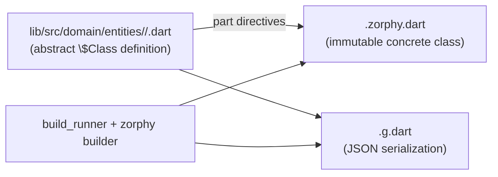

Entities are the atomic unit of the Zuraffa domain layer. Zuraffa does not define its own entity format; it adopts **Zorphy** — an external code generator — as its sole entity, patch, and filter system. This page explains the Zorphy model as Zuraffa uses it: the two-stage definition/generated-class pattern, the annotation grammar, the generated surface, and the way Zuraffa's own tooling reads and validates entity files.

## Why Zorphy

Zuraffa's configuration assumes entities are authored first and that Zorphy is the only entity format in play. `entityFirst` and `zorphyOnly` both default to `true`, so every downstream generator (use cases, repositories, views, DI, tests) treats a Zorphy entity file as the single source of truth for a domain concept.

Sources: [zfa_config.dart](lib/src/config/zfa_config.dart#L52-L53), [zfa_config.dart](lib/src/config/zfa_config.dart#L248-L249)



The two-stage design is the key mental model: `zfa entity create` writes only the *abstract definition*; `zfa build` (which runs `build_runner`) produces the concrete class, JSON plumbing, patches, and query descriptors. You edit the definition, never the generated files.

Sources: [build_command.dart](lib/src/commands/build_command.dart#L54-L64), [build.yaml](build.yaml#L1-L15)

## The Fixed Location Contract

In v5 the output location is fixed and non-negotiable:

```text
lib/src/domain/entities/{entity_snake}/{entity_snake}.dart
```

The constant `fixedEntityOutput` (`lib/src/domain/entities`) is always used; the `--output` flag is accepted for compatibility but ignored. This matters because every downstream tool — `make`, the mock builder, the entity analyzer, the id resolver — expects entities at exactly this path.

Sources: [entity_command.dart](lib/src/commands/entity_command.dart#L9-L10), [entity_command.dart](lib/src/commands/entity_command.dart#L144), [zfa_config.dart](lib/src/config/zfa_config.dart#L12-L14)

## The Definition File

A definition is an abstract class whose fields are declared as getters, annotated with `@Zorphy(...)` (or the `@zorphy`/`@Zorphy2` aliases). The class name is prefixed to signal its role to the generator:

| Prefix | Meaning | Example |
|---|---|---|
| `$` | Normal concrete-producing entity | `abstract class $Todo { ... }` |
| `$$` | Sealed/abstract base (implementations live elsewhere) | `abstract class $$PaymentMethod { ... }` |
| (none, with `nonSealed: true`) | Non-sealed abstract base | `abstract class $$Params` |

The `part` directives declare where generated code lives:

```dart
import 'package:zorphy_annotation/zorphy_annotation.dart';

part 'todo.zorphy.dart';
part 'todo.g.dart';

@Zorphy(generateJson: true, generateCompareTo: true)
abstract class $Todo {
  int get id;
  String get title;
  bool get isCompleted;
  TodoPriority get priority;
  List<String> get tags;
  DateTime get createdAt;
}
```

Sources: [todo.dart](example/lib/src/domain/entities/todo/todo.dart#L1-L16)

## Kinds: Entity vs Value Object

`@Zorphy` carries a `kind` that defaults to `ZorphyKind.entity`:

- **Entity** — an aggregate/event root with its own identity. The framework expects an id-like field (a literal `id`, a `*Id` field, or `autoId: true`); `zfa make` generates the CRUD surface (repository/use case/controller/presenter) around it.
- **Value object** — an immutable composition type with no identity. No id is required and `zfa make` treats it as an embedded type (no repository/use case/controller/presenter). Equality, `copyWith`, and JSON serialization are generated exactly like an entity.

The `@ZValueObject` annotation is a convenience alias for `@Zorphy(kind: ZorphyKind.valueObject)`.

Sources: [annotations.dart](/Users/arrrrny/.pub-cache/hosted/pub.dev/zorphy_annotation-2.4.3/lib/src/annotations.dart#L35-L45), [entity_field_resolver.dart](lib/src/utils/entity_field_resolver.dart#L78-L95)

## Annotation Options

The options that matter most in Zuraffa-generated entities:

| Option | Type | Effect |
|---|---|---|
| `generateJson` | `bool` | Emits `fromJson`/`toJson` and the `.g.dart` part |
| `generateFilter` | `bool` | Emits type-safe `Field` descriptors and filter classes |
| `generateCompareTo` | `bool?` | Emits `compareToX` diff method |
| `generateCopyWith` / `generateCopyWithFn` | `bool?` | Emits `copyWith` / function-based `copyWithFn` |
| `generatePatch` | `bool?` | Emits `Patch` class and `patchWithX` |
| `autoId` | `bool` | Mints a uuid `id` at construction time |
| `equalityExcludes` | `List<String>` | Drops fields from `==`/`hashCode`/`toJsonLean`/`compareTo` |
| `nonSealed` | `bool` | Abstract but open base class |
| `kind` | `ZorphyKind` | Entity vs value object |
| `typeKey` / `subtypeWireValue` | `String?` | Polymorphic JSON dispatch keys |
| `explicitSubTypes` | `List<Type>?` | Sealed subtype list for polymorphic dispatch |
| `preset` | `ZorphyPreset` | `lean`/`standard`/`full` bundle of the above |

Sources: [annotations.dart](/Users/arrrrny/.pub-cache/hosted/pub.dev/zorphy_annotation-2.4.3/lib/src/annotations.dart#L126-L260)

## What Zorphy Generates

After `zfa build`, the `.zorphy.dart` part contains the real, usable concrete class. The surface (from the example `Todo`):

| Member | Purpose |
|---|---|
| `class Todo` | Concrete immutable class with `final` fields and constructor |
| `Todo.fromJson(...)` | Deserialization factory |
| `toJson()` / `toJsonLean()` | Serialization (lean strips identity noise) |
| `copyWith(...)` / `copyWithField<T>` | Field-replacing copies |
| `patchWithTodo(...)` | Applies a typed `TodoPatch` |
| `enum Todo$` | Field-name constants for patches/filters |
| `class TodoPatch` | Fluent typed patch builder (`withId`, `withTitle`, ...) |
| `TodoFields` | Static `Field<Todo, T>` descriptors for query construction |
| `compareToTodo(...)` | Field-by-field diff map |
| Extension helpers | Property helpers, serialization |

The `.g.dart` file holds only the JSON plumbing (`_$TodoFromJson`, `_$TodoToJson`).

Sources: [todo.zorphy.dart](example/lib/src/domain/entities/todo/todo.zorphy.dart#L12-L410)

## Field Types

Zorphy fields use standard Dart type syntax. Zuraffa's type system distinguishes primitives, collections, nested entities, enums, generics, and self-references:

| Category | Example | Notes |
|---|---|---|
| Primitives | `String`, `int`, `double`, `bool`, `DateTime`, `Duration` | Dart built-ins |
| Nullable | `String?`, `int?` | Nullability flows through generated code |
| Collections | `List<String>`, `Set<int>`, `Map<String, dynamic>` | Smart-split parser keeps generics intact |
| Nested entities | `$Address` | `$` prefix marks another Zorphy entity; import auto-resolved |
| Enums | `OrderStatus` | Plain name; recognized as enum, not entity |
| Generics | `T?` | Concrete class becomes generic |
| Self-reference | `List<$Category>?` | Trees and hierarchies |

Zuraffa normalizes primitive aliases (e.g. `Boolean` → `bool`) before validation and emission, and extracts inner entity types from generic wrappers for import resolution.

Sources: [entity_utils.dart](lib/src/utils/entity_utils.dart#L8-L40), [entity_utils.dart](lib/src/utils/entity_utils.dart#L44-L118), [known_types.dart](lib/src/core/constants/known_types.dart#L1-L93)

## Enums

Fixed-value states are plain Dart enums written to `lib/src/domain/entities/enums/{snake}.dart`, with the barrel `enums/index.dart` auto-updated with an `export`. Once an enum exists, reference it in an entity by plain name; Zuraffa recognizes it as an enum (not an entity) and adds `import '../enums/index.dart';` automatically.

Sources: [entity_command.dart](lib/src/commands/entity_command.dart#L871-L937), [entity_command.dart](lib/src/commands/entity_command.dart#L349-L351)

## Sealed Classes & Polymorphism

When a domain concept has distinct variants, use a sealed base (`--sealed`, which changes the prefix from `$` to `$$`). Variants are declared with `--subtypes` or created separately with `--extends`. The result is a type-safe hierarchy supporting exhaustive `switch`. For sealed roots, `.g.dart` is not generated (you cannot deserialize an abstract type directly). The `--non-sealed` variant is used for open shared interfaces like `Timestamped` or `Identifiable`.

Sources: [entity_command.dart](lib/src/commands/entity_command.dart#L393-L410), [entity_command.dart](lib/src/commands/entity_command.dart#L159-L160)

## AutoId and Identity Resolution

`autoId: true` mints a uuid `id` at construction time. Because the minted uuid is identity noise, Zuraffa and Zorphy provide two opt-outs: `equalityExcludes: ['id']` drops it from `==`/`hashCode`/`toJsonLean`/`compareTo`, and Zorphy auto-emits `valueEquals(other)` and `toJsonValue()` for value comparison.

Zuraffa's `EntityFieldResolver` resolves an entity's id-like field for code generation: literal `id` first, then the first field ending in `Id`, then the synthetic `id: String` when `autoId: true`. Value objects (`kind: valueObject` or `@ZValueObject`) have no identity and resolve no id. Entities with neither an id-like field nor `autoId` are reported as id-less and `zfa make` fails loudly.

Sources: [entity_field_resolver.dart](lib/src/utils/entity_field_resolver.dart#L60-L130), [annotations.dart](/Users/arrrrny/.pub-cache/hosted/pub.dev/zorphy_annotation-2.4.3/lib/src/annotations.dart#L130-L180)

## Zuraffa's Validation Layer

Before writing anything, `zfa entity create`/`add-field` validate that every custom field type resolves to either a primitive, an existing entity directory, or an existing enum file. Forward references can be opted into with `--allow-forward-refs` for cyclic schemas. The validator also guards against Dart keyword field names and entity names colliding with framework exports.

Sources: [entity_type_validator.dart](lib/src/utils/entity_type_validator.dart#L60-L173), [entity_command.dart](lib/src/commands/entity_command.dart#L279-L310)

## Next Steps

- [Code Generation Pipeline](9-code-generation-pipeline) — how `zfa build` turns definitions into concrete classes.
- [Domain Layer & Use Cases](12-domain-layer-and-use-cases) — how entities drive use cases.
- [Data Layer & Repositories](13-data-layer-and-repositories) — how entities shape repositories and datasources.
- [Mock Data & Certification](18-mock-data-and-certification) — how entity fields become mock data.