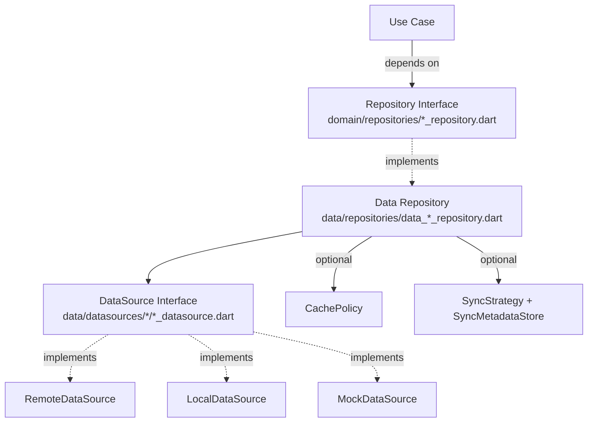

The data layer is where Zuraffa separates *what* the domain needs from *how* it is stored and transported. It is split into two halves: **repository interfaces** that live in the domain layer (`lib/src/domain/repositories`) and define the contract a use case depends on, and **repository implementations plus data sources** that live in the data layer (`lib/src/data`) and fulfill that contract. Code generation keeps the two halves in lockstep through a generation-time conformance gate and a digest-bound contract manifest.



Sources: [repository_plugin.dart](lib/src/plugins/repository/repository_plugin.dart#L1-L60), [data_todo_repository.dart](example/lib/src/data/repositories/data_todo_repository.dart#L1-L54), [todo_repository.dart](example/lib/src/domain/repositories/todo_repository.dart#L1-L19)

## Directory Layout

Every entity that opts into repository generation produces a predictable set of files. The layout below is the default produced by `zfa make <Entity>` and by the `repository` plugin.

| Path | Artifact | Role |
|---|---|---|
| `lib/src/domain/repositories/<entity>_repository.dart` | `<Entity>Repository` (abstract) | Domain contract consumed by use cases |
| `lib/src/data/repositories/data_<entity>_repository.dart` | `Data<Entity>Repository` | Implementation delegating to a data source |
| `lib/src/data/datasources/<entity>/<entity>_datasource.dart` | `<Entity>DataSource` (abstract) | Data-source contract |
| `lib/src/data/datasources/<entity>/<entity>_remote_datasource.dart` | `<Entity>RemoteDataSource` | Network/remote stub to implement |
| `lib/src/data/datasources/<entity>/<entity>_local_datasource.dart` | `<Entity>LocalDataSource` | Local storage stub (cache/sync flows) |
| `lib/src/data/datasources/<entity>/<entity>_mock_datasource.dart` | `<Entity>MockDataSource` | Certified mock data source |
| `lib/src/data/mock/<entity>_mock_data.dart` | `<Entity>MockData` | In-memory mock fixtures |
| `lib/src/di/repositories/<entity>_repository_di.dart` | `register<Entity>Repository` | GetIt wiring |
| `lib/src/cache/<entity>_cache.dart` | `<Entity>Cache` | Cache policy helper (cached variant) |

Sources: [repository_plugin.dart](lib/src/plugins/repository/repository_plugin.dart#L220-L290), [datasource_plugin.dart](lib/src/plugins/datasource/datasource_plugin.dart#L195-L282), [todo_repository_di.dart](example/lib/src/di/repositories/todo_repository_di.dart#L1-L12)

## Repository Interface

The interface generator emits an abstract class named `<Entity>Repository` under `domain/repositories`. Its method set is derived from the configured method vocabulary (see [Method Vocabulary](#method-vocabulary)) plus two optional groups:

- **`generateInit`** adds `isInitialized`, `initialize`, and `dispose` for repositories that own an initialization lifecycle.
- **`enableSync`** adds `syncPending` and `pullRemote` so a sync-enabled repository exposes manual sync triggers matching the concrete synced implementation.

Imports are resolved with discovery: the entity file is located via `DiscoveryEngine` and imported relative to the repository directory; when the entity name collides with a zuraffa core export, the barrel import hides exactly those symbols so the locally imported entity wins resolution.

Sources: [interface_generator.dart](lib/src/plugins/repository/generators/interface_generator.dart#L1-L60), [interface_generator.dart](lib/src/plugins/repository/generators/interface_generator.dart#L195-L260), [interface_generator.dart](lib/src/plugins/repository/generators/interface_generator.dart#L395-L470)

## Repository Implementation Variants

`Data<Entity>Repository` implements the interface. Three variants are selected by flags, and they are **mutually exclusive**:

| Variant | Flag | Data flow | Extra state |
|---|---|---|---|
| Simple | (default) | Delegates every method straight to `_dataSource` | One `_dataSource` field |
| Cached | `--cache` | Remote-first: read from local cache, fall back to remote and backfill; writes go remote then local | `_remoteDataSource`, `_localDataSource`, `_cachePolicy` |
| Synced | `--sync` | Local-first: reads from local only; writes land locally and are marked pending via `SyncStrategy` | `_localDataSource`, `_remoteDataSource`, `_syncMetadataStore`, `_syncStrategy` |
| Conflicted | `--cache` + `--sync` | Generation fails with `ArgumentError` before writing | — |

The cached and synced variants add the appropriate sync-specific methods (`syncPending`, `pullRemote`) only in synced mode. Cache and sync are architecturally incompatible — cache is remote-first, sync is local-first — so requesting both is a hard error rather than a silent choice.

Sources: [implementation_generator.dart](lib/src/plugins/repository/generators/implementation_generator.dart#L60-L120), [implementation_generator.dart](lib/src/plugins/repository/generators/implementation_generator.dart#L195-L260), [implementation_generator_cached.dart](lib/src/plugins/repository/generators/implementation_generator_cached.dart#L1-L60), [implementation_generator_synced.dart](lib/src/plugins/repository/generators/implementation_generator_synced.dart#L1-L60)

## Data Sources

Data sources are the leaves of the data layer. The data-source interface (`<Entity>DataSource`) mirrors the repository method set. Implementations are generated or stubbed depending on flags:

- **Remote** — always generated unless explicitly disabled; methods throw `UnimplementedError` so you wire the real transport.
- **Local** — generated when `--local`, `--cache`, or `--sync` is active.
- **Mock** — generated alongside the interface for development and TDD; backed by in-memory mock fixtures under `data/mock`.

The repository plugin also emits the data-source interface itself when `--datasource` is requested **and** the datasource plugin is not already active, avoiding a duplicate-write conflict on the same file. In the orchestrated `zfa make` flow the datasource plugin is active and emits it instead.

Sources: [datasource_plugin.dart](lib/src/plugins/datasource/datasource_plugin.dart#L195-L282), [interface_generator.dart (datasource)](lib/src/plugins/datasource/builders/interface_generator.dart#L1-L120), [todo_remote_datasource.dart](example/lib/src/data/datasources/todo/todo_remote_datasource.dart#L1-L47), [todo_mock_datasource.dart](example/lib/src/data/datasources/todo/todo_mock_datasource.dart#L1-L104)

## Generation Flow & Flags

The repository plugin runs only when `useService` is false. It resolves the target entity (honoring `--repo` for custom use-case composition), then conditionally emits:

1. The interface — when entity-based or when appending to an existing repository.
2. The implementation — when entity-based, `--data`, `--datasource`, or appending (and not in service mode).
3. The data-source interface — when `--datasource` and the datasource plugin is inactive.

`appendToExisting` drives the append path: missing imports, fields, constructors, and methods are merged into the existing file rather than overwriting it. `revert` reverses the operation, deleting the file when the class becomes empty.

Sources: [repository_plugin.dart](lib/src/plugins/repository/repository_plugin.dart#L200-L300), [configFromContext](lib/src/plugins/repository/repository_plugin.dart#L70-L110)

## Conformance Gate & Contract Manifest

After emitting both sides, the plugin runs a generation-time conformance gate (spec 0973). It parses the interface and implementation with an in-process analyzer AST and proves:

- every interface method has an implementing member, and
- every implementation member claiming the interface via `@override` corresponds to an interface method.

A mismatch fails generation with a per-method `--> fix:` line naming the method and the side that must change, instead of shipping a pair that only fails later at `zfa build`. Fresh pairs are audited in full; append flows are audited in delta scope (only the methods this run contributed).

On success, a digest-bound contract manifest is written to `.zfa/receipts/repository-<entity>.json`. It carries the interface method set with params/returns signatures, the SHA-256 of both files, and a hash of the method table. `SourceInterfaceGuard` consumes the manifest when it is fresh, and `zfa proof check` re-derives the digests and goes red on drift or tampering.

Sources: [repository_plugin.dart](lib/src/plugins/repository/repository_plugin.dart#L300-L360), [repository_conformance_checker.dart](lib/src/plugins/repository/conformance/repository_conformance_checker.dart#L1-L120), [repository_contract_manifest.dart](lib/src/plugins/repository/contract/repository_contract_manifest.dart#L1-L80)

## Emission Plan & `--explain`

`zfa make --explain` (and `zfa repository create --explain`) resolve a pure, deterministic emission plan without generating. The plan reports for each artifact whether it is emitted, its output path, class name, variant (`simple`/`cached`/`synced`/`conflicted`), method list, and the flags that triggered the decision. The direct `zfa repository create` path uses the same planner with `datasourcePluginActive = false`.

Sources: [repository_emission_plan.dart](lib/src/plugins/repository/plan/repository_emission_plan.dart#L1-L80), [repository_emission_plan.dart](lib/src/plugins/repository/plan/repository_emission_plan.dart#L120-L278), [repository_plugin.explainEmission](lib/src/plugins/repository/repository_plugin.dart#L110-L130)

## CLI Entry Points

Direct generation uses the `repository create` subcommand:

```
zfa repository create --name <Entity> \
  [--methods get,create,update,delete,list,watch,getList,watchList] \
  [--data] [--datasource] [--dry-run] [--force] [--verbose] [--json] [--explain]
```

Defaults (matching the positional `zfa repository <Entity>` contract): `--data` and `--datasource` default to `true`, and methods default to `get,update`. `--json` emits the canonical `ZuraffaVerdictEnvelope` as the last stdout line; `--explain` prints the emission plan and exits without writing.

Sources: [repository_create_command.dart](lib/src/commands/repository_create_command.dart#L60-L130), [create_repository_capability.dart](lib/src/plugins/repository/capabilities/create_repository_capability.dart#L1-L80)

## Dependency Injection Wiring

For each entity, a `register<Entity>Repository(GetIt)` function is generated under `di/repositories`. It registers the repository interface against `Data<Entity>Repository`, injecting the data source the implementation expects (remote by default; local for cache/sync flows).

```dart
void registerTodoRepository(GetIt getIt) {
  getIt.registerLazySingleton<TodoRepository>(
    () => DataTodoRepository(getIt<TodoRemoteDataSource>()),
  );
}
```

Sources: [todo_repository_di.dart](example/lib/src/di/repositories/todo_repository_di.dart#L1-L12)

## Method Vocabulary

The interface and implementation generators share a fixed verb set. Unknown verbs contribute nothing to the interface (the conformance gate then flags the orphaned implementation member).

| Verb | Interface signature | Implementation delegation |
|---|---|---|
| `get` | `Future<Entity> get(QueryParams<Entity>)` | `_dataSource.get(params)` |
| `getList` | `Future<List<Entity>> getList(ListQueryParams<Entity>)` | `_dataSource.getList(params)` |
| `list` | `Future<List<Entity>> list(NoParams)` | `_dataSource.list(params)` |
| `create` | `Future<Entity> create(Entity)` | `_dataSource.create(entity)` |
| `update` | `Future<Entity> update(UpdateParams<Id, Patch>)` | `_dataSource.update(params)` |
| `toggle` | `Future<Entity> toggle(ToggleParams<Id, Field>)` | `_dataSource.toggle(params)` |
| `delete` | `Future<void> delete(DeleteParams<Id>)` | `_dataSource.delete(params)` |
| `watch` | `Stream<Entity> watch(QueryParams<Entity>)` | `_dataSource.watch(params)` |
| `watchList` | `Stream<List<Entity>> watchList(ListQueryParams<Entity>)` | `_dataSource.watchList(params)` |

Sources: [interface_generator.dart](lib/src/plugins/repository/generators/interface_generator.dart#L260-L395), [implementation_generator_simple.dart](lib/src/plugins/repository/generators/implementation_generator_simple.dart#L10-L120)

## Next Steps

- [Domain Layer & Use Cases](12-domain-layer-and-use-cases) — how use cases depend on repository interfaces.
- [Presentation Layer & State](14-presentation-layer-and-state) — how controllers consume repository-backed results.
- [Dependency Injection](15-dependency-injection) — wiring repositories and data sources into the container.
- [Mock Data & Certification](18-mock-data-and-certification) — certified mock data sources behind repositories.
- [Offline-First Sync](22-offline-first-sync) — the synced repository variant in depth.
- [GraphQL Integration](21-graphql-integration) — remote data sources backed by GraphQL.