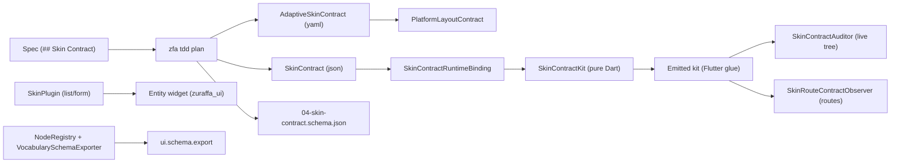

The **Skin & UI Contracts** subsystem is Zuraffa's answer to a single question: *how does a feature declare the surface of its UI, and how does the framework enforce that declaration at runtime without touching the UI framework itself?* It spans two declaration forms (a typed JSON contract and an adaptive YAML platform matrix), a pure-Dart runtime enforcement kit, a certified UI vocabulary (`zuraffa_ui`), and a generation lane that emits Flutter glue into target projects. Every layer is deliberately split so that the framework core stays Flutter-free (Constitution VII) while the skin still gets a live-tree auditor, a route observer, and an impossible-to-miss violation banner.

## Architecture Overview

The subsystem is organized around a **purity split**. The contract logic — facts, rows, tables, violations, the audit bus, the scheduler, the anchor registry, and both typed contract models — lives in pure Dart under `lib/src/skin/` and is exported through `lib/skin.dart`. The Flutter glue — the element-tree walker, the auditor widget, the route observer, the banner chrome, the typed anchor button, and the VM-service driver seam — is emitted into the target project as one self-contained file by `SkinContractKitBuilder`, exactly the way the app shell and the XRay bridge launcher are emitted.



Sources: [lib/skin.dart](lib/skin.dart#L1-L19), [lib/src/skin/builders/skin_contract_kit_builder.dart](lib/src/skin/builders/skin_contract_kit_builder.dart#L1-L40), [specs/1102-runtime-skin-contract-auditor/spec.md](specs/1102-runtime-skin-contract-auditor/spec.md#L1-L60)

## The Two Contract Forms

There are two declaration forms in one vocabulary family. They are **not** interchangeable: one is a JSON-fenced per-view contract, the other a YAML adaptive platform matrix.

### skin-contract.v1 — the typed JSON contract

`SkinContract` (in `lib/src/skin/contract/skin_contract.dart`) is the v1 declaration of a spec's skin surface. It carries four required sections, each a list of typed rows:

| Section | Row type | Fields |
|---|---|---|
| `routes` | `ContractRoute` | `path` (must start with `/`), `view` (PascalCase) |
| `states` | `ContractState` | `view`, `loading` (bool), `error` (`none`/`toaster`/`inline`), `empty` (bool) |
| `platformRows` | `ContractPlatformRow` | `view`, `mobile`, `ios`, `android`, `macos` (all bool) |
| `states` rows | `ContractStateRow` | `view`, `row`, `kind` (`observer`/`listener`/`builder`) |

The parser (`parseSkinContract` / `parseSkinContractDeclaration`) is strict: a missing section, an unknown key, a duplicate, or a malformed row fails naming the offending section and key — never a silent default. The schema (`skinContractSchema`) is generated from the same `SkinContractFieldSpec` tables the parser walks, so model, parser, and schema cannot drift.

Sources: [lib/src/skin/contract/skin_contract.dart](lib/src/skin/contract/skin_contract.dart#L1-L242), [lib/src/skin/contract/skin_contract_parser.dart](lib/src/skin/contract/skin_contract_parser.dart#L1-L120), [lib/src/skin/contract/skin_contract_schema.dart](lib/src/skin/contract/skin_contract_schema.dart#L1-L60)

### adaptive-skin-contract.v1 — the adaptive platform matrix

`AdaptiveSkinContract` (in `lib/src/skin/contract/adaptive_skin_contract.dart`) declares the adaptive-layout platform matrix, the state machine, and the route table as YAML. It is authored under a `## Skin Contract` heading (fenced ```yaml or bare) and carries:

- `adaptive_slots` — the platform slots (`mobile`, `ios`, `android`, `macos`, …)
- `platform_overrides` — a map of platform → override key → value
- `states` — the state machine chain (e.g. `initial, loading, data, error, empty`); `happyPathStates`/`alternateStates` split at the first `error`/`empty`
- `routes` — raw route names; `routeContracts` derives `target`, `screenClass` (e.g. `deal_list` → `DealListScreen`), and `path` (`/deal_list`)

The parser (`parseAdaptiveSkinContract`) returns null when no adaptive contract is declared — including when the section carries the JSON-fenced skin-contract.v1 form, which belongs to the typed contract, not this one.

Sources: [lib/src/skin/contract/adaptive_skin_contract.dart](lib/src/skin/contract/adaptive_skin_contract.dart#L1-L222), [lib/src/skin/contract/adaptive_skin_contract_parser.dart](lib/src/skin/contract/adaptive_skin_contract_parser.dart#L1-L120)

## Runtime Binding

`SkinContractRuntimeBinding.fromContract` (in `lib/src/skin/skin_contract_binding.dart`) turns a parsed `SkinContract` into the runtime kit's inputs in one call: the `RouteContractTable` (from `contract.routes`), the declared route list, per-view `StateBinding`s (toaster/inline/none + empty), and `ContractStateRow` audit descriptors. It carries the contract name as identity. This is the engine half; the Flutter shell (`zuraffa_flutter`) mounts it across the package boundary with zero hand-written contract wiring.

Sources: [lib/src/skin/skin_contract_binding.dart](lib/src/skin/skin_contract_binding.dart#L1-L92)

## Runtime Enforcement Kit (Pure Dart)

The kit lives in `lib/src/skin/` and is exported through `lib/skin.dart` → `lib/src/skin/skin_contract_kit.dart`. Every type is pure Dart (no Flutter import).

| Type | Responsibility |
|---|---|
| `TreeFacts` | Immutable snapshot of the live tree: rendered texts, `zfa:` anchors, progress-indicator flag, platform (from `Theme.of(context).platform`). Value equality so the scheduler can skip no-op audits. |
| `SkinContractRow` | `id` + `requirement` + `bool Function(TreeFacts)`. Named helpers `textRenders`, `anchorExists`, `progressIndicator`, all accepting platform gating. |
| `SkinViolation` | `widget`/`route` breach. Display line is `[<rowId>] <requirement>` (the pilot shape); JSON shape for receipts. |
| `RouteContractTable` | Allowed route names; `'/'` and null/empty names conform by construction (WidgetsApp always pushes `/` on cold start). `validatePush` → violation or null. |
| `SkinAuditController` | Pure bus core: `publish` with change detection, listener protocol, bounded history ring (default 50). |
| `SkinAuditScheduler` | Subscribe-don't-poll: `markDirty(reason)` + `consumeDirty()`. Audits run only when dirty; dirty marks coalesce. |
| `ZfaAnchors` / `ZfaAnchorRegistry` | Typed `zfa:` anchor protocol. `register`/`unregister`/`tap` (unknown anchor refuses honestly — never a silent no-op). |

Sources: [lib/src/skin/tree_facts.dart](lib/src/skin/tree_facts.dart#L1-L143), [lib/src/skin/skin_contract_row.dart](lib/src/skin/skin_contract_row.dart#L1-L110), [lib/src/skin/skin_violation.dart](lib/src/skin/skin_violation.dart#L1-L95), [lib/src/skin/route_contract_table.dart](lib/src/skin/route_contract_table.dart#L1-L77), [lib/src/skin/skin_audit_controller.dart](lib/src/skin/skin_audit_controller.dart#L1-L106), [lib/src/skin/skin_audit_scheduler.dart](lib/src/skin/skin_audit_scheduler.dart#L1-L64), [lib/src/skin/anchors.dart](lib/src/skin/anchors.dart#L1-L85)

## Flutter Glue Emission

`SkinContractKitBuilder` (in `lib/src/skin/builders/skin_contract_kit_builder.dart`) emits `<outputDir>/skin/skin_contract_auditor.dart` — a self-contained Flutter file importing `package:zuraffa/skin.dart`. It contains the element-tree walker (`inspectTree` → `TreeFacts`), the `SkinContractAuditor` widget (subscribes, audits only when dirty), `SkinRouteContractObserver` (validates every push), `SkinAuditBus` + `SkinAuditChrome` + `SkinViolationBanner`, the typed `ZfaButton` (carries `ValueKey('zfa:<contractId>')` and registers its tap handler), and `debugTapAnchor` (the VM-service driver seam). Everything is behind `kDebugMode` — zero release cost. Emission is deterministic and skip-if-exists so hand edits survive (the #1005 hand-written-seam precedent).

The widget-test bridge (`buildBridge`) lands under `test/skin/zfa_anchor_test_bridge.dart` and drives the same anchor-by-key lookup the VM service does, then `pumpAndSettle`s.

Sources: [lib/src/skin/builders/skin_contract_kit_builder.dart](lib/src/skin/builders/skin_contract_kit_builder.dart#L1-L80)

## Generation Lane — SkinPlugin

`SkinPlugin` (id `skin`, version 1.0.0) is a `FileGeneratorPlugin` + `CliAwarePlugin` registered in `PluginLoader` and `CodeGenerator`. It generates entity widgets importing `package:flutter/material.dart` and `package:zuraffa_ui/zuraffa_ui.dart`, using the identified components `ZfaCard`, `ZfaInput`, `ZfaButton`.

Supported layouts are `list` and `form` only. `grid` and `table` are advertised-but-unimplemented: they are registered as refuse subcommands that fail loudly (exit 2) — a generator must never silently emit a mislabeled widget (issue #1149). Unknown layouts are dispatch-level usage errors.

- `zfa skin list <Entity>` → `lib/src/presentation/widgets/<domain>/<entity>_list_widget.dart`
- `zfa skin form <Entity>` → a form widget composing `ZfaInput` + `ZfaButton` (no identified form components exist in zuraffa_ui 0.1.0; `ZfaForm`/`ZfaInputFormField` are reserved names)

The plugin refuses to run in pure-Dart packages (Constitution VII — skin widgets depend on `zuraffa_flutter`).

Sources: [lib/src/plugins/skin/skin_plugin.dart](lib/src/plugins/skin/skin_plugin.dart#L1-L120), [lib/src/plugins/skin/builders/skin_builder.dart](lib/src/plugins/skin/builders/skin_builder.dart#L1-L80), [docs/skin_plugin.md](docs/skin_plugin.md#L1-L40)

## Certified UI Vocabulary

Skins import only `package:zuraffa_ui/zuraffa_ui.dart`. The barrel exports the identified surface: `ZuraffaApp`, `ZfaButton`, `ZfaCard`, `ZfaDialog`, `ZfaInput`, `ZfaSheet`, `ZfaToaster`, `SkinContractKit`, `ZfaContract`, `ZfaAuditBus`, `ZuraffaRouteObserver`, `ZfaTheme`, `ZfaThemeData`. Each identified component carries the typed contract protocol (`contractId`, `contractEnabled`).

The vocabulary is authoritative through `NodeRegistry` (built-ins merged with project composites from `.zfa/ui/components/*.json`) and exported as a versioned, diff-stable JSON schema by `VocabularySchemaExporter`. The `ui.schema.export` capability (MCP-discoverable) exposes it. Action IDs follow the grammar `^[a-z][a-z0-9_]*(\.[a-z][a-z0-9_]*)*$`.

Sources: [lib/src/plugins/skin/vocabulary/ui_node_registry.dart](lib/src/plugins/skin/vocabulary/ui_node_registry.dart#L1-L120), [lib/src/plugins/skin/vocabulary/vocabulary_schema_exporter.dart](lib/src/plugins/skin/vocabulary/vocabulary_schema_exporter.dart#L1-L80), [lib/src/plugins/skin/capabilities/ui_vocabulary_export_capability.dart](lib/src/plugins/skin/capabilities/ui_vocabulary_export_capability.dart#L1-L82), [docs/skin_plugin.md](docs/skin_plugin.md#L1-L40)

## CLI Surface

The `zfa skin` command group (owned by `SkinPlugin`, spec 1276) hosts three grammars:

1. **Generation** — `zfa skin <layout> <Entity>` (`list`, `form`), plus refuse subcommands (`grid`, `table`).
2. **Capability** — `zfa skin ui.schema.export [--project-root] [--schema-version]`.
3. **Auditor** — `zfa skin kit | verify | drive`:
   - `kit [--route <name>]...` emits the kit file (route table from `--route` or the routing barrel's declared routes) and the widget-test bridge.
   - `verify` statically reconciles the kit's route table against the routing barrel. Verdicts: `match` (exit 0), `drift` (exit 1, per-route findings + `--> fix:` lines), `insufficient-input` (exit 2). `--json` emits the verdict envelope.
   - `drive --dart-uri=<uri> --anchor=<key>` drives the live app through the VM service, evaluating `debugTapAnchorJson`. Exit codes: found 0 / disabled 1 / notFound 2 / error 3.

Sources: [lib/src/commands/skin_command.dart](lib/src/commands/skin_command.dart#L1-L120), [lib/src/plugins/skin/commands/skin_command.dart](lib/src/plugins/skin/commands/skin_command.dart#L1-L80), [docs/skin_plugin.md](docs/skin_plugin.md#L1-L20)

## TDD Integration

### Plan-time contract emission

`zfa tdd plan` resolves an adaptive `## Skin Contract` section into typed rows (platform matrix, state machine, routes) rendered into `04-SKIN.md`, plus the machine-parseable JSON contract. A spec without the section writes nothing. If the spec also declares `## Skin Contract:` as the JSON form, `emitSkinContractSchema` writes `04-skin-contract.schema.json` beside the lane plan, generated from the typed model.

The `PlatformLayoutContract` bridges both sources: a Presentation bullet's `adaptive_layouts` wins, falling back to the contract's `adaptive_slots`, so a feature declaring its platform matrix in the contract gets a skeleton satisfying it without a second declaration.

Sources: [lib/src/plugins/tdd/commands/plan_command.dart](lib/src/plugins/tdd/commands/plan_command.dart#L1200-L1215), [lib/src/plugins/tdd/services/skin_contract_emit.dart](lib/src/plugins/tdd/services/skin_contract_emit.dart#L1-L60), [lib/src/plugins/tdd/services/platform_layout_contract.dart](lib/src/plugins/tdd/services/platform_layout_contract.dart#L1-L181)

### Visual contract (golden arm)

The SKIN lane carries an opt-in visual/pixel arm: declare `golden: true` (or `golden: [W1, W3]`) on the SKIN row of `## Lanes`. Plan marks those rows with `[golden]` and renders a `## Visual contract` section; gen emits a `matchesGoldenFile` baseline hook. SKIN behaviors must not bind to design-system property state — prefer interaction-shaped finders or text/shape-shaped finders.

Sources: [docs/skin_plugin.md](docs/skin_plugin.md#L40-L80)

### View and app-shell flags

- `--skin` on view generation wraps the view getter in `SkinContractAuditor(rows: k<View>SkinRows, child: …)` and emits the starter row list (hand-edit seam; generation never clobbers it).
- `--skin-audit` on `zfa app shell` emits the kit (skip-if-exists), mounts the route observer on the `GoRouter` (table built from `getAllRoutes()` + root), and wraps the router in `SkinAuditChrome` via `MaterialApp.router(builder:)`.

Sources: [specs/1102-runtime-skin-contract-auditor/spec.md](specs/1102-runtime-skin-contract-auditor/spec.md#L60-L120)

## Next Steps

- [Presentation Layer & State](14-presentation-layer-and-state) — how generated views consume state and where the auditor wrap lands
- [TDD & Spec-Driven Loop](16-tdd-and-spec-driven-loop) — how `## Skin Contract` and `## Lanes` drive plan/gen/make/run
- [Proof & Provenance](17-proof-and-provenance) — how contract rows and verdicts feed the proof chain
- [Mock Data & Certification](18-mock-data-and-certification) — certified mocks that back the SKIN lane's widget tests