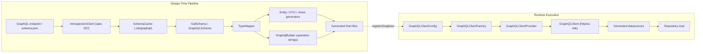

Zuraffa's GraphQL integration is a two-phase pipeline: **design-time** schema ingestion and code generation, followed by **runtime** client construction and request execution. The core package keeps the lightweight schema/introspection/cache/diff/type-translation surface, while the heavyweight full-stack generators and runtime GraphQL client live in the optional companion package `zuraffa_graphql`. The boundary between them is enforced by the capability gate in `PluginGate`.

## Enabling the Capability

GraphQL is an opt-in capability. A project must both enable the flag and resolve the companion package before any GraphQL command will run.

```bash
zfa plugin enable graphql
```

Then add the repository-local package to `pubspec.yaml`:

```yaml
dependencies:
  zuraffa_graphql:
    path: packages/zuraffa_graphql
```

followed by `dart pub get`. `PluginGate.refusalFor('graphql')` returns a non-null guidance message (and the command exits with a usage code) when either the `capabilities.graphql` flag is missing from `.zfa.json` or `zuraffa_graphql` is not present in `.dart_tool/package_config.json`.

Sources: [plugin_gate.dart](lib/src/plugins/plugin_gate/plugin_gate.dart#L1-L189), [plugin_catalog.dart](lib/src/plugins/plugin_gate/plugin_catalog.dart#L25-L35), [README.md](packages/zuraffa_graphql/README.md#L1-L22)

## Architecture Overview



The design-time side produces both **operation string files** (via the core `GraphqlPlugin`) and, through the companion, **full-stack** entities, DTOs, unions, datasources, repositories, and DI registrations. The runtime side lazily builds the `GraphQLClient` on first access and injects it into generated datasources through the DI container.

Sources: [graphql_plugin.dart](lib/src/plugins/graphql/graphql_plugin.dart#L1-L109), [graphql_builder.dart](lib/src/plugins/graphql/builders/graphql_builder.dart#L1-L436), [slice_orchestrator.dart](packages/zuraffa_graphql/lib/src/slice_orchestrator.dart#L1-L139)

## Schema Ingestion & Caching

Two introspection implementations coexist. `GraphQLIntrospectionService` is the legacy service used by `zfa graphql introspect` and direct API calls; it returns `null` on failure. `IntrospectionClient` is the spec-037 client with an injectable transport, detailed errors, and validation of type kinds; it throws `IntrospectionException` instead of returning `null`.

`SchemaCache` persists two artifacts per named schema under `.zfa/graphql/<name>/`:

| Artifact | Path | Purpose |
|----------|------|---------|
| Introspection JSON | `.zfa/graphql/<name>/<name>.schema.json` | Raw server response envelope |
| SDL document | `.zfa/graphql/<name>/<name>.schema.graphql` | Human-readable schema |
| Previous JSON | `.zfa/graphql/<name>/<name>.schema.prev.json` | Rotated prior version for diffing |

Flat compatibility copies (`.zfa/graphql/<name>.schema.json`) are also written for legacy callers. Rotation happens atomically: the previous JSON is moved before the new one is written, so `zfa graphql diff` can always compare the two most recent versions. `SchemaCache.load`/`save`/`hasCache` preserve the legacy single-file `<cacheDir>/schema.json` layout.

Sources: [introspection_client.dart](lib/src/graphql/introspection/introspection_client.dart#L1-L335), [graphql_introspection_service.dart](lib/src/graphql/graphql_introspection_service.dart#L1-L126), [schema_cache.dart](lib/src/graphql/cache/schema_cache.dart#L1-L339), [sdl_printer.dart](lib/src/graphql/sdl/sdl_printer.dart#L1-L151)

## Schema Models

The layer uses two schema representations at different stages. `GqlSchema`/`GqlTypeDef`/`GqlTypeRef` (in `graphql_schema.dart`) is the introspection model parsed from server responses; it exposes `entityTypes`, `enumTypes`, and `fromIntrospection`. `GraphQLSchema`/`GraphQLType` (in `types/graphql_type.dart` and `schema/schema_parser.dart`) is the codegen model produced by `SchemaParser.parse` from introspection JSON; it provides `getQueryType`, `getMutationType`, `getObjectTypes`, etc. The companion package operates on `GraphQLSchema`.

Sources: [graphql_schema.dart](lib/src/graphql/graphql_schema.dart#L1-L282), [graphql_type.dart](lib/src/graphql/types/graphql_type.dart#L1-L205), [schema_parser.dart](lib/src/graphql/schema/schema_parser.dart#L1-L279)

## Type Translation

`TypeMapper` maps GraphQL types to Dart types. `TypeMapper.fromZfaConfig` reads `graphql.scalarMap` from `.zfa.json`; malformed entries throw `FormatException` rather than silently falling back. Default scalar mappings are `String`/`ID`→`String`, `Int`→`int`, `Float`→`double`, `Boolean`→`bool`, `DateTime`/`Date`→`DateTime`, `JSON`→`Map<String, dynamic>`. `GraphQLSchemaTranslator` converts `GqlSchema` into `EntitySpec`, `FieldSpec`, `EnumSpec`, and `OperationSpec` with two-pass type extraction and ID-field inference (scanning for `id`, `identifier`, or `uuid`, falling back to the first field).

Sources: [type_mapper.dart](lib/src/graphql/mapping/type_mapper.dart#L1-L222), [graphql_schema_translator.dart](lib/src/graphql/graphql_schema_translator.dart#L1-L381), [dart_type_namer.dart](lib/src/graphql/mapping/dart_type_namer.dart#L1-L100)

## Core Plugin: GraphQL Operation Strings

The core `GraphqlPlugin` generates raw GraphQL operation string files from entity definitions. `GraphqlBuilder.generate` produces one file per method (or one per custom use case), writing to `data/datasources/<entity>/graphql/<operation>_<type>.dart`. Operation types default from the method name (`get`/`getList`→query, `create`/`update`/`delete`→mutation, `watch`/`watchList`→subscription); `gql-type` overrides this. The plugin is also reachable through `zfa make <Name> --graphql` (the deprecated `--gql` alias folds into it).

Sources: [graphql_plugin.dart](lib/src/plugins/graphql/graphql_plugin.dart#L1-L109), [graphql_builder.dart](lib/src/plugins/graphql/builders/graphql_builder.dart#L1-L436), [graphql_command.dart](lib/src/commands/graphql_command.dart#L1-L202)

## Companion Full-Stack Generation

`zfa graphql generate` is a thin delegate: it enforces the capability gate, compiles the companion through the `ZfaExecutable` no-JIT seam, and forwards arguments to `zuraffa_graphql`'s `GraphqlGenerateCommand`. The companion parses the schema with `SchemaParser.parse`, then `SliceOrchestrator.generateAll` emits entities, DTOs, unions, and DI registrations. `DatasourceGenerator` produces fully implemented remote datasources (with optional union error handling and subscription/watch methods), `DiGenerator` emits `configureGraphqlDi()`, and `GraphQLDocumentBuilder` builds type-safe AST documents. `GqlFilePreserver` validates existing `.graphql` files against the schema and preserves user edits when still valid; `GraphQLValidator` checks operations, fields, variable types, and fragments.

Sources: [graphql_generate_command.dart](packages/zuraffa_graphql/lib/src/graphql_generate_command.dart#L1-L126), [slice_orchestrator.dart](packages/zuraffa_graphql/lib/src/slice_orchestrator.dart#L1-L139), [datasource_generator.dart](packages/zuraffa_graphql/lib/src/datasource_generator.dart#L1-L626), [di_generator.dart](packages/zuraffa_graphql/lib/src/di_generator.dart#L1-L152), [graphql_document_builder.dart](packages/zuraffa_graphql/lib/src/gql/graphql_document_builder.dart#L1-L393), [graphql_validator.dart](packages/zuraffa_graphql/lib/src/validators/graphql_validator.dart#L1-L324), [gql_file_preserver.dart](packages/zuraffa_graphql/lib/src/preservers/gql_file_preserver.dart#L1-L95)

## Runtime Client Construction

`GraphQLClientConfig` (parsed from the `graphql` section of `.zfa.json`) carries endpoint, subscription flag, WebSocket endpoint, and headers. `GraphQLClientFactory.build` assembles an `HttpLink` (with `FetchPolicy.noCache` defaults) and, when subscriptions are enabled and a WebSocket endpoint is present, splits traffic via `Link.split`. `GraphQLClientProvider` is a singleton that lazily builds and disposes the client. `SubscriptionStream<T>` converts GraphQL subscription streams into `SignalResult`-compatible streams with automatic retry on transient errors.

Sources: [graphql_client_factory.dart](packages/zuraffa_graphql/lib/src/client/graphql_client_factory.dart#L1-L105), [graphql_client_provider.dart](packages/zuraffa_graphql/lib/src/client/graphql_client_provider.dart#L1-L62), [subscription_stream.dart](packages/zuraffa_graphql/lib/src/client/subscription_stream.dart#L1-L134)

## Document Builders & Validation

Two document builders serve different needs: `DocumentBuilder` (core) builds string templates, while `GraphQLDocumentBuilder` (companion) builds `package:gql` AST nodes serialized through `printNode()`. `GraphQLValidator` (companion) validates documents against the cached schema, and `GqlFilePreserver` decides whether to preserve, overwrite, or generate a `.graphql` file.

Sources: [document_builder.dart](lib/src/graphql/document/document_builder.dart#L1-L97), [graphql_document_builder.dart](packages/zuraffa_graphql/lib/src/gql/graphql_document_builder.dart#L1-L393), [graphql_validator.dart](packages/zuraffa_graphql/lib/src/validators/graphql_validator.dart#L1-L324), [gql_file_preserver.dart](packages/zuraffa_graphql/lib/src/preservers/gql_file_preserver.dart#L1-L95)

## Schema Diff

`SchemaDiffer.diff` classifies changes between two `GqlSchema` versions: removed types/fields/enum values, nullability changes, and added required fields are breaking; added optional fields, enum values, and types are non-breaking. `zfa graphql diff` maps `SchemaDiff.hasBreaking` to exit code 1, otherwise 0.

Sources: [schema_diff.dart](lib/src/graphql/diff/schema_diff.dart#L1-L304), [graphql_diff_command.dart](lib/src/commands/graphql_diff_command.dart#L1-L194)

## Error Mapping

`ErrorMappingConfig` maps GraphQL union error variants to Zuraffa's `AppFailure` taxonomy using a resolution order of per-operation override → global mapping → wildcard `*Error` → default. Categories include `success`, `business`, `session`, `validation`, `network`, and `unknown`; `UnionResultHandler` generates the dispatch and `_mapError` helper used by datasources.

Sources: [error_mapping_config.dart](lib/src/graphql/codegen/error_mapping_config.dart#L1-L128), [union_result_handler.dart](lib/src/graphql/codegen/union_result_handler.dart#L1-L173)

## CLI Reference

| Command | Purpose |
|---------|---------|
| `zfa graphql` | Group; defaults to subcommand usage |
| `zfa graphql create <Name>` | Generate GraphQL operation strings from an entity |
| `zfa graphql introspect <url>` | Introspect endpoint and print generation plan (`--output`, `--dry-run`, `--force`, `--verbose`, `--headers`) |
| `zfa graphql pull` | Fetch and cache schema (`--endpoint`, `--name`, `--dir`, `--headers`) |
| `zfa graphql diff <name>` | Diff cached schema versions (`--dir`, `--old`, `--new`) |
| `zfa graphql generate` | Full-stack codegen via companion (`--schema`, `--output`, `--endpoint`, `--force`, `--verbose`) |
| `zfa make <Name> --graphql` | Run GraphQL generator within `make` pipeline |

Sources: [graphql_command.dart](lib/src/commands/graphql_command.dart#L1-L202), [graphql_introspect_command.dart](lib/src/commands/graphql_introspect_command.dart#L1-L267), [graphql_pull_command.dart](lib/src/commands/graphql_pull_command.dart#L1-L137), [graphql_diff_command.dart](lib/src/commands/graphql_diff_command.dart#L1-L194), [openwiki cli.md](docs/openwiki/cli.md#L576-L600)

## Configuration

Relevant `.zfa.json` sections:

```json
{
  "capabilities": { "graphql": true },
  "graphql": {
    "endpoint": "https://api.example.com/graphql",
    "subscriptions": true,
    "wsEndpoint": "wss://api.example.com/graphql",
    "headers": { "vendure-token": "{{VENDURE_TOKEN}}" },
    "scalarMap": { "DateTime": "DateTime" },
    "errorMapping": {
      "global": { "InsufficientStockError": "business", "*Error": "unknown" },
      "perOperation": { "addItemToOrder": { "NegativeQuantityError": "validation" } }
    }
  }
}
```

`TypeMapper.fromZfaConfig` validates `graphql.scalarMap` strictly, and `ErrorMappingConfig.fromJson` reads the `graphql.errorMapping` block.

Sources: [type_mapper.dart](lib/src/graphql/mapping/type_mapper.dart#L20-L60), [error_mapping_config.dart](lib/src/graphql/codegen/error_mapping_config.dart#L40-L80), [graphql_client_factory.dart](packages/zuraffa_graphql/lib/src/client/graphql_client_factory.dart#L10-L45)

## Next Steps

- [Code Generation Pipeline](9-code-generation-pipeline) — how generated code is verified
- [Dependency Injection](15-dependency-injection) — how generated datasources are registered
- [State Management & Sync Framework](18-state-management-and-sync-framework) — how `SignalResult` integrates with state
- [Offline-First Sync](22-offline-first-sync) — combining remote GraphQL with local persistence