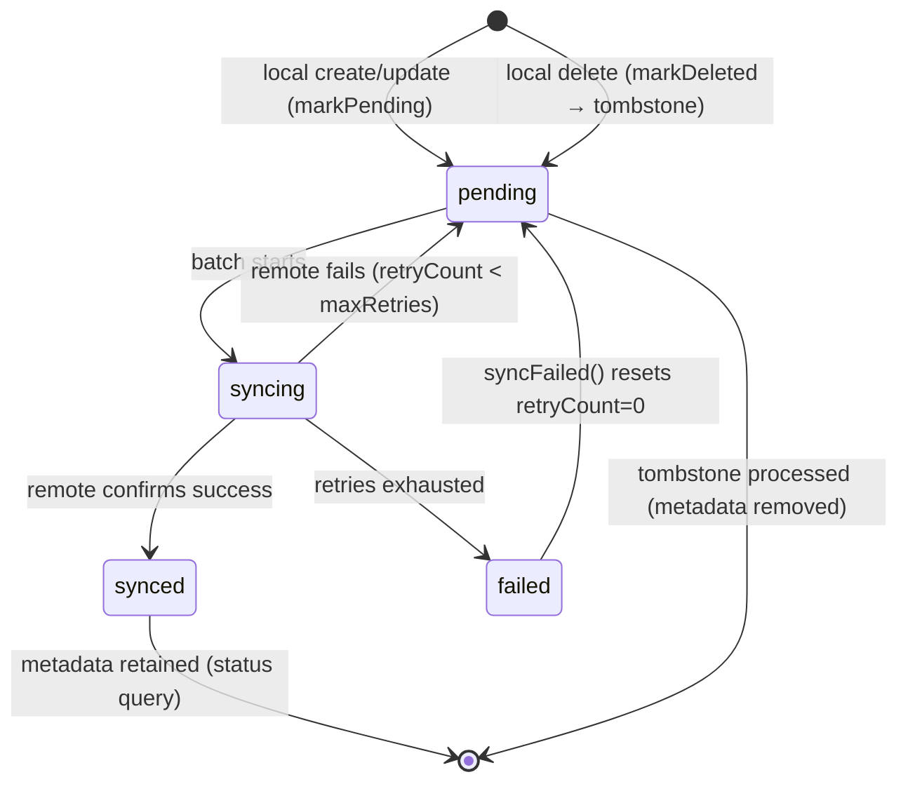
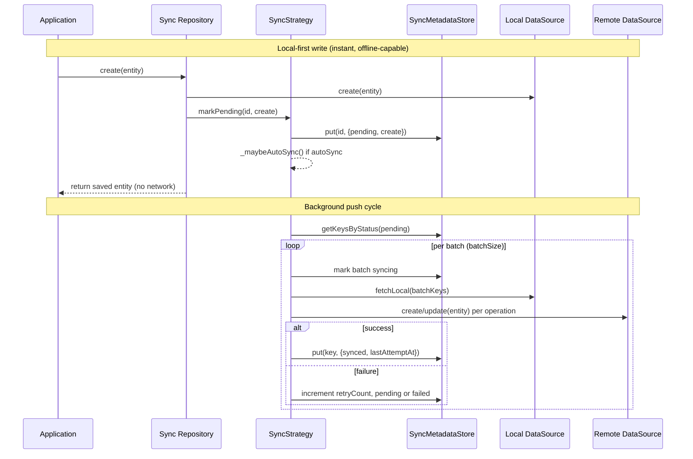

Zuraffa's sync subsystem implements **local-first persistence**: the local data source is the source of truth, and the remote data source is a synchronization target. Where the cache plugin treats remote as authoritative and local as a disposable mirror, sync inverts the dependency — every write lands in local storage and returns instantly, while a background `SyncStrategy` reconciles the delta with the remote on a schedule the application controls.

This page covers the strategy abstraction, the sync status lifecycle, the push processing pipeline, retry/backoff, bidirectional pull and conflict resolution, triggering, generated runtime wiring, configuration, and the architectural invariants that define sync's boundaries.

## The Strategy Abstraction

The sync contract is defined by `SyncStrategy<T>`, an abstract class in the core library that mirrors the role of `CachePolicy` for cached repositories — it is the swappable piece that controls all non-CRUD behavior injected into a sync-enabled repository. The repository owns four dependencies: the local data source, the remote data source, a `SyncMetadataStore`, and the strategy itself.

```mermaid
classDiagram
    class SyncStrategy~T~ {
        <<abstract>>
        +syncPending({CancelToken?})
        +syncFailed({CancelToken?})
        +pullRemote({CancelToken?})
        +getPendingCount()
        +getSyncStatus(String key)
        +markPending(String key, {SyncOperation})
        +markDeleted(String key)
    }
    class PushOnlySyncStrategy~T~ {
        -fetchLocal(List~String~ keys)
        -createRemote(T entity)
        -updateRemote(T entity)
        -deleteRemote(String key)
        -keyResolver(T entity)
        -metadataStore
        -config
        +syncPending({CancelToken?})
        +syncFailed({CancelToken?})
        +pullRemote() UnimplementedError
    }
    class BidirectionalSyncStrategy~T~ {
        -fetchRemoteList()
        -saveLocal(T entity)
        -conflictResolver(T? local, T remote)
        +pullRemote({CancelToken?})
    }
    class SyncMetadataStore {
        -Box~SyncMetadata~ box
        +get(String key)
        +put(String key, SyncMetadata)
        +remove(String key)
        +getKeysByStatus(SyncStatus)
        +countByStatus(SyncStatus)
        +clear()
    }
    class SyncConfig {
        +batchSize
        +maxRetries
        +backoffBaseMs
        +backoffMaxMs
        +direction
        +autoSync
        +backoffDelayFor(int retryCount)
    }
    SyncStrategy~T~ <|-- PushOnlySyncStrategy~T~
    PushOnlySyncStrategy~T~ <|-- BidirectionalSyncStrategy~T~
    PushOnlySyncStrategy~T~ --> SyncMetadataStore
    PushOnlySyncStrategy~T~ --> SyncConfig
```

The interface contract is deliberately narrow — five mutation/query verbs plus two sync drivers. `markPending` and `markDeleted` are called *by the repository* after a local write; `syncPending`, `syncFailed`, and `pullRemote` are called *by the application* when it decides to reconcile. The two query verbs (`getPendingCount`, `getSyncStatus`) exist for observability and UI status indicators.

The crucial design constraint is that `PushOnlySyncStrategy<T>` lives in the framework and can never know about concrete entity types or datasource interfaces. It therefore accepts **callback functions** that generated (or hand-written) code wires up at construction time. The strategy factory generated by `SyncBuilder` binds these callbacks to the entity's datasources, keeping all entity-specific knowledge confined to the generated factory and making the strategy swappable — a custom `SyncStrategy` can replace the generated one at DI registration.

Sources: [sync_strategy.dart](lib/src/core/sync_strategy.dart#L42-L83), [push_only_sync_strategy.dart](lib/src/plugins/sync/builders/push_only_sync_strategy.dart#L39-L75), [sync_builder.dart](lib/src/plugins/sync/builders/sync_builder.dart#L200-L300)

## Core Domain Types

The sync types live in `lib/src/core/` and are exported via `lib/zuraffa.dart`:

| Type | Kind | Purpose |
|------|------|---------|
| `SyncStatus` | Enum | `pending`, `syncing`, `synced`, `failed` — per-record sync state |
| `SyncOperation` | Enum | `create`, `update`, `delete` — which remote method to invoke |
| `SyncDirection` | Enum | `push` (default) or `bidirectional` |
| `SyncMetadata` | Data class | Per-record sync tracking (status, retry count, errors, tombstone) |
| `SyncConfig` | Config class | Batch size, retry limits, backoff, autoSync, direction |
| `SyncStrategy<T>` | Abstract interface | The swappable sync contract |
| `SyncMetadataStore` | Hive wrapper | Persists `SyncMetadata` in a dedicated box per entity |

Sources: [sync_status.dart](lib/src/core/sync_status.dart#L1-L27), [sync_operation.dart](lib/src/core/sync_operation.dart#L1-L15), [sync_direction.dart](lib/src/core/sync_direction.dart#L1-L15), [sync_metadata.dart](lib/src/core/sync_metadata.dart#L1-L81), [sync_config.dart](lib/src/core/sync_config.dart#L1-L58), [zuraffa.dart](lib/zuraffa.dart#L188-L199)

## The Sync Status Lifecycle

Every locally-written record is tracked by a `SyncMetadata` entry in a dedicated Hive box, keyed by the entity identifier. The metadata deliberately excludes the entity itself — no sync infrastructure fields pollute the domain entity. Each entry carries the current `SyncStatus`, the operation that must be transmitted, a retry counter, the last attempt timestamp, an optional error message, and an optional `deletedAt` tombstone timestamp.



Four states, each with a precise meaning. `pending` is the queue: fresh, never-failed records awaiting transmission (including tombstones). `syncing` is a transient in-flight marker written at the start of batch processing. `synced` is the terminal success state — the record exists on both ends and `retryCount` resets to zero. `failed` is the dead-letter state reached only after `maxRetries` consecutive failures; it is excluded from the normal `syncPending` path and requires an explicit `syncFailed()` call to retry.

Sources: [sync_status.dart](lib/src/core/sync_status.dart#L1-L27), [sync_metadata.dart](lib/src/core/sync_metadata.dart#L1-L81), [push_only_sync_strategy.dart](lib/src/plugins/sync/builders/push_only_sync_strategy.dart#L321-L325)

## The Push Processing Pipeline

`syncPending` and `syncFailed` converge on a single `_processKeys` pipeline, which partitions the incoming keys into tombstones and live records, then executes a deterministic order: **remote deletes first, then live record pushes in batches of `batchSize`**. Tombstones-first ordering matters because a record deleted locally and then recreated with the same id must not have its create pushed before its delete lands on the remote.



Within `_syncBatch`, the strategy first marks every record in the batch as `syncing`, then fetches the corresponding entities from local storage in a single call, then pushes each entity to remote. Dispatch is driven by the recorded `SyncOperation`: `create` routes to `createRemote`, anything else routes to `updateRemote`. Keys whose entities are no longer present in local storage (e.g., deleted between queueing and processing) have their metadata removed rather than failing the batch.

Sources: [push_only_sync_strategy.dart](lib/src/plugins/sync/builders/push_only_sync_strategy.dart#L120-L235)

## Failure, Retry & Backoff

Failures are handled by `_handleFailure`, which increments `retryCount` and decides the record's fate. If the new count is still below `maxRetries`, the record returns to `pending` — it stays in the queue for the next cycle with its error recorded. If the count reaches `maxRetries`, the record transitions to `failed` and leaves the normal queue. Backoff is computed by `SyncConfig.backoffDelayFor(retryCount)` using the formula `min(backoffBaseMs * 2^retryCount, backoffMaxMs)` with defaults of 1s base and 60s cap.

The framework makes a deliberate distinction between two retry audiences, and this separation is the core of the infinite-loop safety argument:

| Trigger | Method | Records processed | Semantics |
|---------|--------|-------------------|-----------|
| After each local write (autoSync) | `syncPending()` | Only `pending` — fresh, never-failed | Fire-and-forget, returns quickly when queue is empty |
| On app start / explicit retry | `syncFailed()` | Resets `failed` → `pending` with `retryCount=0`, then processes | Bounded: each cycle is capped by `maxRetries` |

`syncPending` never touches failed records, so an unhealthy record cannot hammer the server on every write. `syncFailed` is the only path out of the `failed` state, and it gives exhausted records a clean slate before reprocessing them through the identical pipeline. The call graph is acyclic by construction: `syncPending` never calls itself, `markPending`, `markDeleted`, or `syncFailed`; `syncFailed` never calls itself, `markPending`, or `markDeleted`; `_handleFailure` only updates metadata.

Sources: [sync_config.dart](lib/src/core/sync_config.dart#L44-L51), [push_only_sync_strategy.dart](lib/src/plugins/sync/builders/push_only_sync_strategy.dart#L77-L118), [push_only_sync_strategy.dart](lib/src/plugins/sync/builders/push_only_sync_strategy.dart#L241-L312)

## Bidirectional Pull & Conflict Resolution

`BidirectionalSyncStrategy<T>` extends `PushOnlySyncStrategy<T>` — inheriting the entire push pipeline and its protected accessors — and adds the pull half: `fetchRemoteList` (remote `getAll`), `saveLocal` (local upsert), and a `conflictResolver`. The pull algorithm is single-pass over the remote result set.

```mermaid
flowchart TD
    A[pullRemote: fetch remote list] --> B{For each remote record}
    B --> C{metadata == null or synced?}
    C -->|Yes| D[saveLocal(remote) → mark synced]
    C -->|No (pending/failed)| E[fetchLocal for key]
    E --> F[conflictResolver(local, remote)]
    F --> G{resolver returned remote?}
    G -->|Yes| H[saveLocal(resolved) → mark synced]
    G -->|No| I[saveLocal(resolved) → keep pending]
    D --> J[next record]
    H --> J
    I --> J
```

The resolver's return value carries semantic weight beyond which value wins. If it returns the remote version, the local pending change is considered **discarded in favor of remote**, and the record is marked `synced` — the queued local change never pushes. If it returns the local version (or a merged entity that is not identical to remote), the record stays `pending` so the local change still pushes on the next cycle. The default resolver is remote-wins (`(local, remote) => remote`), implementing the server-authoritative policy required for most collaborative data.

Sources: [bidirectional_sync_strategy.dart](lib/src/plugins/sync/builders/bidirectional_sync_strategy.dart#L41-L133)

## Triggering the Sync Engine

The framework does not impose a single sync schedule; it provides the infrastructure and leaves trigger timing to the application. There are exactly three entry points:

1. **`autoSync` (write-driven).** When `SyncConfig.autoSync` is `true`, every `markPending` and `markDeleted` call fires `unawaited(syncPending())` — a fire-and-forget background cycle. The caller (a repository write method) returns immediately; if the device is online the record pushes within milliseconds, if offline it stays `pending` for the next trigger. Default is `false` — sync only happens when explicitly called.

2. **Explicit repository delegation.** The generated repository exposes `syncPending({cancelToken})` and `pullRemote({cancelToken})`, which delegate straight to the injected strategy. The app can call these on connectivity restoration, on a timer, on app resume, or from a manual "Sync now" button.

3. **`syncFailed` (recovery).** Not surfaced on the repository — it lives on the strategy interface and is the app-start recovery hook that resets exhausted records. This is the documented retry path for records that hit `maxRetries` while the device was offline for an extended period.

Every cycle in the pipeline checks the `CancelToken` at batch boundaries and between individual entity pushes (`cancelToken?.throwIfCancelled()`), enabling cooperative cancellation of long sync runs — for example, when the user backgrounds the app. Cancellation is checked before tombstone processing, before each batch, and before each entity push.

Sources: [sync_strategy.dart](lib/src/core/sync_strategy.dart#L42-L82), [push_only_sync_strategy.dart](lib/src/plugins/sync/builders/push_only_sync_strategy.dart#L135-L149), [push_only_sync_strategy.dart](lib/src/plugins/sync/builders/push_only_sync_strategy.dart#L296-L312), [implementation_generator_synced.dart](lib/src/plugins/repository/generators/implementation_generator_synced.dart#L286-L372)

## Generated Runtime Wiring

`SyncBuilder` produces four categories of output for each sync-enabled entity, all driven by a single `GeneratorConfig` carrying the sync parameters:

| Generated artifact | Path | Responsibility |
|--------------------|------|----------------|
| Sync box init | `sync/{entity_snake}_sync.dart` | `init{Entity}Sync()` opens `Hive.openBox<SyncMetadata>('sync_metadata_{entity_snake}')` |
| Metadata store factory | `data/datasources/{entity_snake}/{entity_snake}_sync_metadata_store.dart` | `create{Entity}SyncMetadataStore()` wraps the box in a `SyncMetadataStore` |
| Strategy factory | `data/datasources/{entity_snake}/{entity_snake}_sync_strategy.dart` | `create{Entity}SyncStrategy(...)` builds `PushOnlySyncStrategy` or `BidirectionalSyncStrategy` wired to the entity's datasources |
| Sync use case | `domain/usecases/{domain}/{entity_snake}_sync_usecase.dart` | `Sync{Entity}UseCase` delegating to `repository.syncPending()` |
| Sync barrel | `sync/index.dart` | Aggregates every `init{Entity}Sync()` into a single `initAllSyncs()` — parallel to `cache/index.dart` |

The strategy factory is the wiring hub. It binds the five push callbacks (`fetchLocal` → `localDataSource.getByIds`, `createRemote`/`updateRemote`/`deleteRemote` → remote CRUD, `keyResolver` → `entity.id`) and, in bidirectional mode, adds `fetchRemoteList` → `remoteDataSource.getAll` and `saveLocal` → `localDataSource.put`. The `SyncConfig` is constructed with `batchSize`, `maxRetries`, `backoffBaseMs` (1000), `backoffMaxMs` (60000), and the resolved direction.

On the repository side, the sync-enabled implementation carries four final fields — `_localDataSource`, `_remoteDataSource`, `_syncMetadataStore`, `_syncStrategy` — and rewrites every CRUD verb to a local-first flow: reads (`get`, `getList`) and streams (`watch`, `watchList`) hit local storage only; writes (`create`, `update`) save locally then call `markPending`; `delete` hard-deletes locally then calls `markDeleted` (tombstone). The repository also gains `syncPending` and `pullRemote` methods delegating to the strategy.

When `--di` is enabled, the DI plugin registers the repository with constructor arguments resolving `LocalDataSource`, `RemoteDataSource`, `SyncMetadataStore`, and `SyncStrategy<Entity>` from GetIt.

Sources: [sync_builder.dart](lib/src/plugins/sync/builders/sync_builder.dart#L41-L173), [implementation_generator_synced.dart](lib/src/plugins/repository/generators/implementation_generator_synced.dart#L1-L372), [sync_usecase_generator.dart](lib/src/plugins/sync/generators/sync_usecase_generator.dart#L1-L164), [di_plugin.dart](lib/src/plugins/di/di_plugin.dart#L776-L800)

## Sync-Enabled Repository Method Patterns

| Method | Behavior | Network? |
|--------|----------|----------|
| `create(entity)` | Write to local + `markPending(create)` | Instant, no network |
| `update(params)` | Write to local + `markPending(update)` | Instant, no network |
| `delete(params)` | Hard-delete from local + `markDeleted` (tombstone) | Instant, no network |
| `get(params)` | Read from local only | Instant, no network |
| `getList(params)` | Read from local only | Instant, no network |
| `watch(params)` | Stream from local only | Instant, no network |
| `watchList(params)` | Stream from local only | Instant, no network |
| `syncPending({cancelToken})` | Delegate to `SyncStrategy.syncPending()` | Background |
| `pullRemote({cancelToken})` | Delegate to `SyncStrategy.pullRemote()` | Background (bidirectional only) |

Sources: [implementation_generator_synced.dart](lib/src/plugins/repository/generators/implementation_generator_synced.dart#L1-L372)

## Configuration Reference

Sync parameters flow through three surfaces: the `zfa make` flags, the standalone `zfa sync` command, and the plugin's capability schema (which is what the MCP/AI-agent surface uses). All three converge on the same `GeneratorConfig` fields with identical defaults.

| Parameter | `zfa make` flag | `zfa sync` option | Default | Meaning |
|-----------|----------------|-------------------|---------|---------|
| Direction | `--sync` / `--bidirectional` | `--direction=push\|bidirectional` | `push` | Push-only, or push + pull with conflict resolution |
| Batch size | `--sync-batch-size` | `--batch-size` | `50` | Records processed per batch against remote |
| Max retries | `--sync-max-retries` | `--max-retries` | `5` | Attempts before a record is marked `failed` |
| Backoff base | (plugin schema only) | — | `1000` ms | `backoffBaseMs` for exponential backoff |
| Backoff cap | (plugin schema only) | — | `60000` ms | `backoffMaxMs` ceiling |
| autoSync | (runtime `SyncConfig`) | — | `false` | Fire-and-forget push after every local write |

The plugin declares `runAfter: ['datasource', 'repository']`, guaranteeing that the datasources and repository implementation exist before sync support files are generated, and it is registered in the plugin loader immediately after `CachePlugin`. The capability schema additionally exposes `dryRun`, `force`, and `verbose` flags.

Sources: [make_command.dart](lib/src/commands/make_command.dart#L328-L345), [sync_command.dart](lib/src/commands/sync_command.dart#L10-L28), [create_sync_capability.dart](lib/src/plugins/sync/capabilities/create_sync_capability.dart#L18-L57), [sync_plugin.dart](lib/src/plugins/sync/sync_plugin.dart#L30-L104)

## CLI Usage

```bash
# Generate a sync-enabled entity via make
zfa make EngagementEvent \
  --preset=crud \
  --methods=get,getList,create,update,delete \
  --sync \
  --with=vpc \
  --state \
  --di \
  --test

# Bidirectional sync
zfa make EngagementEvent \
  --preset=crud \
  --methods=get,getList,create,update,delete \
  --sync --bidirectional \
  --di

# Standalone sync command
zfa sync EngagementEvent --direction=bidirectional --batch-size=50 --max-retries=5
```

Sources: [sync_command.dart](lib/src/commands/sync_command.dart#L1-L95), [quickstart.md](specs/010-offline-first-sync/quickstart.md#L1-L150)

## Design Boundaries

Three architectural invariants define what sync is *not*, and they are enforced at generation time rather than at runtime:

- **Sync and cache are mutually exclusive.** The repository generator throws an `ArgumentError` if both `enableCache` and `enableSync` are set on the same entity: "Cache is remote-first; sync is local-first. They are architecturally incompatible." The two plugins solve opposite problems and cannot coexist on one repository.

- **The domain entity stays pure.** Sync state lives exclusively in `SyncMetadata` inside a dedicated Hive box, keyed by entity id. No `isDirty`, `pendingSync`, or timestamp fields ever appear on the entity. The tradeoff is that `SyncMetadataStore.getKeysByStatus` must scan the entire box and filter — acceptable for the expected scale of pending records.

- **Framework code never knows entity types.** The strategy is generic over `T` and receives behavior as callbacks; all entity-specific knowledge is confined to the generated factory. This is what makes the strategy swappable — a custom `SyncStrategy` can replace the generated one at DI registration.

The strategy abstraction slots into the wider Zuraffa runtime: it pairs with the [Data Layer & Repositories](13-data-layer-and-repositories) as its architectural inverse (remote-first vs. local-first), consumes `CancelToken` from the same cancellation model used across [Domain Layer & Use Cases](12-domain-layer-and-use-cases), and reuses the Hive box and adapter registration patterns from [Mock Data & Certification](18-mock-data-and-certification).

Sources: [implementation_generator.dart](lib/src/plugins/repository/generators/implementation_generator.dart#L75-L104), [sync_metadata_store.dart](lib/src/plugins/sync/builders/sync_metadata_store.dart#L1-L82), [zuraffa.dart](lib/zuraffa.dart#L188-L199)

## Next Steps

- [Data Layer & Repositories](13-data-layer-and-repositories) — how repositories are structured and generated
- [Dependency Injection](15-dependency-injection) — how sync components are registered in GetIt
- [Mock Data & Certification](18-mock-data-and-certification) — reusing Hive box and adapter patterns
- [GraphQL Integration](21-graphql-integration) — combining remote GraphQL with local persistence
- [Cache Policies](15-dependency-injection) — the architectural inverse of sync (remote-first caching)