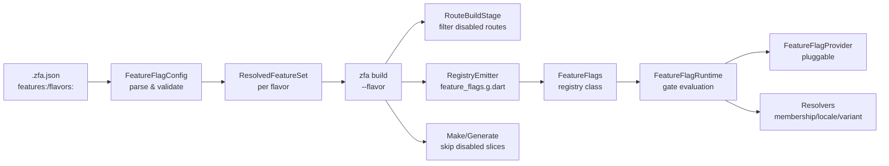
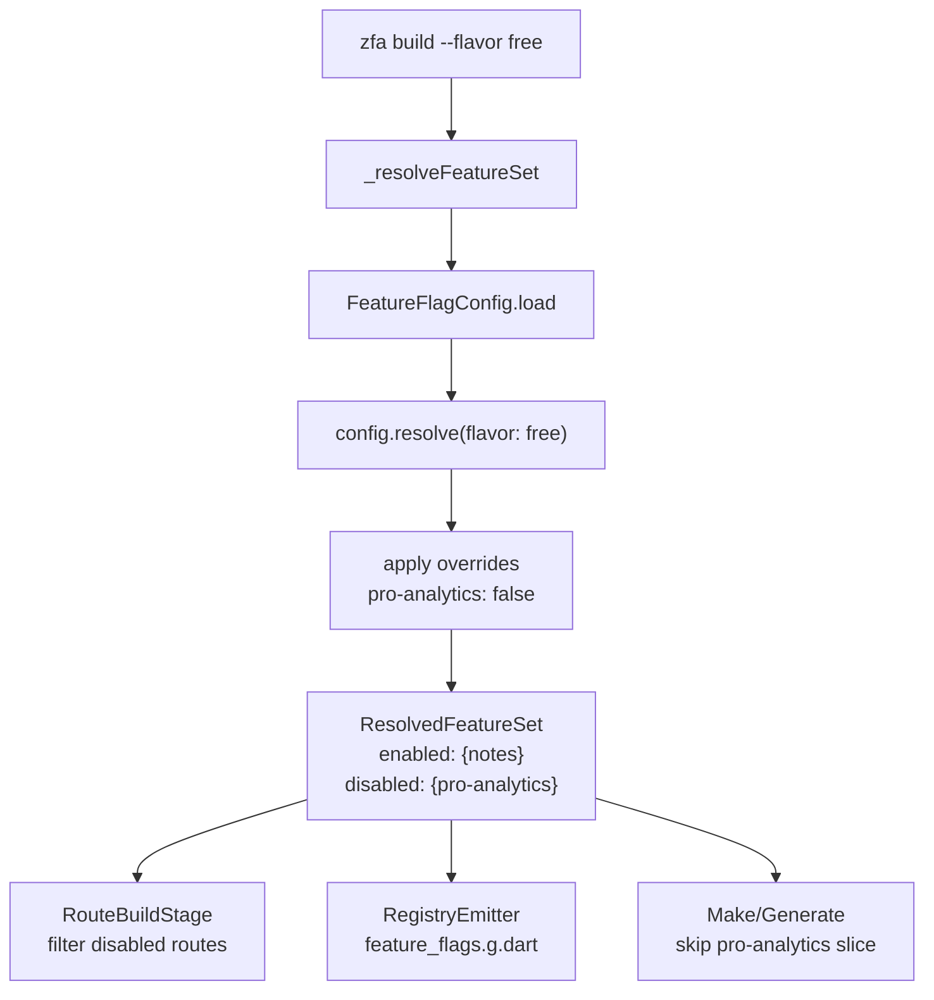

Feature Flags in Zuraffa make entire feature slices optional per build. A feature is declared in the `features:` section of `.zfa.json`; its `enabled` state (and optional flavor overrides) drives code generation, route emission, and a generated runtime registry that evaluates gates against injectable providers. Disabled features leave no trace in generated output.

## Architecture Overview

The system operates across three layers: configuration (`.zfa.json` parsing and validation), build-time filtering (code generation and routing respect enabled features), and runtime resolution (pluggable providers evaluate gates).



Sources: [feature_flag.dart](lib/src/feature_flags/feature_flag.dart#L1-L148), [feature_flag_config.dart](lib/src/feature_flags/feature_flag_config.dart#L1-L267), [registry_emitter.dart](lib/src/feature_flags/registry_emitter.dart#L1-L76), [feature_flag_provider.dart](lib/src/feature_flags/runtime/feature_flag_provider.dart#L1-L210), [build_command.dart](lib/src/commands/build_command.dart#L95-L137), [route_build_stage.dart](lib/src/dda/plugins/route/route_build_stage.dart#L117-L131)

## Configuration Model

The source of truth is the `features:` section in `.zfa.json`. Two shapes are supported: a canonical list of objects and a map with names as keys.

### Feature Declaration

```json
{
  "features": [
    { "name": "pro-analytics", "enabled": true },
    { "name": "beta-scheduler", "enabled": false, "gates": ["locale:en-US,en-GB"] }
  ],
  "flavors": {
    "free": { "pro-analytics": false },
    "pro": {}
  }
}
```

A feature flag carries a name, a build-time `enabled` boolean, and optional gates. Feature names must match `^[a-zA-Z0-9]+(-[a-zA-Z0-9]+)*$`. The `FeatureFlag` type exposes `pascalName` (e.g. `ProAnalytics`) and `snakeName` (e.g. `pro_analytics`) for matching generated slice names.

Sources: [feature_flag.dart](lib/src/feature_flags/feature_flag.dart#L56-L113), [feature_flag_config.dart](lib/src/feature_flags/feature_flag_config.dart#L1-L203)

### Gate Syntax

Gates use a colon-delimited convention and are evaluated at runtime against injectable providers.

| Gate Type | Syntax | Example | Purpose |
|-----------|--------|---------|---------|
| membership | `membership:<tier>` | `membership:pro` | Subscription tier check |
| locale | `locale:<l1>,<l2>` | `locale:en-US,en-GB` | Locale allow-list |
| variant | `variant:<a\|b\|c>` | `variant:a\|b` | A/B testing |
| custom | `custom:<handler>` | `custom:power-user` | Custom gate logic |

A gate string is parsed by `FeatureGate.parse`, which splits locale values on commas and variant values on pipes. Malformed syntax (no colon, empty value, unknown type) throws `FormatException`, which the config layer converts into `FeatureConfigException`.

Sources: [feature_flag.dart](lib/src/feature_flags/feature_flag.dart#L13-L113)

### Validation Rules

All validation failures throw `FeatureConfigException` with messages that name the offending item. Invalid feature names, duplicate names, unknown flavors, unknown gate types, and malformed gate syntax all fail fast at config load time. Flavor overrides are validated against declared features, so a flavor cannot override an unknown feature.

Sources: [feature_flag_config.dart](lib/src/feature_flags/feature_flag_config.dart#L42-L203), [feature_flag_config_test.dart](test/feature_flags/feature_flag_config_test.dart#L1-L275)

## CLI Commands

The `zfa feature` command group provides list, enable, and disable subcommands that modify `.zfa.json` in place.

### Command Reference

| Command | Behavior | Exit Code |
|---------|----------|-----------|
| `zfa feature list` | Lists all declared features with status | 0 on success |
| `zfa feature list --format=json` | JSON array output | 0 on success |
| `zfa feature enable <name>` | Declares and enables a feature (upsert) | 0 on success, 1 on invalid name |
| `zfa feature disable <name>` | Disables a declared feature | 0 on success, 1 if undeclared |

`enable` performs an upsert — it declares a feature if absent, then sets `enabled: true`. `disable` refuses to operate on undeclared features; you must `enable` first. The CLI normalizes map-shaped `features:` to the canonical list shape on write. Validation runs before any file write, so an invalid resulting config is never persisted.

Sources: [feature_flag_cli.dart](lib/src/feature_flags/feature_flag_cli.dart#L1-L175), [feature_command.dart](lib/src/commands/feature_command.dart#L200-L296), [feature_flag_cli_test.dart](test/feature_flags/feature_flag_cli_test.dart#L1-L257)

## Build-Time Filtering

The `zfa build` command resolves the feature set before any stage runs, so a broken config fails fast.

### Flavor-Based Builds

The `--flavor <name>` flag resolves `features:` against `flavors:` overrides. Unknown flavors exit non-zero with a message naming the offender. When no features section exists, a flavor request is also fatal.



Sources: [build_command.dart](lib/src/commands/build_command.dart#L95-L137), [build_command.dart](lib/src/commands/build_command.dart#L494-L526), [build_flavor_filter_test.dart](test/feature_flags/build_flavor_filter_test.dart#L1-L246)

### Registry Emission

`emitRegistry` generates `lib/src/core/feature_flags.g.dart` containing only enabled features. Disabled features leave no trace — not even in the `_enabled` list literal. The emitted class delegates to `FeatureFlagRuntime`, so gate evaluation, provider swapping, and fail-safe fallbacks are runtime-package behavior, while the per-build feature-set and gate declarations are baked into the generated file. The class exposes `isEnabled`, `enabledFeatures`, and `resolveVariant`.

Sources: [registry_emitter.dart](lib/src/feature_flags/registry_emitter.dart#L1-L76), [registry_emitter_test.dart](test/feature_flags/registry_emitter_test.dart#L1-L123)

### Route Filtering

`RouteBuildStage` drops `@Route`/`@ZfaRoute` annotations owned by disabled features using normalized name matching on class names and file paths. Class-name prefix matching requires a PascalCase boundary (`ProAnalyticsView` matches `pro-analytics`), and path-segment matching checks `pro_analytics` or `pro-analytics` segments. When no feature set is passed, behavior is unchanged.

Sources: [route_build_stage.dart](lib/src/dda/plugins/route/route_build_stage.dart#L40-L131), [route_filter_test.dart](test/feature_flags/route_filter_test.dart#L1-L140)

### Make Skip

`zfa make` skips generation for slices whose entity name normalizes (via `pascalToKebab`) to a disabled feature, printing a skip reason and writing zero files. The check happens before planning, so a disabled feature never reaches the entity-exists guard.

Sources: [make_command.dart](lib/src/commands/make_command.dart#L1995-L2015), [make_skip_test.dart](test/feature_flags/make_skip_test.dart#L1-L155)

## Runtime Resolution

The generated `FeatureFlags` registry delegates to `FeatureFlagRuntime`, which resolves features against injectable providers with fail-safe fallbacks.

### Resolution Order

1. Pluggable whole-feature provider (`FeatureFlagProvider`) — its answer wins; throwing or null falls back.
2. Build-time static default — a feature disabled at build time is disabled, period; unknown names return `false`.
3. Gate evaluation — ALL gates must pass; any failing or unavailable gate fails closed.

Sources: [feature_flag_provider.dart](lib/src/feature_flags/runtime/feature_flag_provider.dart#L64-L107)

### Pluggable Providers

| Provider Type | Interface | Purpose |
|---------------|-----------|---------|
| Whole-feature | `FeatureFlagProvider` | Override build-time defaults (remote config, entitlements) |
| Membership | `MembershipResolver` | Return current tier (`free`, `pro`) or null |
| Locale | `LocaleResolver` | Return app locale or null |
| Variant | `VariantResolver` | Pick active variant from declared list |
| Custom gate | `CustomGateHandler` | Evaluate a named custom gate |

`Resolvers` bundles the membership, locale, and variant resolvers. `ProviderContext` carries the resolved membership tier, locale, and variant to providers and custom gate handlers.

Sources: [feature_flag_provider.dart](lib/src/feature_flags/runtime/feature_flag_provider.dart#L24-L47)

### Fail-Safe Design

- A throwing provider or resolver never propagates — the system falls back to build-time defaults.
- Membership and locale gates fail closed (a restricted feature must not fail open).
- An unregistered custom gate fails closed.
- A variant resolver returning an undeclared variant fails the gate.
- `disabled` features can never be re-enabled by gates; they are removed from the enabled set at construction.

Sources: [feature_flag_provider.dart](lib/src/feature_flags/runtime/feature_flag_provider.dart#L64-L209), [runtime_provider_test.dart](test/feature_flags/runtime_provider_test.dart#L1-L296)

## Performance Characteristics

- O(1) static lookup: the generated registry uses a `const` set for default resolution.
- Flavor diff: switching flavors produces distinct builds verified by automated diff.
- CLI commands complete quickly for configs with up to 50 features.

Sources: [registry_emitter.dart](lib/src/feature_flags/registry_emitter.dart#L1-L76), [build_flavor_filter_test.dart](test/feature_flags/build_flavor_filter_test.dart#L1-L246)

## Edge Cases

| Scenario | Behavior |
|----------|----------|
| Feature enabled in config but code doesn't exist | Build proceeds; no generation occurs for the missing entity |
| Unknown gate type (e.g. `tenant:xyz`) | Config validation throws `FeatureConfigException` naming the gate |
| Conflicting flavor overrides | Flavor overrides take precedence; base `enabled` state is the fallback |
| Feature toggled after generation | `zfa build` re-resolves and regenerates the registry |
| Invalid JSON or schema violations | `FeatureConfigException` with message naming the offending item |
| Membership provider unavailable | Gate fails closed (feature disabled) |
| Locale unavailable | Locale gate fails closed |
| Unknown feature queried at runtime | `isEnabled` returns `false` |

Sources: [feature_flag_provider.dart](lib/src/feature_flags/runtime/feature_flag_provider.dart#L88-L107), [feature_flag_config.dart](lib/src/feature_flags/feature_flag_config.dart#L207-L237)

## Integration Points

The feature set flows through the build pipeline as a `ResolvedFeatureSet?` parameter:

- Build command: resolves once, passes to all stages.
- Route stage: filters `@Route` annotations by disabled feature ownership.
- Make/Generate commands: skip slices whose entity name maps to a disabled feature.
- Registry emitter: generates the runtime `FeatureFlags` class.

Sources: [build_command.dart](lib/src/commands/build_command.dart#L95-L137), [route_build_stage.dart](lib/src/dda/plugins/route/route_build_stage.dart#L40-L131)

## Next Steps

- [TDD & Spec-Driven Loop](16-tdd-and-spec-driven-loop) — how feature flags interact with the TDD loop
- [Code Generation Pipeline](9-code-generation-pipeline) — the generation pipeline that respects feature flags
- [Exit Codes & Machine Verdicts](25-exit-codes-and-machine-verdicts) — exit codes for feature flag validation failures
- [Configuration & Project Memory](6-configuration-and-project-memory) — the config file format