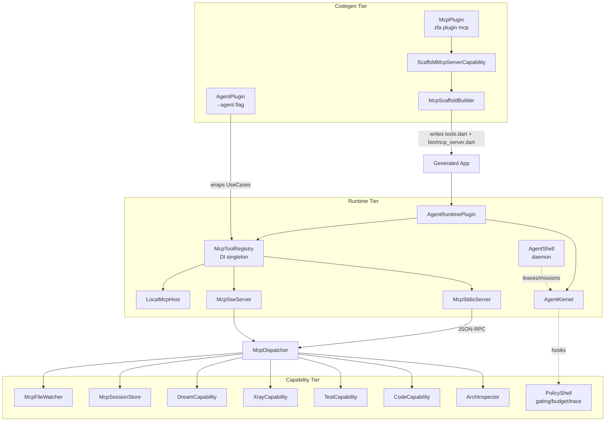

Zuraffa exposes two complementary integration surfaces for autonomous agents. The **MCP layer** turns an app's generated features into callable Model Context Protocol tools over stdio, SSE, or an in-process host, with a shared JSON-RPC dispatcher and a collision-safe tool registry. The **Agent layer** adds a governed runtime (kernel, policy shell, durable mission shell, UI-render tool) plus codegen that wraps every UseCase as an MCP tool. Together they let AI agents inspect architecture, generate code, run UseCases, drive a live Flutter app via X-Ray, and execute multi-step missions under budget and permission governance.

## Architecture Overview

The system spans three tiers that share a single `McpToolRegistry` as the source of truth for the tool surface.



Sources: [agent_runtime_plugin.dart](lib/src/agent/runtime/agent_runtime_plugin.dart#L1-L28), [mcp_server_plugin.dart](lib/src/core/module/mcp_server_plugin.dart#L1-L96), [mcp_dispatcher.dart](lib/src/core/module/mcp_dispatcher.dart#L1-L117)

## MCP Server — Codegen Scaffolding

The codegen tier scaffolds a runnable runtime MCP server into a generated app. `McpPlugin` (id `mcp`) implements `CliAwarePlugin` and exposes a single `ScaffoldMcpServerCapability`.

- `zfa plugin mcp` (or `zfa mcp scaffold`) writes two files:
  - `lib/src/mcp/tools.dart` — declares the app's `McpTool` list, initially an `EchoTool` placeholder so the server compiles and runs immediately.
  - `bin/mcp_server.dart` — standalone entrypoint that boots a `ZuraffaEngine` + `McpServerPlugin` and serves stdio (default) or SSE (`--sse`), with `--list-tools` support.
- Both files are stamped `// Generated by zfa` (not `// GENERATED - DO NOT EDIT` markers, which are reserved for build_runner outputs).
- `--force` overwrites; without it, existing files are skipped so user customisations survive re-runs. `--revert` deletes them.

Sources: [mcp_plugin.dart](lib/src/plugins/mcp/mcp_plugin.dart#L1-L96), [scaffold_mcp_server_capability.dart](lib/src/plugins/mcp/capabilities/scaffold_mcp_server_capability.dart#L1-L199), [mcp_scaffold_builder.dart](lib/src/plugins/mcp/builders/mcp_scaffold_builder.dart#L1-L245)

## MCP Server — Runtime Plugin

`McpServerPlugin` (core module, id `mcp`) is the runtime-tier `ZuraffaPlugin` that wires app tools into the DI tree.

| Parameter | Type | Default | Purpose |
|-----------|------|---------|---------|
| `pluginId` | `String` | `'mcp'` | Plugin identifier in the engine |
| `tools` | `List<McpTool>` | `[]` | Tools to expose |
| `autoStartStdio` | `bool` | `false` | Auto-start stdio server in `onInit` |
| `autoStartSsePort` | `int?` | `null` | Auto-start SSE server on this port |
| `sseAuthToken` | `String?` | `null` | Bearer token for auto-started SSE |
| `maxSseConnections` | `int?` | `null` | Max concurrent SSE sessions |
| `sseToolAllowlist` | `Map<String, Set<String>>?` | `null` | Per-token tool restrictions |

Lifecycle: `registerDependencies(di)` creates the `McpToolRegistry` and registers every tool as a DI singleton; `onInit(di)` captures the DI container and optionally auto-starts stdio/SSE. The plugin does not auto-start any server by default — the host app decides when to start the loop, typically at the end of `main()` after `engine.bootstrap()`.

Post-bootstrap accessors: `registry` (throws `StateError` if called before bootstrap), `listTools()`, `serveStdio()`, `serveSse()`, `sseServer`.

Sources: [mcp_server_plugin.dart](lib/src/core/module/mcp_server_plugin.dart#L1-L228)

## Transports

### stdio Transport

`McpStdioServer` reads JSON-RPC requests line-by-line from stdin and writes one response per line to stdout. It is the default transport for agent integrations and is suitable for local and CI environments.

| Property | Value |
|----------|-------|
| Input | stdin (UTF-8, line-delimited JSON-RPC) |
| Output | stdout (one JSON-RPC response per line) |
| Diagnostic sink | stderr |
| Protocol version | `2024-11-05` |
| Supported methods | `initialize`, `tools/list`, `tools/call`, `ping`, `shutdown` |
| Injectability | Tests inject `inputStream`, `outputSink`, `errorSink` |

The stdio loop never returns in production — stdin is held open until the process is killed. Notifications (requests with `id == null`) receive no response, per JSON-RPC 2.0.

Sources: [mcp_stdio_server.dart](lib/src/core/module/mcp_stdio_server.dart#L1-L163)

### SSE Transport

`McpSseServer` exposes the MCP protocol over HTTP with Server-Sent Events, enabling remote agents to connect over a network. It listens on `127.0.0.1` by default and binds to `0.0.0.0` when authentication is enabled.

| Method | Path | Purpose |
|--------|------|---------|
| `GET` | `/sse` | Opens the SSE stream; first event is `endpoint` with the POST URL |
| `POST` | `/message?sessionId=<id>` | Accepts JSON-RPC request body, dispatches to registry |
| `GET` | `/health` | Returns `{"status": "ok", "transport": "sse"}` |

Security model: unauthenticated mode enforces loopback-only via `Origin`/`Host` header validation (DNS-rebinding protection); authenticated mode requires a Bearer token for non-loopback clients; optional `maxConnections` cap rejects new connections with HTTP 503; per-token tool allowlists restrict which tools a bearer token may invoke. The SSE implementation is deliberately minimal — no retries, no keep-alive heartbeats, no SSE-Event-ID bookkeeping. Responses stream back over the SSE channel after the POST is acknowledged with HTTP 202.

Sources: [sse_server.dart](lib/src/mcp/sse_server.dart#L1-L496)

### Local (In-Process) Host

`LocalMcpHost` wraps an `McpToolRegistry` and exposes enumerate/call operations with no socket, no JSON-RPC framing, and no serialization. It is the server-side half of the in-process bridge used by the agent runtime; the client half is `dart_agent_core`'s `LocalMcpTransport`. Until that interface lands, it is the standalone transport-free call surface for in-process tool invocation.

Sources: [mcp_local_host.dart](lib/src/core/module/mcp_local_host.dart#L1-L36)

## JSON-RPC Dispatcher

`McpDispatcher` is the shared method-routing layer for both transports. It handles the MCP protocol subset and converts tool handler failures into tool-level error results (never transport errors).

| Method | Behavior |
|--------|----------|
| `initialize` | Returns `protocolVersion`, `serverInfo`, and `capabilities` |
| `tools/list` | Returns `registry.toolDefinitions()` — name, description, inputSchema per tool |
| `tools/call` | Resolves tool by name, validates args, invokes handler, returns `McpToolResult.toJson()` |
| `ping` | Returns `{"pong": true}` |
| `shutdown` | Returns `{}` |
| Unknown method | JSON-RPC error `-32601 Method not found` |
| Invalid params | JSON-RPC error `-32602 Invalid params` |

Tool-level exceptions are caught and surfaced as `isError: true` results so the MCP client sees them as tool problems rather than transport failures. The full stack trace is logged to the diagnostic sink; the wire response carries only the exception message.

Sources: [mcp_dispatcher.dart](lib/src/core/module/mcp_dispatcher.dart#L1-L117)

## Tool Registry & Contract

### McpTool abstract class

Every app feature exposed as an MCP tool implements the `McpTool` contract:

```dart
abstract class McpTool {
  String get name;               // stable snake_case identifier
  String get description;        // AI-facing description
  Map<String, dynamic> get inputSchema;  // JSON Schema draft-07 subset
  Future<McpToolResult> call(Map<String, dynamic> arguments);
}
```

The `inputSchema` is forwarded verbatim to the MCP client in the `tools/list` response. Implementations should validate inputs defensively — the MCP client is untrusted — and return an `McpToolResult`, never throw across the JSON-RPC boundary.

### McpToolResult

The result contract mirrors the MCP `tools/call` response shape with an `isError` flag and a `content` array. The current contract emits a single text content block.

| Constructor | Purpose |
|-------------|---------|
| `McpToolResult.ok(text)` | Success result with text payload |
| `McpToolResult.error(message)` | Error result surfaced to the model |
| `McpToolResult.artifact(ref)` | Ref-only result for large bodies stored out-of-band |

The `artifactRef` pattern implements the "ref-only" contract: when set, the wire response carries only a pointer (file path, content-addressed URI, or object-store key), never the body itself. This prevents multi-MB results from crossing the JSON-RPC boundary.

Sources: [mcp_tool.dart](lib/src/core/module/mcp_tool.dart#L1-L179)

### McpToolRegistry

The registry is the single source of truth for the tool surface. It is registered as a singleton in the DI container during the engine's `registerDependencies` phase.

| Method | Purpose |
|--------|---------|
| `register(tool, override: false)` | Registers a tool; throws on duplicate name unless `override: true` |
| `unregister(name)` | Removes a tool; returns the removed instance or null |
| `find(name)` | Looks up a tool by name |
| `call(name, args)` | Transport-free invocation; converts throws to error results |
| `toolDefinitions()` | Builds the MCP `tools/list` result list |
| `allTools` / `toolNames` | Immutable views of registered tools in insertion order |

Dart's `LinkedHashMap` preserves insertion order by default, so `toolDefinitions()` returns tools in registration order.

Sources: [mcp_tool_registry.dart](lib/src/core/module/mcp_tool_registry.dart#L1-L103)

## Capabilities (v2 Tools)

The codegen-side MCP server (`bin/zuraffa_mcp_server.dart`) additionally exposes v2 capability tools that operate on the project itself:

| Tool | Capability | Purpose |
|------|------------|---------|
| `arch_inspect` | `ArchCapability`/`ArchInspector` | Returns the full architectural model: entities, use cases, repositories, data sources, presentation, DI registrations, routes |
| `arch_refactor` | AST Smart Regeneration | `rename-entity-field`, `add-entity-method` across the entity and all references |
| `test_runUseCase` | `TestCapability` | Runs a specific UseCase in isolation with provided params and optional mocks |
| `code_generateView` | `CodeCapability` | Generates a view/controller/state trio for an entity via the canonical v5 pipeline |
| `graphql_pullSchema` | GraphQL introspection | Introspects an endpoint and returns the schema as JSON |
| `graphql_generateFromSchema` | GraphQL codegen | Generates entities, enums, and UseCases from a GraphQL schema |
| `xray_inspect` | `XrayCapability` | Inspects the live X-Ray widget tree of a running app |
| `xray_triggerAction` | `XrayCapability` | Triggers a bound action on an X-Ray node |
| `xray_triggerMock` | `XrayCapability` | Triggers a mock injection via the Control Deck (`/xray/control-deck`) |
| `session_save` / `session_restore` / `session_record` | `McpSessionStore` | Persist and replay agent session state and recorded tool-call sequences |
| `dream_draftSpec` | `DreamCapability` | Drafts a spec/plan pair from a plain-English description via LLM or deterministic fallback |

Sources: [v2_tools.dart](lib/src/mcp/v2_tools.dart#L1-L200), [arch_capability.dart](lib/src/mcp/capabilities/arch_capability.dart#L1-L707), [code_capability.dart](lib/src/mcp/capabilities/code_capability.dart#L1-L76), [test_capability.dart](lib/src/mcp/capabilities/test_capability.dart#L1-L205), [xray_capability.dart](lib/src/mcp/capabilities/xray_capability.dart#L1-L174), [dream_capability.dart](lib/src/mcp/capabilities/dream_capability.dart#L1-L200)

## Authentication, Sessions & File Watching

- **Auth**: `McpAuth` provides token-based authentication. localhost connections bypass auth; remote connections require a Bearer token in the `Authorization` header or an `auth` field in the JSON-RPC body. `validateHeader` parses the scheme case-insensitively; `isToolAllowed` enforces per-token tool allowlists (when configured, anonymous and unlisted tokens are denied tool calls). Constant-time comparison prevents timing attacks; `generateToken` produces a random hex token.
- **Sessions**: `McpSessionStore` persists agent session state (subscribed paths, last inspect result, pending refactors) plus a recorded tool-call sequence (`calls`) to `.zfa/mcp_sessions/<id>.json`. `appendCall` records a tool invocation; `callsOf` retrieves the sequence; `zfa mcp replay <id>` re-executes it against the real scaffolded server. Session IDs are validated against path traversal.
- **File watcher**: `McpFileWatcher` watches `lib/src/` recursively for `.dart` changes and emits `McpFileEvent` (created/modified/deleted) plus synthetic regeneration notifications.

Sources: [auth.dart](lib/src/mcp/auth.dart#L1-L143), [session_store.dart](lib/src/mcp/session_store.dart#L1-L192), [file_watcher.dart](lib/src/mcp/file_watcher.dart#L1-L119)

## Replay

`zfa mcp replay <session-file|session-id>` re-executes a recorded sequence of MCP tool calls against the real scaffolded `bin/mcp_server.dart` over the stdio JSON-RPC wire. Two resolution forms: a committed scenario JSON file (`{"session": ..., "calls": [...]}`) or a persisted session id from `McpSessionStore`. It prints one verdict line per call (`ok` / `missing-tool` / `mismatch` / `error`), a summary line, and writes a proof-carrying receipt under `.zfa/receipts/`. Exit 0 iff every call is ok. `--timeout <seconds>` sets a deadline for the whole replay.

Sources: [mcp_command.dart](lib/src/commands/mcp_command.dart#L38-L120)

## Agent Runtime

The agent runtime is gated behind a dedicated import URI to avoid barrel collisions with ecosystem packages (e.g. `zuraffa_agent`):

```dart
import 'package:zuraffa/agent.dart';
```

This facade re-exports four entry libraries: ui_render, kernel, policy shell, and runtime plugin. The default `package:zuraffa/zuraffa.dart` barrel no longer re-exports any agent runtime declaration.

Sources: [agent.dart](lib/agent.dart#L1-L24), [lib/zuraffa/agent.dart](lib/zuraffa/agent.dart#L1-L105)

### AgentRuntimePlugin — Registry Assembly

`AgentRuntimePlugin` assembles a flat, collision-safe `McpToolRegistry` from three sources:

1. **SPI providers** (in-proc) — device packages implement `McpToolProvider` to self-describe their tools under a namespace.
2. **Generated usecase tools** — produced by `AgentPlugin` under the `usecase` namespace.
3. **Remote MCP servers** — registered under `remote:<serverId>` namespaces.

It wires an `AgentKernel` with a `StatefulAgent`, an `LlmClient` (default `FallbackLLMClient`), a `SystemPromptComposer`, a `FileStateStorage`, and ordered `AgentHook`s. Throws `NamespaceCollisionException` on any canonical-name collision (first source wins). Exposes `kernel.status()`.

Sources: [agent_runtime_plugin_class.dart](lib/src/agent/runtime/agent_runtime_plugin_class.dart#L1-L125), [mcp_tool_provider.dart](lib/src/agent/runtime/mcp_tool_provider.dart#L1-L57), [mcp_tool_registry.dart](lib/src/agent/runtime/mcp_tool_registry.dart#L1-L82)

### McpToolProvider SPI

```dart
abstract class McpToolProvider {
  String get namespace;
  List<McpTool> buildTools(McpToolContext ctx);
}
```

`McpToolContext` acts as a DI accessor (`dependency(key)`). Providers must be idempotent: building tools twice for the same context returns equivalent lists.

Sources: [mcp_tool_provider.dart](lib/src/agent/runtime/mcp_tool_provider.dart#L1-L57)

### AgentKernel — Mission Delegation

`AgentKernel` is the thin orchestrator that bridges the tool registry to `dart_agent_core`'s `StatefulAgent`. It delegates the agent loop entirely to `StatefulAgent.runStream` (no loop duplication). Per mission it: loads persisted state, runs `onMissionStart` hooks, composes the system prompt from playbook + tool manifests, delegates to `StatefulAgent.runStream` with an `invokeTool` callback that runs the hook policy chain, records progress, then runs `onMissionEnd` hooks and persists state. `invokeTool` runs hooks in registration order; the first `ToolDecisionDeny` aborts with `ToolDeniedException`; `AgentHook.afterToolCall` may rewrite the result. Exposes `kernel.status()`.

Sources: [agent_kernel.dart (runtime)](lib/src/agent/runtime/agent_kernel.dart#L1-L152)

### Policy Shell — Governance Hooks

The `PolicyShell` composes policy hooks in registration order. `beforeToolCall` runs in registration order (first non-allow decision wins); `afterToolCall` runs in reverse order (middleware wrapping). Three framework-default hooks:

- **ToolGatingHook** — three-tier risk model: `safe` (auto-execute), `confirm` (blocks until user approves, denies on timeout, default 30s), `admin` (denied for non-internal missions). `PermissionRegistry` maps tool names to `RiskLevel` with most-restrictive-wins semantics. Precedence: per-mission allowlist → registry lookup → tool's self-declared risk → default `safe`.
- **MissionBudgetHook** — four-dimension enforcement: `calls` (max 100), `wallClock` (10 min), `tokens` (100,000), `perToolClass` (webview/scraper 5 min each). Cancels the mission on the first breach; emits typed `BudgetBreach` events; supports a `BudgetDegradeCallback` for model-client degradation.
- **MissionTraceRecorder** — produces a complete, replayable JSON trace with hashed arguments (SHA-256), configurable cleartext allowlist, timing, status, token usage, and provider. Single-mission by design.

The `OversizedResultGuard` implements the ref-only contract for large tool results.

Sources: [policy_shell.dart](lib/src/agent/policy/policy_shell.dart#L1-L25), [policy_shell_class.dart](lib/src/agent/policy/policy_shell_class.dart#L1-L87), [tool_gating_hook.dart](lib/src/agent/policy/tool_gating_hook.dart#L1-L77), [mission_budget.dart](lib/src/agent/policy/mission_budget.dart#L1-L158), [mission_budget_hook.dart](lib/src/agent/policy/mission_budget_hook.dart#L1-L134)

### Agent Shell — Durable Daemon

`AgentShell` (`zfa agent shell`, v0 daemon) is a long-lived shell that agents connect to over an NDJSON message stream. Inside:

- **File leases** — real-time, crash-safe ownership via `FileLeaseTable` + `LeaseGuard` (acquire / release / steal-on-timeout).
- **Mission documents** — durable, resumable missions via `SnapshotStore`: submit, step, snapshot, `kill -9`, resume. Missions survive disconnects; a fresh agent or daemon process over the same snapshot store resumes from the last durable cursor.
- **Budget meters** — per-mission call/token budgets surfacing as `budget.tick` / `budget.breach` events, backed by the same dimensions as the policy shell's `MissionBudget`.

Sources: [agent_shell.dart](lib/src/agent/shell/agent_shell.dart#L1-L200)

### UI Render Tool

The `ui.render` tool (spec 023) lets agents author a component tree validated against the UI Vocabulary Schema; user interactions route back as semantic actions via a streaming UI event channel. Includes `PolicyGate`, `ScreenRenderer`, `ScreenVerifier`, `UiVocabularySchema`, and `VocabularyNarrowing`. Pure-Dart, no `package:flutter` imports.

Sources: [lib/src/agent/ui_render/ui_render.dart](lib/src/agent/ui_render/ui_render.dart)

### Agent Plugin — Codegen McpTool Wrappers for UseCases

`AgentPlugin` (id `agent`) generates an `McpTool` wrapper per UseCase when invoked via `zfa make Foo --agent`. It activates when the `--agent` flag is parsed or when `.zfa.json` → `plugins.defaults.agent: true` enables it by default (and the user has not passed `--no-agent`). It runs after usecase generation (`dependsOn: ['usecase']`), introspects the entity's usecase directory, detects canonical-tool-name collisions before writing, emits one tool wrapper per usecase under `lib/src/agent/tools/{entity}_{verb}_tool.dart`, emits a `manifest.dart` barrel with name/entity/risk tier, uses `GeneratedMarkerMerger` to preserve manual edits outside `// GENERATED - DO NOT EDIT` markers, and sweeps orphaned tool files for that entity (only deleting files with GENERATED markers).

Tool names use the canonical form `<namespace>.<entity_snake>.<verb>` (default namespace `app`). Risk tier: `admin` for agent-internal usecases, `safe` otherwise.

Sources: [agent_plugin.dart](lib/src/agent/plugin/agent_plugin.dart#L1-L297), [manifest_emitter.dart](lib/src/agent/plugin/manifest_emitter.dart#L1-L55)

### System Prompt, State Storage & LLM Client

- `SystemPromptComposer` composes the system prompt from playbook text plus tool manifests (one line per registered tool: canonical name + description).
- `FileStateStorage` persists per-mission `AgentState` (missionId + steps). `InMemoryFileStateStorage` is the no-op fallback.
- `LlmClient` is the completion abstraction; `FallbackLLMClient` tries primary then secondary, returning empty string in degraded mode (never crashes).

Sources: [system_prompt_composer.dart](lib/src/agent/runtime/system_prompt_composer.dart#L1-L25), [state_storage.dart](lib/src/agent/runtime/state_storage.dart#L1-L46), [llm_client.dart](lib/src/agent/runtime/llm_client.dart#L1-L33)

## Kernel Layer (Mission Coalescing & Safety)

The kernel layer (spec 026) provides the efficiency + safety core: identical missions coalesce via a composite key (spark type + normalized value + country + strategy variant) and execute exactly once with events fanned out to all subscribers; mid-execution cancellation triggers a grace period that disposes all registered resource handles before teardown, salvaging partial results as `cancelled_partial` and asserting zero resource leaks; an idempotency cache serves repeated submissions within a configurable TTL. Single-isolate assumption (FR-009); `MissionExecutor`/`ResourceRegistry` are the multi-isolate extension points.

Sources: [agent_kernel.dart (kernel)](lib/src/agent/kernel/agent_kernel.dart#L1-L36)

## X-Ray Bridge (Runtime App Bridge)

The `XrayCapability` bridges MCP tools to a running Flutter app's X-Ray bridge server (default port 8372):

- `xray_inspect` → `GET /xray/tree` returns the live widget tree.
- `xray_triggerAction` → `POST /xray/action` triggers a bound action on a node (`{nodeId, payload}`).
- `xray_triggerMock` → `POST /xray/control-deck` triggers a mock injection (`{mockName, payload}`) per the canonical bridge contract (spec 035, FR-003).

All three return graceful failure objects (`SocketException`/`TimeoutException` mapped to helpful errors) when no app is running. The Control Deck injection endpoint is `/xray/control-deck` (the prior `/xray/mock` path was a pre-spec placeholder).

Sources: [xray_capability.dart](lib/src/mcp/capabilities/xray_capability.dart#L1-L174), [xray_bridge_handlers.dart](lib/src/mcp/xray_bridge/xray_bridge_handlers.dart)

## CLI Surface

- `zfa plugin mcp` / `zfa mcp scaffold` — scaffold runtime MCP server files.
- `zfa mcp serve [--sse] [--port <n>] [--token <t>]` — run the scaffolded `bin/mcp_server.dart` (stdio default or SSE).
- `zfa mcp list-tools` — subprocess `bin/mcp_server.dart --list-tools` and print tool definitions as JSON.
- `zfa mcp replay <session-file|session-id> [--timeout <s>]` — re-execute a recorded tool-call sequence and write a verdict receipt.
- `zfa make Foo --agent` (or `plugins.defaults.agent: true`) — generate `McpTool` wrappers for Foo's UseCases.

Sources: [mcp_command.dart](lib/src/commands/mcp_command.dart#L1-L60), [agent_plugin.dart](lib/src/agent/plugin/agent_plugin.dart#L1-L60)

## Next Steps

- [Mock Data & Certification](18-mock-data-and-certification) — how mock data flows into MCP-driven tests
- [Simulation Worlds](19-simulation-worlds) — simulation worlds the agent can target
- [Skin & UI Contracts](20-skin-and-ui-contracts) — UI contracts the `ui.render` tool validates against
- [Feature Flags](23-feature-flags) — feature-gated slices the agent can enable/disable
- [Exit Codes & Machine Verdicts](25-exit-codes-and-machine-verdicts) — exit codes for MCP/agent commands
- [Extending with Custom Plugins & Packages](26-extending-with-custom-plugins-and-packages) — implementing `McpToolProvider` for device packages