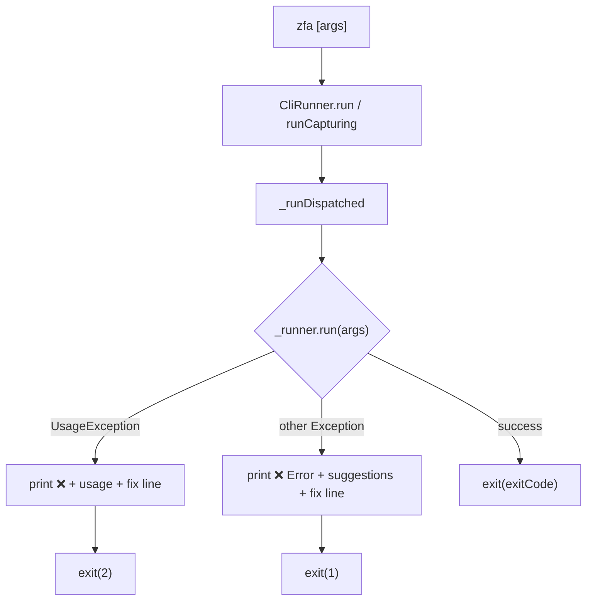

Zuraffa treats process exit codes and `--json` verdict envelopes as a single machine contract, not as human-readable side effects. Governed by **SPEC 917** (VISION §3 and §4 made mechanical), the contract is: every invocation exits with one of five canonical codes, and every `--json` run ends with a single-line `zuraffa.verdict.v1` envelope whose `exit_class` names that code. Agents and CI parse these verdicts; they never parse prose.

Sources: [exit_protocol.dart](lib/src/cli/exit_protocol.dart#L1-L34), [verdict_envelope.dart](lib/src/core/verdict_envelope.dart#L1-L34)

## The Exit Code Protocol

The ratified table lives in `ExitProtocol.tableDoc` and is asserted by `test/commands/exit_protocol_golden_test.dart` against live CLI behavior. It is printed by `zfa --help` (the `EXIT CODES` section) and embedded in `zfa schema` under `x-zfa-exit-protocol`.

| Code | Name | Meaning |
|------|------|---------|
| 0 | success | GREEN / complete — the operation ran and everything passed |
| 1 | failure | RED (honest, expected in-loop) / stopped / audit failure / runtime failure — the operation ran and gave an honest negative verdict; the JSON verdict's `exit_class` distinguishes the sub-flavor |
| 2 | usage | The operation could NOT run as invoked — grammar/usage error, unknown flag or subcommand, missing required arguments, invalid invocation target, or runner-infrastructure error (legacy 64 maps here) |
| 3 | drift | Contract/spec drift — manifest ↔ CLI flag drift, template-version drift, traceability drift, corrupt state evidence |
| 4 | conflict | State conflict — concurrent run ownership, evidence lock inconsistency |

**Legacy codes.** `64` (`EX_USAGE`) is the pre-protocol usage error; `ExitProtocol.canonicalize(64)` maps it onto canonical `2`, and new code must use `ExitProtocol.usage` directly. Codes `255`, `-9`, and `137` are external termination signals (OOM killer, shell limits) — zfa never emits them and they are not part of the protocol.

Sources: [exit_protocol.dart](lib/src/cli/exit_protocol.dart#L9-L34), [exit_protocol.dart](lib/src/cli/exit_protocol.dart#L38-L88)

## Protocol Enforcement in the CLI Runner

`CliRunner` is the single process-boundary enforcer. `run()` and `runCapturing()` both delegate to `_runDispatched()`, which wraps `_runner.run(args)` and translates every outcome into a protocol code:

- Success → `exit(exitCode)`, honoring any code the command set via `dart:io exitCode`.
- `UsageException` → prints `❌`, usage text, and a `--> fix:` line, then exits `ExitProtocol.usage` (2).
- Any other exception → prints `❌ Error`, suggestions, and a `--> fix:` line, then exits `ExitProtocol.failure` (1).

Commands that cannot run as invoked (missing required args, removed verbs like `generate`, unknown shells) set `exitCode` directly to `ExitProtocol.usage` before returning. `exitOnCompletion: false` (used by tests and embedded hosts) skips the actual `exit()` call while still publishing the code through `exitCode` and `CliRunner.lastDispatchedExitCode`.

Sources: [cli_runner.dart](lib/src/cli/cli_runner.dart#L300-L415), [cli_runner.dart](lib/src/cli/cli_runner.dart#L839-L985)

## The `--> fix:` Line Convention

VISION §4 requires every error to end with a machine-actionable remediation. `ExitProtocol.fixLine(String fix)` formats it as `--> fix: $fix`. Usage errors produce grammar-oriented fixes ("re-run with --help …"), generic failures point at `--verbose` plus `zfa doctor`, and migrated commands append their own domain-specific fix (e.g. `zfa route create Product`). The golden test greps the final non-empty output line for `fix:` on every non-zero path.

Sources: [exit_protocol.dart](lib/src/cli/exit_protocol.dart#L69-L71), [cli_runner.dart](lib/src/cli/cli_runner.dart#L402-L412)

## Machine Verdicts: `zuraffa.verdict.v1`

For `--json` consumers, every migrated command emits a single canonical `VerdictEnvelope` as the **last stdout line**. The schema identifier is exactly `zuraffa.verdict.v1`; `VerdictEnvelope.fromJson` throws `VerdictSchemaException` on any other value, so drifted shapes (`schema: 1`, `verdict.v1`, `cache.verify.v1`) break loudly instead of being silently re-interpreted.

| Field | Type | Purpose |
|-------|------|---------|
| `schema` | string | Always `zuraffa.verdict.v1` |
| `command` | string | Producing invocation (e.g. `zfa route create Product`) |
| `verdict` | enum | `pass \| fail \| skip \| error \| stopped` |
| `exit_class` | int or label | ExitProtocol code (0–4, 64) or a grandfathered tdd label |
| `subject` | object | What the verdict is about: `{kind, id, …extra}` |
| `artifacts` | object | `{created, modified, deleted}` file lists |
| `receipts` | string[] | Receipt paths under `.zfa/receipts/…` |
| `findings` | object[] | Structured findings with `kind`, `fix`, `file`, `member`, extras |
| `drifts` | string[] | Drift/diff findings (empty when none) |
| `details` | object | The only plugin-specific free-form surface |
| `explain` | object (optional) | Additive `--explain` block (issue #1122) |
| `timestamp` | ISO 8601 UTC | Emission time |

`VerdictEnvelope.tryParse(String output)` scans stdout bottom-up for the last JSON object line that speaks the canonical schema, which is the seam MCP and other mixed-stream consumers use. `VerdictEnvelope.emit()` prints the single-line wire form so the envelope remains the final stdout line.

Sources: [verdict_envelope.dart](lib/src/core/verdict_envelope.dart#L1-L120), [verdict_envelope.dart](lib/src/core/verdict_envelope.dart#L200-L360)

### Core vs. TDD Envelope

Two envelope classes coexist deliberately:

- **`lib/src/core/verdict_envelope.dart`** — `VerdictEnvelope` with `VerdictKind` (`pass/fail/skip/error/stopped`) and an integer or label `exit_class`. This is the canonical `zuraffa.verdict.v1` producer and parser.
- **`lib/src/plugins/tdd/models/verdict_envelope.dart`** — the TDD-family `VerdictEnvelope` with `VerdictOutcome` (`pass/fail/stopped/error`) and a string `exit_class` label (`ok`, `fail`, command-specific). It keeps its class name and shape; only its schema string moved onto the canonical identifier (SPEC 1105). Its `defaultExitClass` maps pass → `ok`, everything else → `fail`.

- **`ZuraffaVerdictEnvelope`** (in the same core file) is the repository-command alias (`VerdictStatus` = `pass/fail/skip/error`) with an integer `exitClass`, used by `zfa repository …` verbs.

`exit_class` duality is handled in the parser: an integer parses into `exitClass`; a string parses into `exitClassLabel` and re-encodes as the same label (round-trip honesty — the parser never upgrades a label behind the producer's back). `defaultExitClass(VerdictKind)` maps pass → 0, everything else → 1.

Sources: [verdict_envelope.dart](lib/src/core/verdict_envelope.dart#L380-L598), [plugins/tdd/models/verdict_envelope.dart](lib/src/plugins/tdd/models/verdict_envelope.dart#L1-L160)

## Discovering the Protocol

- `zfa --help` prints the `EXIT CODES` section (`ExitProtocol.tableDoc`).
- `zfa schema` embeds the same table under `x-zfa-exit-protocol`, plus the rule that every non-zero exit ends with a `--> fix:` line.

Sources: [cli_runner.dart](lib/src/cli/cli_runner.dart#L1055-L1080), [schema_command.dart](lib/src/commands/schema_command.dart#L1-L30)

## Concurrency & Isolate Safety

`dart:io exitCode` is process-global, but `dart test` runs suites as concurrent isolates in one VM. `CliRunner` solves this with two locks and a hermetic snapshot:

1. **`_exitSpanLockFile`** — held across the whole `runCapturing` dispatch (reset, command body, snapshot, re-apply), so only one writer touches the global `exitCode` at a time.
2. **`_cwdLockFile`** — guards the scoped chdir window for `-C`/`--directory`.

Both use exclusive-create (`File.createSync(exclusive: true)`) with 30-second stale-lock breaking and heartbeat liveness. `CliRunner.lastDispatchedExitCode` is a per-isolate static that callers read instead of the global, immune to sibling clobber.

Sources: [cli_runner.dart](lib/src/cli/cli_runner.dart#L500-L650)

## Testing the Protocol

| Test file | Tier | What it asserts |
|-----------|------|-----------------|
| `test/commands/exit_protocol_golden_test.dart` | Fast | Constants, legacy mapping, live CLI behavior per code, `fix:` line presence |
| `test/core/verdict_envelope_canonical_test.dart` | Fast | Canonical schema id, parsing, loud failure on mismatch, round-trip stability, `tryParse` |
| `test/core/verdict_envelope_emitter_scan_test.dart` | Fast | Every `--json` emitter references the canonical envelope; literal schema id lives only in core + emitters |
| `test/commands/verify_gate_json_sweep_test.dart` | Fast | Every verify-gate command ships `--json` |

Sources: [exit_protocol_golden_test.dart](test/commands/exit_protocol_golden_test.dart#L1-L191), [verdict_envelope_canonical_test.dart](test/core/verdict_envelope_canonical_test.dart#L1-L237), [verdict_envelope_emitter_scan_test.dart](test/core/verdict_envelope_emitter_scan_test.dart#L1-L196)

## Next Steps

- [Canonical CLI Workflow](4-canonical-cli-workflow) — the generation commands that emit these verdicts
- [Proof & Provenance](17-proof-and-provenance) — receipts and verification gates that consume `zuraffa.verdict.v1`
- [TDD & Spec-Driven Loop](16-tdd-and-spec-driven-loop) — the TDD-family envelope and cycle evidence
- [Running Tests & Local CI](7-running-tests-and-local-ci) — how the protocol is exercised in CI