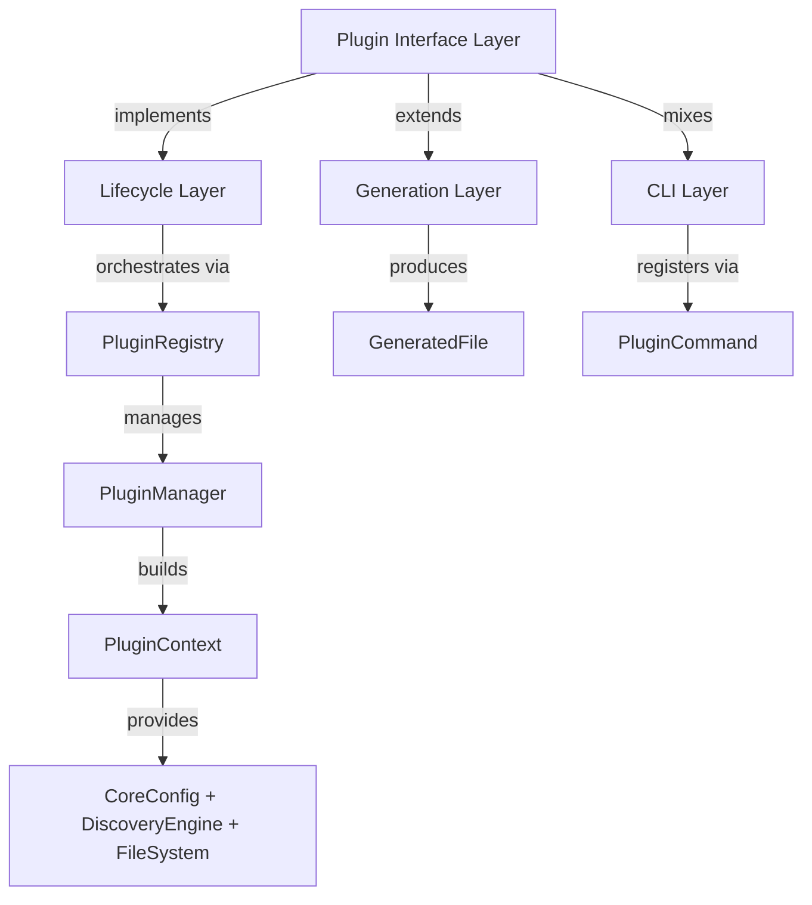
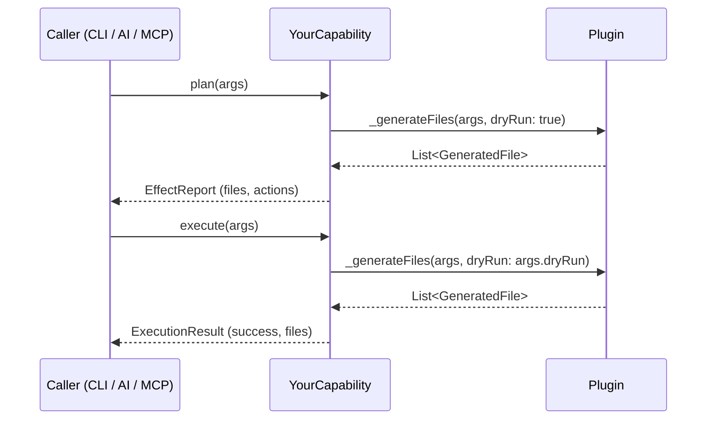
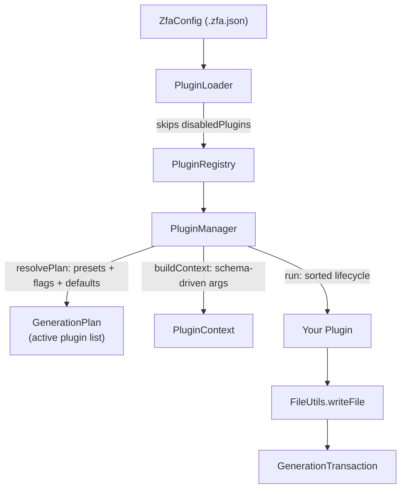

Zuraffa offers two distinct extension surfaces, and this page covers both. **Generation plugins** are in-process Dart classes that implement `ZuraffaPlugin` (or `FileGeneratorPlugin`) and participate in the code-generation pipeline — emitting files, validating configuration, and exposing capabilities to the CLI, agents, and MCP. **Packages** are reusable, domain-oriented libraries scaffolded with `zfa package create` that contribute architecture (entities, datasources, repositories, usecases) to consuming apps through auto-registration and runtime modules. A third, narrower surface — **optional companion capabilities** (`graphql`, `storage`, `observability`) — gates heavyweight functionality behind `zfa plugin enable` plus a companion package added to the consumer's `pubspec.yaml`.

The two surfaces share the same plugin *runtime* (`ZuraffaPlugin` / `PackageModule` both extend the runtime plugin contract) but differ in *delivery*: generation plugins ship inside the zuraffa CLI process; packages ship as published Dart packages consumed by apps.

Sources: [plugin_interface.dart](lib/src/core/plugin_system/plugin_interface.dart#L9-L84), [package_module.dart](lib/src/core/module/package_module.dart#L39-L68), [plugin_catalog.dart](lib/src/plugins/plugin_gate/plugin_catalog.dart#L26-L43)

## Extension Surface Comparison

| Surface | Unit of extension | Ships as | Activated via | Contributes | Advanced use |
|---|---|---|---|---|---|
| Generation plugin | Dart class implementing `ZuraffaPlugin` | Code inside zuraffa (or a fork) | `PluginRegistry` registration + `.zfa.json` defaults | Generated files, lifecycle hooks, capabilities | New generators, new layers, new CLI commands |
| Zuraffa-native package | Scaffolded package with `zfa.yaml` marker | Published Dart package | `ZuraffaEngine.registerPackage(Module)` in app | Entities, datasources, repositories, usecases, agent tools | Reusable domain modules |
| Optional companion capability | Entry in `PluginCatalog` | Companion package (`zuraffa_graphql`, …) | `zfa plugin enable <name>` + pubspec dep | Gated commands delegated to companion binary | Heavy deps kept out of core |

Sources: [plugin_loader.dart](lib/src/cli/plugin_loader.dart#L181-L246), [package_scaffold.dart](lib/src/package/package_scaffold.dart#L33-L59), [plugin_gate.dart](lib/src/plugins/plugin_gate/plugin_gate.dart#L1-L10)

## Part I — Custom Generation Plugins

### 1. The Plugin Contract

Every plugin implements either the base `ZuraffaPlugin` or `FileGeneratorPlugin`, which adds file generation. The base contract requires three strings and exposes ordering, schema, activation, and capability hooks:

| Member | Type | Contract |
|---|---|---|
| `id` | `String` | Unique identifier; must never change. Duplicate ids throw `StateError` at registration. |
| `name` / `version` | `String` | Human-readable reporting values |
| `dependsOn` | `List<String>` | Plugin ids that must be active before this one |
| `runAfter` | `List<String>` | Soft ordering hint applied only if the target is present |
| `configSchema` | `JsonSchema` | JSON Schema driving CLI flag generation and validation |
| `configKey` | `String?` | `.zfa.json` default-activation key (default derivation `<id>ByDefault`) |
| `capabilities` | `List<ZuraffaCapability>` | Interrogable operations (plan/execute) |
| `validate` / `beforeGenerate` / `afterGenerate` / `onError` | lifecycle hooks | See §2 |

`FileGeneratorPlugin` adds `generate(GeneratorConfig)` (legacy) and `generateWithContext(PluginContext)` (modern, which bridges to `generate` while respecting `dryRun`, `force`, `verbose`, `revert`, and `outputDir` from the context). To expose a dedicated CLI subcommand (`zfa <id> …`), mix in `CliAwarePlugin` and return a `Command` from `createCommand()`.

Sources: [plugin_interface.dart](lib/src/core/plugin_system/plugin_interface.dart#L9-L84), [cli_aware_plugin.dart](lib/src/core/plugin_system/cli_aware_plugin.dart#L1-L14)



Sources: [plugin_registry.dart](lib/src/core/plugin_system/plugin_registry.dart#L1-L116), [plugin_manager.dart](lib/src/core/plugin_system/plugin_manager.dart#L36-L49)

### 2. Lifecycle Hooks

`PluginManager.run` executes five stages inside a single `GenerationTransaction`: `validate`, `beforeGenerate`, `generate` (only for `FileGeneratorPlugin`s), commit, then `afterGenerate`. A generation exception triggers `onError` on every plugin before propagating. Plugins are sorted topologically by `dependsOn` and `runAfter` before execution.

| Hook | Signature | Failure semantics | Typical use |
|---|---|---|---|
| `validate` | `Future<ValidationResult>(PluginContext)` | Failure reasons abort the run (`StateError`) | Config/schema checks |
| `beforeGenerate` | `Future<void>(PluginContext)` | Exception aborts the run | Pre-generation setup |
| `generateWithContext` | `Future<List<GeneratedFile>>(PluginContext)` | Exception → `onError` on all plugins | File creation |
| `afterGenerate` | `Future<void>(PluginContext)` | Runs post-commit | Formatting, cleanup |
| `onError` | `Future<void>(ctx, error, stack)` | Called on every plugin | Error recovery, cleanup |

`ValidationResult` is a mergeable value object: `failure(List<String> reasons)` collects problems, and `merge` concatenates reasons so users see all validation errors across all plugins. The registry exposes batch variants `validateAll`, `beforeGenerateAll`, `afterGenerateAll`, `onErrorAll`.

Sources: [plugin_lifecycle.dart](lib/src/core/plugin_system/plugin_lifecycle.dart#L1-L27), [plugin_interface.dart](lib/src/core/plugin_system/plugin_interface.dart#L37-L53), [plugin_registry.dart](lib/src/core/plugin_system/plugin_registry.dart#L81-L115)

### 3. Config Schema and CLI Flags

The `configSchema` JSON Schema is executable, not documentation. `PluginManager.buildContext` reads every property in the schema, generates CLI options for it (`boolean` → flag, `array` → multi-option, everything else → option with `enum`/`default`/`description`), parses parsed values, and merges defaults into `context.data`.

| Schema `type` | CLI representation | `context.data` value |
|---|---|---|
| `boolean` | `--flag` / `--no-flag` | `bool` |
| `array` | `--multi-option a,b` (repeatable) | `List<String>` |
| `integer` | `--option 42` | `int` (throws `FormatException` on bad parse) |
| `number` | `--option 3.14` | `double` |
| `string` with `enum` | `--option <allowed>` | validated `String` |

Activation defaults flow from `ZfaConfig.pluginDefaults` (all built-ins default to `false`). The `configKey` getter maps your plugin id to a `.zfa.json` key — default derivation is `<id>ByDefault`, with explicit overrides for `method_append` → `appendByDefault` and `gql`/`graphql` → `gqlByDefault`.

Sources: [plugin_manager.dart](lib/src/core/plugin_system/plugin_manager.dart#L134-L200), [zfa_config.dart](lib/src/config/zfa_config.dart#L173-L180)

### 4. Capabilities (AI and CLI Interrogation)

Beyond bulk generation, a plugin can expose `ZuraffaCapability` objects — a strict interview interface letting the CLI (`zfa <plugin> <capability> --dry-run`), an AI agent, or the MCP server ask "what will this do?" before executing. Each capability declares `name`, `description`, `inputSchema`, `outputSchema`, and `plan(args)` / `execute(args)`.

The canonical implementation pattern is to share a private `_generateFiles(args, {required bool dryRun})` helper: `plan` invokes it with `dryRun: true` and maps the resulting `GeneratedFile` list into `Effect` objects; `execute` invokes it with `dryRun: args.dryRun`. Capabilities may implement `FeatureScopedCapability` to declare which feature contracts they serve; the plugin loader drops a plugin whose every capability refuses the active feature.



Capabilities become visible to AI tooling at zero extra cost: the MCP server iterates `PluginRegistry.instance.plugins`, namespaces each capability as a tool (`zuraffa_<plugin>_<capability>`), and converts `inputSchema` directly into the tool's schema. `CapabilityCommand` does the same for the CLI.

Sources: [capability.dart](lib/src/core/plugin_system/capability.dart#L118-L154), [plugin_loader.dart](lib/src/cli/plugin_loader.dart#L126-L152), [create_api_bridge_capability.dart](lib/src/plugins/api/capabilities/create_api_bridge_capability.dart#L55-L80)

### 5. Registration and Activation

Plugins live in a `PluginRegistry` — either the shared singleton `PluginRegistry.instance` (used by MCP and capability commands) or a private instance you construct and drive yourself. `register` rejects duplicate ids; `registerAll` and `discover` (factory-based) batch registration.



The built-in `PluginLoader._plugins()` instantiates every built-in plugin with `outputDir`, `dryRun`, `force`, `verbose`. For a custom plugin, add its factory to that list (or construct a private registry). `buildRegistry()` filters by the active `FeatureContract` and skips ids present in `config.disabled`. The `.zfa.json` `disabledPlugins` set is the persistent activation store, mutated via `zfa plugin enable/disable`.

Sources: [plugin_loader.dart](lib/src/cli/plugin_loader.dart#L103-L180), [plugin_registry.dart](lib/src/core/plugin_system/plugin_registry.dart#L53-L71), [plugin_command.dart](lib/src/commands/plugin_command.dart#L80-L163)

### 6. Code Emission: FileUtils and SpecLibrary

File output must go through `FileUtils.writeFile`, never direct `dart:io` writes. The utility is transaction-aware: when a `GenerationTransaction` is active (as during `PluginManager.run`), it stages a `FileOperation` into the transaction instead of touching disk, so all plugin writes are conflict-checked and revertible. `writeFile` returns a `GeneratedFile` whose `action` is `'created'`, `'overwritten'`, or `'skipped'` (file exists and `force` is false); the `PluginManager` aggregates these results into the run artifact.

For generated Dart, build source programmatically with `code_builder` and emit it through `SpecLibrary`. `SpecLibrary.library` assembles `Directive`s and `Spec`s (classes, methods, fields); `emitLibrary` runs the `DartEmitter` with null-safety and `DartFormatter`. This enforces import ordering and null-safety syntax centrally, and produced specs can be re-emitted as method members for AST append compatibility.

| Concern | Raw string interpolation | `code_builder` + `SpecLibrary` |
|---|---|---|
| Formatting | Manual, drifts | `DartFormatter` applied centrally |
| Import ordering | Manual | `DartEmitter(orderDirectives: true)` |
| Null safety syntax | Manual | Enforced by emitter |
| AST append compatibility | Not reusable | Specs can be re-emitted as method members |
| Error surface | Runtime only | Compile-time builder API |

Sources: [spec_library.dart](lib/src/core/builder/shared/spec_library.dart#L20-L36), [file_utils.dart](lib/src/utils/file_utils.dart#L1-L194)

### 7. Package Mode Filtering

When a project carries the package-mode marker (`zfa.yaml` with `package_mode: true`), the `PluginManager` suppresses app-only plugins — `route`, `view`, `presenter`, `controller`, `app_shell` — from the resolved plan, printing one notice per dropped plugin. The DI plugin additionally emits a package registrar instead of the app service locator. This lets the same `zfa make` / `zfa build` commands work in both app and package contexts; only the emission shape differs.

Sources: [plugin_manager.dart](lib/src/core/plugin_system/plugin_manager.dart#L70-L117), [package_mode.dart](lib/src/package/package_mode.dart#L31-L108)

### 8. Append Mode: Extending Existing Files

When a plugin targets existing classes (adding methods, fields, or imports to already-generated or user-edited files), route through `AppendExecutor` rather than rewriting the file. It dispatches an `AppendRequest` to a strategy chain — method, field, constructor, extension method, function statement, import — and applies the change via the AST-based `SmartMergeWriter`. The `method_append` plugin demonstrates the full integration: it uses `DiscoveryEngine` to locate the target repository interface and implementation, creates the file if missing, and otherwise dispatches `AppendRequest.method` through the executor.

Sources: [method_append_plugin.dart](lib/src/plugins/method_append/method_append_plugin.dart), [append_executor.dart](lib/src/core/ast/append_executor.dart)

### 9. Reading Runtime State: PluginContext and Discovery

Plugins never reach for global state. `PluginContext` carries everything: `core` (a `CoreConfig` with target name, project root, output dir, and universal flags), `data` (schema-validated args), `sharedData` (mutable cross-plugin map — publish file paths here for downstream plugins), `discovery` (a `DiscoveryEngine`), and `fileSystem` (a `FileSystem` abstraction).

`DiscoveryEngine` finds existing files without hardcoded paths: `findFile` (and its sync variant) matches both PascalCase and snake_case naming conventions under `lib/src`, searches the active transaction's pending operations before hitting disk, and overlays transaction state onto glob results.

Sources: [plugin_context.dart](lib/src/core/plugin_system/plugin_context.dart#L87-L161), [discovery_engine.dart](lib/src/core/plugin_system/discovery_engine.dart)

### 10. Testing Custom Plugins

The plugin system is tested at three levels, and a custom plugin should mirror all three. First, contract-level tests in `test/core/plugin_system/` — registering plugins, asserting `validate` defaults to success, verifying lifecycle hook forwarding order, and testing `ValidationResult.merge` semantics. Second, plugin-level tests in `test/plugins/<id>/` — instantiating the plugin with a temp `outputDir` under `lib/src`, seeding fixtures (entities and UseCases), then asserting identity (`id`, capability count), generation output (file existence, content, path), and capability plan/execute behavior (including `dryRun: true` producing no disk writes). Third, integration tests in `test/integration/` — full `zfa make` flows through the CLI runner with package-mode and revert paths.

Sources: [api_plugin_test.dart](test/plugins/api/api_plugin_test.dart#L1-L60)

## Part II — Zuraffa-Native Packages (Package SDK)

A Zuraffa-native package is a reusable, domain-oriented library that follows the standard Zuraffa layout and contributes architecture to consuming apps via auto-registration — entities, datasources, repositories, usecases, agent tools — with zero manual wiring on the app side.

Sources: [writing_zuraffa_packages.md](docs/writing_zuraffa_packages.md#L1-L13)

### 1. Create the Package

```bash
zfa package create notes_package
```

This scaffolds the standard layout:

```text
notes_package/
├── pubspec.yaml                  # zuraffa + zorphy deps
├── zfa.yaml                      # package-mode marker (see §3)
├── build.yaml                    # zorphy + json_serializable builders
├── analysis_options.yaml
├── lib/
│   ├── notes_package.dart        # public barrel
│   └── src/
│       ├── domain/{entities,repositories,usecases}/
│       ├── data/{datasources,repositories}/
│       ├── module/notes_package_package_module.dart   # runtime module
│       └── di/notes_package_package_registrar.dart    # package registrar
└── test/package_smoke_test.dart  # test harness
```

The scaffold passes `dart analyze` and the `zfa build` codegen pipeline with zero manual edits — a module-only package (no entities) is a valid starting point. Package names must be `snake_case` (`^[a-z][a-z0-9_]*$`); running against an existing directory fails with a clear error and never overwrites content. Flags: `--output`, `--description`, `--zuraffa-path` (pin zuraffa as a path dependency), `--zuraffa-constraint` (pin the hosted constraint verbatim; defaults to the latest version published on pub.dev), `--dry-run`.

Sources: [package_scaffold.dart](lib/src/package/package_scaffold.dart#L33-L199), [package_command.dart](lib/src/commands/package_command.dart#L44-L156)

### 2. Generate Architecture Inside the Package

The same commands you use in an app work identically:

```bash
cd notes_package
zfa entity create -n Note --field id:String --field body:String
zfa make Note datasource repository usecase di --mock --use-mock
zfa build
dart test
```

What differs from an app is the **emission shape**, not the commands:

- `zfa make … di` updates `lib/src/di/<name>_package_registrar.dart` — a standalone registration unit aggregating every contributed datasource/repository/usecase — instead of the app pair (`di/index.dart` with `setupDependencies` + `di/service_locator.dart`).
- App-only artifacts are **suppressed** in package mode: no routes, no app service locator, no presentation, no app shell (`zfa app shell` refuses with a clear error).
- The domain/data layers are byte-identical to what the same entity generates in an app — only DI registration and presentation differ.

The registrar is regenerated from the full set of category indexes on every `zfa make … di` run — multiple entities aggregate into the one registrar in a single pass. Generated datasource methods are intentionally `UnimplementedError` extension points; ship a real implementation (or, for demos/tests, the mock datasource via `--mock --use-mock`).

Sources: [plugin_manager.dart](lib/src/core/plugin_system/plugin_manager.dart#L70-L117), [di_plugin.dart](lib/src/plugins/di/builders/package_registrar_builder.dart)

### 3. The Package-Mode Marker

`zfa.yaml` at the package root is the package-shape marker the pipeline reads:

```yaml
package_mode: true
```

It suppresses app-specific codegen and switches DI emission to the package registrar. The marker deliberately does not live in `build.yaml`: build_runner strictly validates that file's schema and rejects unknown top-level keys, which would break every subsequent build. Any project with `package_mode: true` gets package-mode behavior — including one assembled by hand rather than via the scaffold. Detection walks upward from an output dir, stopping at the first `zfa.yaml` (marker checked) or the first `pubspec.yaml` without one (definitively not package-mode); it never throws.

Sources: [package_mode.dart](lib/src/package/package_mode.dart#L1-L108)

### 4. Author the Module (Hand-Edit Zone)

`lib/src/module/<name>_package_module.dart` is the package's runtime module — the only file routinely edited after scaffolding. The scaffold emits a working minimal module; you extend it with agent tools and lifecycle logic:

```dart
class NotesPackageModule extends PackageModule {
  @override
  String get zuraffaSdkConstraint => '^6.1.0'; // stamped at create time

  @override
  String get pluginId => 'notes_package';      // stable identifier

  @override
  void registerDependencies(ZuraffaDIContainer di) =>
      registerNotesPackage(di);                // the package registrar

  @override
  Map<String, ZuraffaRouteHandler> get routes => const {};

  /// Agent tools (§6): built against the consuming app's container.
  @override
  List<McpTool> buildAgentTools(ZuraffaDIContainer di) => [
    PackageUseCaseTool<GetNoteUseCase>(
      name: 'get_note',
      description: 'Fetches a note by query params.',
      container: di,
      invoke: (usecase, args) async => usecase.execute(
        QueryParams<Note>(params: {...}), null,
      ),
    ),
  ];
}
```

Export your public surface through the barrel (`lib/<name>.dart`): the module, the registrar, and the domain types consuming apps use.

Sources: [package_module.dart](lib/src/core/module/package_module.dart#L1-L68), [package_agent_tools.dart](lib/src/package/package_agent_tools.dart#L72-L131)

### 5. Consume the Package in an App

Add the dependency, import the barrel, and activate the module — that is the entire integration:

```dart
import 'package:zuraffa/zuraffa.dart';
import 'package:notes_package/notes_package.dart';

Future<void> main() async {
  final engine = ZuraffaEngine()..registerPackage(NotesPackageModule());
  await engine.bootstrap();  // registerDependencies → onInit, per module
  await engine.ready();      // onReady, registration order

  // Resolves through auto-DI — no registration code anywhere in the app:
  final note = await engine.di
      .get<GetNoteUseCase>()
      .execute(QueryParams<Note>(params: {'id': 'id 1'}), null);

  await engine.shutdown();   // onDispose, reverse order
}
```

What the app gets for free:

- **Auto-DI**: the module's `registerDependencies` runs the package registrar during `bootstrap()` — the app's container resolves the package's datasources, repositories, and usecases with zero manual registration. Registration is strictly import-scoped: a package the app does not activate contributes nothing.
- **Lifecycle**: `bootstrap()` → `registerDependencies` + `onInit`; `ready()` → `onReady`; `shutdown()` → `onDispose` (reverse order). Modules initialize and dispose independently; query `engine.activeModuleIds` for the discoverable identifiers.
- **Version gating**: `registerPackage` validates the module's `zuraffaSdkConstraint` against the running zuraffa version — a major-version mismatch throws a `StateError` naming both versions before registration; a package built against a newer minor prints a warning and registers.
- **Agent tools namespacing**: a package's `PackageModule` exposes tools with plain, un-namespaced usecase names. `PackageAgentTools.registerInto(registry, module, di)` applies the `"$packageName.$toolName"` namespace, so tools from different packages never collide. `PackageUseCaseTool<T>` resolves its usecase from the container the package registered into; errors surface as `isError` results, never as exceptions across the tool boundary.

Sources: [engine.dart](lib/src/core/module/engine.dart#L169-L231), [package_agent_tools.dart](lib/src/package/package_agent_tools.dart#L1-L131), [package_compatibility.dart](lib/src/package/package_compatibility.dart)

### 6. Federated Plugin Scaffold (`create-plugin`)

For platform-channel-style plugins (the `zuraffa_auth` / `zuraffa_permissions` shape), `zfa package create-plugin <name>` scaffolds a publish-ready federated monorepo:

```text
<name>/
├── README.md                          # monorepo table
├── LICENSE                            # MIT
├── CHANGELOG.md
├── PUBLISH.md                         # publish-manager configuration
├── scripts/                           # the zikzak publish pipeline
├── specs/                             # spec-driven development records
└── packages/
    ├── <name>                         # app-facing: Port + Service + register
    ├── <name>_platform                # shared channel-envelope core
    └── <name>_<platform>/…            # one adapter per --platforms entry
```

Every package resolves, analyzes, and tests green with zero manual edits, and the app-facing package passes `dart pub publish --dry-run`. Native code stays out of the repo by design: adapters speak over an injected `ChannelInvoke` seam, so the packages are pure Dart and the consuming app (or a later native shell) wires the transport. Platforms default to `android,ios,macos` (normalized to that order regardless of input). Flags: `--output`, `--platforms`, `--description`, `--repo`, `--zuraffa-path`, `--zuraffa-constraint`, `--dry-run`. `zfa package plugin <name>` is an alias for the same scaffold.

Sources: [plugin_scaffold.dart](lib/src/package/plugin_scaffold.dart#L30-L200), [package_command.dart](lib/src/commands/package_command.dart#L158-L335), [plugin_family_names.dart](lib/src/package/plugin_family_names.dart#L1-L67)

## Part III — Optional Companion Capabilities

Core carries only the catalog — names, backing packages, and gate logic. The heavyweight implementations live in companion packages (`packages/zuraffa_graphql`, `packages/zuraffa_storage`, `packages/zuraffa_observability`), which the developer adds to their project when they enable a capability. This keeps core's dependency footprint small.

Catalog entries:

| Capability | Companion package |
|---|---|
| `graphql` | `zuraffa_graphql` |
| `storage` | `zuraffa_storage` |
| `observability` | `zuraffa_observability` |

A capability is usable when (a) it is enabled — persisted in the project's `.zfa.json` under `capabilities:` by `zfa plugin enable` — and (b) its companion package is resolvable in the project (present in `.dart_tool/package_config.json`, the same resolution seam `ZuraffaBarrelExports` reads). `PluginGate.refusalFor(name)` returns `null` when usable, otherwise the exact guidance message naming the fix (ending with a machine-actionable `--> fix:` line). Every entry point refuses identically.

CLI surface (`zfa plugin …`):

| Action | Effect |
|---|---|
| `list` | Lists built-in plugins and optional capabilities with enabled/resolvable state |
| `enable <id>` / `disable <id>` | Toggles a built-in plugin (`.zfa.json` `disabledPlugins`) or an optional capability (`capabilities:`). Persists via awaited save; refused if `.zfa.json` could not be parsed. |
| `add <package>` | Adds a plugin package |
| `search` / `install` / `verify` / `publish` | Plugin package lifecycle operations |
| `mcp` | Alias for `zfa mcp scaffold` |

For an enabled-but-unresolvable capability, `zfa plugin enable` prints guidance to add `package:<name>` to `pubspec.yaml` and run `dart pub get`. The companion package's own `bin/<package>.dart` entrypoint is resolved from `package_config.json`'s `rootUri` and invoked through the no-JIT `ZfaExecutable` seam.

Sources: [plugin_catalog.dart](lib/src/plugins/plugin_gate/plugin_catalog.dart#L25-L43), [plugin_gate.dart](lib/src/plugins/plugin_gate/plugin_gate.dart#L19-L188), [plugin_command.dart](lib/src/commands/plugin_command.dart#L59-L198)

## Manifest and Signing

A `PluginManifest` is a signed capability manifest describing what a plugin may do: `id`, `name`, `version`, `description`, `writePaths` (glob/path prefixes the plugin is allowed to write), `commands` (CLI commands provided), `tools` (agent/MCP tools registered), and `signature`. It serializes to/from `manifest.json` (loadable from a file path or directory). Signing uses HMAC-SHA256 over the canonical JSON (everything except `signature`) with a v0 dev-only symmetric key (`zuraffa-plugin-dev-signing-key`); `verify()` compares in constant-ish time. Production needs an asymmetric keypair + trust store. A `PluginRegistryIndex` is a static JSON index of plugins (`{ "plugins": [ { id, name, version, description, manifest } ] }`) loaded from a file or string.

Sources: [plugin_manifest.dart](lib/src/plugins/registry/plugin_manifest.dart#L13-L122), [plugin_registry_index.dart](lib/src/plugins/registry/plugin_registry_index.dart#L1-L79)

## Integration Checklist for Third-Party Plugins

1. Implement `FileGeneratorPlugin` (and `CliAwarePlugin` if a CLI command is needed); set a stable `id`.
2. Emit files through `FileUtils.writeFile` with a type tag; return the resulting `GeneratedFile` list.
3. Use `code_builder` + `SpecLibrary` for Dart emission; never hand-format.
4. Declare a `configSchema` with descriptions; let `PluginManager` generate flags.
5. Declare `dependsOn` / `runAfter` for correct topological ordering.
6. Publish generated paths through `sharedData` for downstream plugins.
7. Use `DiscoveryEngine` instead of hardcoded paths; overlay transaction state.
8. Use `AppendExecutor` for modifications to existing files.
9. Expose capabilities with a shared `_generateFiles` helper for plan/execute parity.
10. Register via `PluginRegistry`; persist activation in `.zfa.json` through `PluginConfig`.
11. Add the factory to `PluginLoader._plugins()` (or a private registry) and tests.
12. Mirror the three-level test structure (contract, plugin, integration).

For packages: scaffold with `zfa package create`, generate with the same commands, author the module, consume via `ZuraffaEngine.registerPackage`, namespace agent tools, and gate on `zuraffaSdkConstraint`. For federated platform plugins, use `zfa package create-plugin`.

Sources: [plugin_loader.dart](lib/src/cli/plugin_loader.dart#L181-L246), [package_scaffold.dart](lib/src/package/package_scaffold.dart#L59-L200), [engine.dart](lib/src/core/module/engine.dart#L169-L193)

## Related Pages

- [Plugin System & Manifest](10-plugin-system-and-manifest) — kernel architecture
- [Code Generation Pipeline](9-code-generation-pipeline) — pipeline stages
- [Dependency Injection](15-dependency-injection) — DI registration and package registrars
- [Agent & MCP Integration](24-agent-and-mcp-integration) — capabilities and MCP tooling
- [Configuration & Project Memory](6-configuration-and-project-memory) — `.zfa.json` and `PluginConfig`