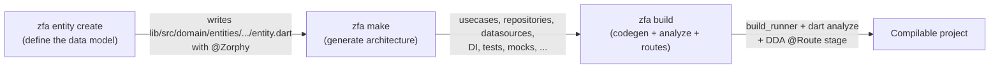

Zuraffa v7 standardizes all code generation around one linear three-command workflow: `zfa entity create` → `zfa make` → `zfa build`. Each command has a single responsibility — define the data model, generate the architecture around it, and compile/verify the result — so that both humans and AI agents can reason about a change one stage at a time. `zfa feature scaffold` still exists, but only as a wrapper over the normalized feature preset; `zfa make` is the primary generation surface.

Sources: [README.md](README.md#L10-L16), [README.md](README.md#L77-L115), [CLI_GUIDE.md](CLI_GUIDE.md#L1-L12)

## Workflow at a Glance

The three commands form a pipeline where each stage consumes the output of the previous one. Nothing downstream can run without the entity, and nothing is considered complete until `zfa build` proves it compiles.



The pipeline rule for humans and agents is simple: if a new entity is needed, use `zfa entity create`; if the architecture skeleton needs to exist or change, use `zfa make`; if generated annotations or build outputs need to be finalized, use `zfa build`. Zuraffa owns the architecture skeleton, so hand-written boilerplate is not required.

Sources: [README.md](README.md#L77-L115), [SKILL.md](SKILL.md#L25-L42)

## Step 1 — `zfa entity create`: Define Your Data Model

The entity step creates a Zorphy-annotated immutable data class at `lib/src/domain/entities/{entity_snake}/{entity_snake}.dart`. This file is the foundation of the entire pipeline — `zfa make` fails fast when the entity source is missing, and `zfa build` has nothing to generate from without it.

```bash
zfa entity create -n Product \
  --field id:String \
  --field name:String \
  --field price:double \
  --field description:String?
```

Common options:

| Option | Purpose |
|---|---|
| `-n, --name` | Entity name in PascalCase |
| `--field <name>:<type>` | Field with a Dart type (`?` suffix for nullable) |
| `--fields` | Comma-separated field shorthand |
| `--sealed` | Sealed class for polymorphism |
| `--non-sealed` | Non-sealed abstract class |
| `--kind=value_object` | Value object (immutable composition type, no identity required) |
| `--auto-id` | Auto-generate a `String id` defaulting to `Uuid().v4()` |
| `--allow-forward-refs` | Allow fields referencing entities not yet created (cyclic graphs) |
| `--json=false` | Disable JSON serialization |

A few rules govern this step. Every entity needs a real identity (`id` or `*Id` field) unless you pass `--auto-id` or mark it `--kind=value_object`; value objects are skipped by the root plugins (repository, usecase, controller, …) with a notice, since they are embedded types. Field types are validated before writing — primitives, existing entities, and existing enums are accepted, while unknown types are refused (issue #296). Pass `--allow-forward-refs` when generating cyclic schemas such as `Order ↔ Customer`. The command is convergent: if the entity file already exists, the run is a no-op rather than clobbering hand edits.

Sources: [CLI_GUIDE.md](CLI_GUIDE.md#L33-L140), [README.md](README.md#L79-L89), [lib/src/commands/entity_command.dart](lib/src/commands/entity_command.dart#L256-L457)

### What It Produces

```text
lib/src/domain/entities/
└── product/
    ├── product.dart          # @Zorphy annotated source
    ├── product.zorphy.dart   # Generated implementation (copyWith, compareTo, ...)
    └── product.g.dart        # JSON serialization (when --json enabled)
```

The `.dart` file carries the `@Zorphy` annotation — that is the signal `zfa build` uses to know which files need code generation. A generation receipt (schema `proof.v1`) is also written to `.zfa/receipts/`, binding the artifact to the command, version, and SHA-256 of the bytes on disk.

Sources: [README.md](README.md#L148-L158), [README.md](README.md#L193-L230)

## Step 2 — `zfa make`: Generate Architecture Code

The make step generates the full architecture around an entity using a plugin-based pipeline. Each plugin is a focused generator (usecase, repository, datasource, provider, …); `zfa make` resolves a normalized plan from CLI flags, presets, and `.zfa.json` defaults, then executes the active plugins in dependency order inside a transactional file writer.

```bash
zfa make Product \
  --preset=crud \
  --methods=get,getList,create,update,delete \
  --with=vpc \
  --state \
  --di \
  --test
```

### Presets

Presets expand to a fixed plugin list. They are the recommended starting point for beginners.

| Preset | Plugins |
|---|---|
| `crud` | usecase, repository, datasource, mock, di |
| `read-only` | usecase, repository, datasource, mock, di |
| `feature` | usecase, repository, datasource, view, presenter, controller, state, di, test |
| `engine` | usecase, service, provider, repository, datasource, mock, di, test |
| `service-feature` | service, provider, usecase, view, presenter, controller, state, di, test |
| `adaptive-feature` | usecase, repository, datasource, view, presenter, controller, state, di, test, route |
| `platform-feature` | usecase, repository, datasource, view, presenter, controller, state, di, test, route |
| `module` | module (FeaturePlugin orchestrator, no backing entity) |

The `engine` preset is pure Dart — it drops every Flutter-importing presentation plugin and is intended for data-layer slices. The `module` preset emits only the feature orchestrator and is treated as `--no-entity`.

Sources: [lib/src/core/planning/preset_registry.dart](lib/src/core/planning/preset_registry.dart#L1-L127), [README.md](README.md#L91-L105)

### Common Flags

| Flag | Purpose |
|---|---|
| `--preset=<name>` | Expand a preset into its plugin list |
| `--with=<plugin>` | Add plugins or aliases (repeatable) |
| `--without=<plugin>` | Exclude plugins or aliases (repeatable) |
| `--vpc` / `--vpcs` | Generate the full View-Presenter-Controller set |
| `--state` | Generate state classes |
| `--data` | Generate the data layer |
| `--route` | Generate route definitions |
| `--mock` | Generate mock data |
| `--test` | Generate tests |
| `--cache` | Enable caching |
| `--sqlite` | Generate a SQLite-backed local datasource |
| `--sync` | Enable offline-first sync |
| `--methods=<m1,m2>` | Entity methods to generate (e.g. `get,getList,create,update,delete`) |
| `--no-entity` | Skip the entity-exists guard (generate code without a backing entity) |
| `--plan` / `--explain` | Print the normalized execution plan and exit |
| `--dry-run` | Preview without writing files |
| `--force` | Overwrite existing files |
| `--compile-only` | Skip the mocked tier (compile-green, not demo-green) |

Configuration defaults come from `.zfa.json`: if no flags select plugins and the config enables none, the run exits with a usage error naming `--preset=crud` as the remedy. Pass `--plan` or `--explain` to inspect the resolved plan before writing anything.

Sources: [lib/src/commands/make_command.dart](lib/src/commands/make_command.dart#L209-L360), [lib/src/commands/make_command.dart](lib/src/commands/make_command.dart#L640-L700), [CLI_GUIDE.md](CLI_GUIDE.md#L44-L52)

### One-Shot Engine Mode

For pure-Dart data layers, the `engine` token chains entity creation through plugin execution in one command:

```bash
zfa make engine Login \
  --methods=get,getList,create,update,delete
```

This auto-creates the entity if it is missing, runs the engine plugin chain, certifies mocks, runs engine verification, and writes an `engine.receipt.json`. The engine slice is pure Dart — no Flutter-importing plugins are allowed.

Sources: [lib/src/commands/make_command.dart](lib/src/commands/make_command.dart#L598-L700), [lib/src/core/planning/preset_registry.dart](lib/src/core/planning/preset_registry.dart#L12-L28)

### How Make Resolves What to Generate

`zfa make` does not run every plugin blindly. It resolves a normalized execution plan:

1. **Plugin selection** — from explicit CLI arguments, preset expansion, or `.zfa.json` config defaults.
2. **Plan resolution** — `PluginManager.resolvePlan()` normalizes all sources into a definitive active plugin list, warning on conflicts.
3. **Pre-flight guard** — verifies the entity source file exists (unless `--no-entity` or engine mode). Fails fast before any code is written.
4. **ID field resolution** — auto-detects the entity's identity field from the source instead of hardcoding `id`, so entities with custom key fields get correct signatures.
5. **Value object detection** — if the entity is a value object, root plugins are dropped with a notice.
6. **Plugin execution** — `manager.run(context, activePlugins)` runs each plugin in dependency order within a transactional file writer.
7. **Post-passes** — usecase expectation verification, provider conformance gate, pubspec sync (auto-adding undeclared dependencies), and mock certification in the mocked tier.

Sources: [lib/src/commands/make_command.dart](lib/src/commands/make_command.dart#L640-L790), [README.md](README.md#L91-L105)

### Mocked vs. Compile-Only Tier

`zfa make` defaults to the **mocked** tier: it emits a certified mock datasource so the slice boots on certified mocks under `--dart-define=SIMULATION=true` before any real adapter is written. Pass `--compile-only` for a slice that is compile-green but not demo-green (no mocked tier). Swapping certified mocks to real implementations is the job of `zfa tdd realize`.

Sources: [lib/src/commands/make_command.dart](lib/src/commands/make_command.dart#L370-L385), [lib/src/commands/make_command.dart](lib/src/commands/make_command.dart#L960-L1010)

## Step 3 — `zfa build`: Compile and Verify

The build step runs code generation (`build_runner`), static analysis (`dart analyze`), and DDA route compilation. It is the verification gate that proves the pipeline's output is compilable. Use `zfa build` instead of calling `build_runner` directly.

```bash
zfa build
```

Common options:

| Option | Purpose |
|---|---|
| `--clean` / `-c` | Delete the build cache first (fixes stale cache errors) |
| `--dry-run` | Preview without writing files |
| `--force` | Bypass AST merge and regenerate all files from scratch |
| `--analyze` / `--no-analyze` | Run `dart analyze` after build (default on) |
| `--dda-routes` / `--no-dda-routes` | Run the DDA `@Route` stage (default on) |
| `--dda-routes-only` | Run only the DDA `@Route` stage |
| `--flavor=<name>` | Build a named feature flavor |

The build pipeline runs these stages in order: DDA `@Route` stage first (fail fast on route misconfigurations), then Slang codegen when translation sources exist, then `build_runner`, then the Hive registrar refresh, then `dart analyze` (unless `--no-analyze`), with tracked-generated-output recovery (spec 1540) to restore git-tracked generated-name files that the build deleted.

Sources: [lib/src/commands/build_command.dart](lib/src/commands/build_command.dart#L1-L50), [lib/src/commands/build_command.dart](lib/src/commands/build_command.dart#L60-L140), [lib/src/commands/build_command.dart](lib/src/commands/build_command.dart#L290-L490)

## Exit Codes and Machine Verdicts

Zuraffa uses a ratified exit-code protocol so agents never parse prose. The canonical codes are `0` success, `1` failure/RED, `2` usage error, `3` contract/spec drift, and `4` state conflict. Every non-zero exit ends with a machine-actionable `--> fix:` line. JSON mode (`--format=json` / `--json`) emits the `zuraffa.verdict.v1` envelope, and generated artifacts carry `proof.v1` receipts under `.zfa/receipts/`.

Sources: [lib/src/cli/exit_protocol.dart](lib/src/cli/exit_protocol.dart#L1-L88), [docs/openwiki/cli.md](docs/openwiki/cli.md#L1-L8)

## Convergence and Safety

The workflow is designed to be idempotent and safe to re-run. `zfa entity create` is convergent (no-op when the file exists). `zfa make` runs inside a transactional file writer and supports `--revert` to delete generated files. `zfa build` performs a tracked-generated-output recovery pass that restores git-tracked generated-name files deleted by the build, refusing to report success when restoration fails. Every artifact carries a `proof.v1` receipt so generation can be audited after the fact.

Sources: [lib/src/commands/entity_command.dart](lib/src/commands/entity_command.dart#L457-L470), [lib/src/commands/make_command.dart](lib/src/commands/make_command.dart#L209-L220), [lib/src/commands/build_command.dart](lib/src/commands/build_command.dart#L340-L400), [README.md](README.md#L193-L230)

## Common Recipes

```bash
# Standard CRUD slice with presentation layer
zfa make Product --preset=crud --with=vpc --state --test

# Pure-Dart data layer (one shot)
zfa make engine Login --methods=get,getList,create,update,delete

# Inspect the plan before writing anything
zfa make Product --preset=crud --plan

# Preview a build without writing
zfa build --dry-run

# Clean rebuild after stale cache errors
zfa build --clean
```

Sources: [README.md](README.md#L77-L115), [CLI_GUIDE.md](CLI_GUIDE.md#L20-L32)

## Troubleshooting

| Symptom | Likely cause | Remedy |
|---|---|---|
| `Cannot run zfa make ... no entity source file` | Entity was never created | Run `zfa entity create -n <Name>` first (or pass `--no-entity`) |
| `No active plugins to run` | No flags and `.zfa.json` enables none | Pass `--preset=crud` or `--with=<plugin>` |
| `zfa build` reports success but 0 outputs | `build.yaml` missing the zorphy builder | Run `zfa build` again (self-healing preflight) or `zfa doctor` |
| Stale cache errors | Leftover build cache | `zfa build --clean` |
| Missing dependencies (`zuraffa`, `zorphy_annotation`) | Project not opted into Zuraffa | Run `zfa doctor` / `zfa config init` |

Sources: [lib/src/commands/make_command.dart](lib/src/commands/make_command.dart#L700-L720), [lib/src/commands/build_command.dart](lib/src/commands/build_command.dart#L140-L180), [CLI_GUIDE.md](CLI_GUIDE.md#L14-L32)

## Next Steps

- [Project Layout & Fixed Architecture Root](5-project-layout-and-fixed-architecture-root) — where every generated file lands.
- [Configuration & Project Memory](6-configuration-and-project-memory) — `.zfa.json` defaults and `.zfa/` memory.
- [Entity & Zorphy Model](11-entity-and-zorphy-model) — deeper entity authoring.
- [Code Generation Pipeline](9-code-generation-pipeline) — how `make` resolves and executes plugins.
- [Running Tests & Local CI](7-running-tests-and-local-ci) — verifying generated code.