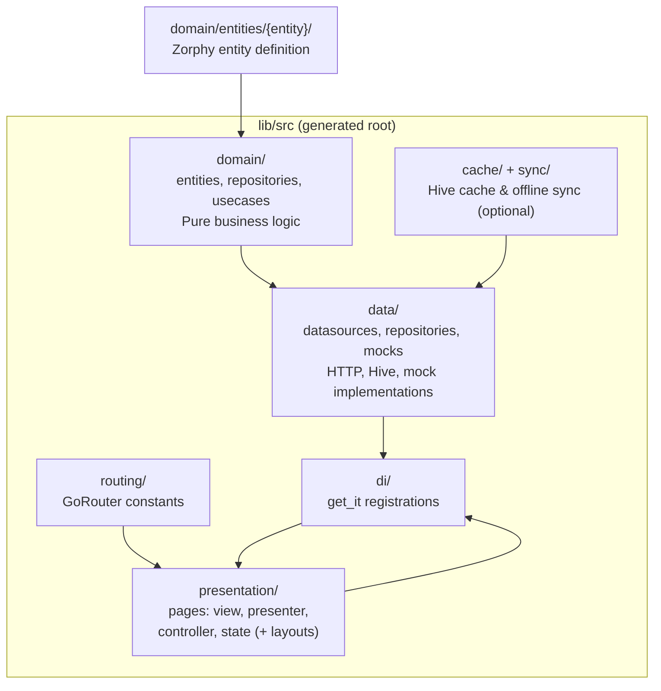

This page is your map of where Zuraffa puts things. Zuraffa has two layouts you need to keep separate: the **framework repository** (the `zuraffa` package itself) and the **generated app** (the `lib/src` tree that `zfa make` writes into your Flutter/Dart project). The single most important rule is that the generated architecture lives under one hard-coded root — `lib/src` — so that every file is predictable, every tool can reason about it, and you never have to configure where feature code goes.

## Why a Fixed Root Matters

Zuraffa's central convention is **consistency over configuration**. The output directory is a constant in the generator, not a setting you change per project:

```dart
static const String fixedOutputDir = 'lib/src';
```

Because `lib/src` is the only architecture root, three things become possible. First, **deterministic generation**: the same `zfa make Product` invocation always produces files at the same paths, so regeneration and diffing are reliable. Second, **agent predictability**: an AI agent (or a teammate) can reason about where `ProductRepository` or `product_view.dart` lives without reading configuration. Third, **tooling and proofs**: commands like `zfa proof check lib/src` walk a known tree, and the regression suite asserts that generated files appear at exact paths. If you let each project pick its own root, none of those guarantees hold.

Sources: [lib/src/models/generator_config.dart](lib/src/models/generator_config.dart#L13-L14), [README.md](README.md#L133-L160), [AGENTS.md](AGENTS.md#L123-L135)

## The Fixed Architecture Root: `lib/src`

Every generated file lands under `lib/src`. Inside it, Zuraffa organizes code by **concern area** — six top-level folders that mirror Clean Architecture's separation of business rules from UI and storage:

```text
lib/src/
├── data/              # Data layer (datasources, repositories, mocks)
├── di/                # Dependency injection wiring (get_it)
├── domain/            # Pure business logic (entities, repositories, use cases)
│   ├── entities/      # Zorphy entities (generated)
│   ├── repositories/  # Repository interfaces / implementations
│   └── usecases/      # Business logic (UseCase, StreamUseCase)
├── presentation/      # UI layer (views, presenters, controllers, state)
├── routing/           # GoRouter constants and per-entity routes
├── cache/             # Hive cache adapters (only with --cache)
└── sync/              # Offline-first sync metadata (only with --sync)
```

The dependency direction matters: **domain knows nothing about data or presentation**. The domain layer declares abstract contracts (repository interfaces, use cases); the data layer implements them; the presentation layer consumes them through the DI layer, which wires concrete implementations together at runtime. `cache/` and `sync/` are conditional — they appear only when you pass `--cache` or `--sync` — but when they do, they still live under the same fixed root.

Sources: [README.md](README.md#L133-L160), [example/lib/src](example/lib/src)



Sources: [example/lib/src/di/index.dart](example/lib/src/di/index.dart#L1-L16), [example/lib/src/domain/entities/todo/todo.dart](example/lib/src/domain/entities/todo/todo.dart#L1-L13)

## Where Entity Files Must Live

Entity source files have a single, enforced location. This is the one path rule you should memorize:

```text
lib/src/domain/entities/{entity_snake}/{entity_snake}.dart
```

For example, a `Product` entity lives at `lib/src/domain/entities/product/product.dart`. The snake-case folder and the snake-case file name are both derived from the entity name. This rule is not a style preference — it is what the generators, the entity commands, and the regression tests all assume. If you hand-create an entity, put it here; if you use `zfa entity create`, the tool puts it here for you.

Sources: [README.md](README.md#L148-L158), [AGENTS.md](AGENTS.md#L125-L135), [lib/src/models/generator_config.dart](lib/src/models/generator_config.dart#L13-L14)

## Repository Top-Level Layout (the framework and your project)

Whether you are browsing the `zuraffa` package itself or a generated app, the top-level shape is the same set of concerns. The table below describes the framework repository; a consuming app mirrors the subset it needs (`lib/`, `test/`, `bin/`, etc.):

| Directory | Purpose |
|---|---|
| `bin/` | CLI executables (`zfa.dart`, `zuraffa.dart`, `zuraffa_mcp_server.dart`) |
| `lib/` | All framework source code (the core package) |
| `test/` | Unit, integration, regression, and plugin test suites |
| `example/` | A Flutter app demonstrating the TDD cycle |
| `examples/` | Standalone example packages (gym templates, MCP demo, etc.) |
| `doc/` | Architecture docs, ADRs, guides |
| `docs/` | Auto-generated documentation (TDD guide, migration guides) |
| `specs/` | Feature specifications driving the TDD cycle |
| `corpus/` | Spec corpus for TDD automation |
| `.specify/` | Spec Kit state, memory, and workflow configuration |
| `.zfa/` | Runtime receipts and state for the TDD engine |
| `.gym/` | Gym training exercises and fixtures |
| `scripts/` | Shell scripts for build, test, and deployment automation |
| `tools/` | Dart scripts for corpus generation and probing |
| `.github/` | CI workflows, issue templates, and PR templates |

Sources: [website/static/docs/3-project-architecture-and-layout.md](website/static/docs/3-project-architecture-and-layout.md#L5-L25), [pubspec.yaml](pubspec.yaml#L1-L104)

## Three CLI Entry Points

Zuraffa ships three compiled binaries, all delegating to the same runner. You almost always want `zfa`:

| Binary | Source | Primary Audience |
|---|---|---|
| `zfa` | `bin/zfa.dart` → `lib/src/zfa_cli.dart` | Developers and AI agents driving the TDD cycle |
| `zuraffa` | `bin/zuraffa.dart` → `lib/src/zfa_cli.dart` | Legacy alias for the same runner |
| `zuraffa_mcp_server` | `bin/zuraffa_mcp_server.dart` | MCP clients (e.g., Claude) via the Model Context Protocol |

Sources: [bin/zfa.dart](bin/zfa.dart#L1-L13), [lib/src/zfa_cli.dart](lib/src/zfa_cli.dart#L1-L15)

## Core Library Barrel Structure

The `zuraffa` package splits its public surface into dedicated barrel files so that capability domains do not collide. Import the one you need:

| Barrel File | Scope | Import Path |
|---|---|---|
| `lib/zuraffa.dart` | Default barrel — core framework, DI, state, sync, params, plugins | `package:zuraffa/zuraffa.dart` |
| `lib/agent.dart` | Agent runtime (kernel, policy, ui_render, runtime plugin) | `package:zuraffa/agent.dart` |
| `lib/mock.dart` | Native mocking framework | `package:zuraffa/mock.dart` |
| `lib/simulation.dart` | Simulation flavor and world machinery | `package:zuraffa/simulation.dart` |
| `lib/skin.dart` | Skin contract auditor and UI layer generation | `package:zuraffa/skin.dart` |
| `lib/zap.dart` | ZAP agent protocol (messages, host, client, conformance) | `package:zuraffa/zap.dart` |

The default barrel (`lib/zuraffa.dart`) re-exports the whole framework surface — Result types, the failure hierarchy, UseCase patterns, params, hooks, sync strategies, cache policies, the plugin system, and more. The dedicated barrels keep agent, mock, simulation, skin, and ZAP code out of the default import path.

Sources: [lib/zuraffa.dart](lib/zuraffa.dart#L1-L200), [lib/agent.dart](lib/agent.dart#L1-L24), [lib/mock.dart](lib/mock.dart#L1-L6), [lib/simulation.dart](lib/simulation.dart#L1-L30), [lib/skin.dart](lib/skin.dart#L1-L19), [lib/zap.dart](lib/zap.dart#L1-L57)

## What `zfa make` Produces Under `lib/src`

A single `zfa make Product --preset=feature` expands into a consistent subtree. The `feature` preset bundles use case, repository, datasource, view, presenter, controller, state, DI, and test; `adaptive-feature` also adds a `layouts/` folder. Below is the shape for one entity, with each folder's role:

```text
lib/src/
├── domain/
│   ├── entities/product/          # product.dart (hand), product.zorphy.dart, product.g.dart
│   ├── repositories/              # product_repository.dart (abstract contract)
│   └── usecases/product/          # get_product_usecase.dart, create_product_usecase.dart, …
├── data/
│   ├── datasources/product/       # product_datasource.dart, *_remote/local/mock_datasource.dart
│   ├── repositories/              # data_product_repository.dart (implements contract)
│   └── mock/                      # product_mock_data.dart
├── presentation/pages/product/    # product_view.dart, presenter, controller, state
│   └── layouts/                   # only with adaptive/platform presets
├── di/                            # service_locator.dart, datasources/, repositories/, usecases/
├── routing/                       # app_routes.dart, product_routes.dart, index.dart
├── cache/                         # only with --cache
└── sync/                          # only with --sync
```

Two points of emphasis. First, the **entity folder** (`domain/entities/product/`) holds three files with the same base name: the hand-written `product.dart` (your source of truth), `product.zorphy.dart` (the generated immutable class), and `product.g.dart` (JSON serialization). Second, the **presentation folder** always contains four coordinated files — view, presenter, controller, and state — produced by the `vpc` alias plus `--state`. Layouts appear only when you opt into adaptive/platform presets.

Sources: [example/lib/src](example/lib/src), [lib/src/core/planning/preset_registry.dart](lib/src/core/planning/preset_registry.dart#L1-L85), [lib/src/core/planning/plugin_alias_resolver.dart](lib/src/core/planning/plugin_alias_resolver.dart#L1-L55)

## Outside `lib/src`: Tests and Project Memory

Two important outputs live outside the feature root, and you should know where to find them:

- **Generated tests** go to `test/domain/usecases/{entity_snake}/` — one `*_test.dart` per use case, using `mocktail` to stub the repository and asserting success/failure branches.
- **Project memory** lives in `.zfa/` — `plans/`, `runs/`, `blueprints/`, `decisions/`, `manifests/`, `receipts/`, and `context.json`. Project defaults live separately in `.zfa.json`. Receipts (schema `proof.v1`) bind every generated file to the command and generator version that produced it.

Sources: [lib/src/plugins/test/builders/test_builder_custom.dart](lib/src/plugins/test/builders/test_builder_custom.dart#L13-L27), [README.md](README.md#L160-L185), [AGENTS.md](AGENTS.md#L152-L176)

## What Shapes the Layout: Presets, Aliases, and Flags

The exact folders you get depend on what you ask `zfa make` for. Presets bundle plugins into ready-made feature sets; aliases expand common combinations; individual flags toggle optional layers:

| Preset | Plugins included | Typical use |
|---|---|---|
| `crud` | usecase, repository, datasource | Backend-only skeleton |
| `feature` | crud + view, presenter, controller, state, di, test | Full stack UI feature |
| `adaptive-feature` | feature + route (enables layouts) | Multi-platform app |
| `platform-feature` | same as adaptive-feature | Alias-style variant |
| `service-feature` | service, provider + feature set | Service-driven features |
| `read-only` | usecase, repository, datasource | Get/watch only |

Aliases: `vpc` = view + presenter + controller; `data` = repository + datasource; `full-ui` adds state and route; `quality` bundles test, mock, and di. Flags like `--state`, `--di`, `--test`, `--cache`, `--sync`, and `--graphql` add the corresponding folders. With no optional flags, you get only the preset's core layers.

Sources: [lib/src/core/planning/preset_registry.dart](lib/src/core/planning/preset_registry.dart#L1-L85), [lib/src/core/planning/plugin_alias_resolver.dart](lib/src/core/planning/plugin_alias_resolver.dart#L1-L55)

## Next Steps

You now know *where* generated code lives. The natural next questions are *how it got there* and *how the pieces behave at runtime*:

- **[Code Generation Pipeline](9-code-generation-pipeline)** — trace how `zfa make` turns flags into the file tree you just explored.
- **[Plugin System & Manifest](10-plugin-system-and-manifest)** — each folder in the layout is produced by a dedicated plugin; learn how they cooperate.
- **[Entity & Zorphy Model](11-entity-and-zorphy-model)** — the three-file entity pattern under `domain/entities/`.
- **[Domain Layer & Use Cases](12-domain-layer-and-use-cases)** — what lives in `domain/`.
- **[Data Layer & Repositories](13-data-layer-and-repositories)** — the datasource and repository implementations.
- **[Presentation Layer & State](14-presentation-layer-and-state)** — the runtime behavior behind the `pages/` folder.
- **[Configuration & Project Memory](6-configuration-and-project-memory)** — `.zfa.json` and the `.zfa/` memory model.