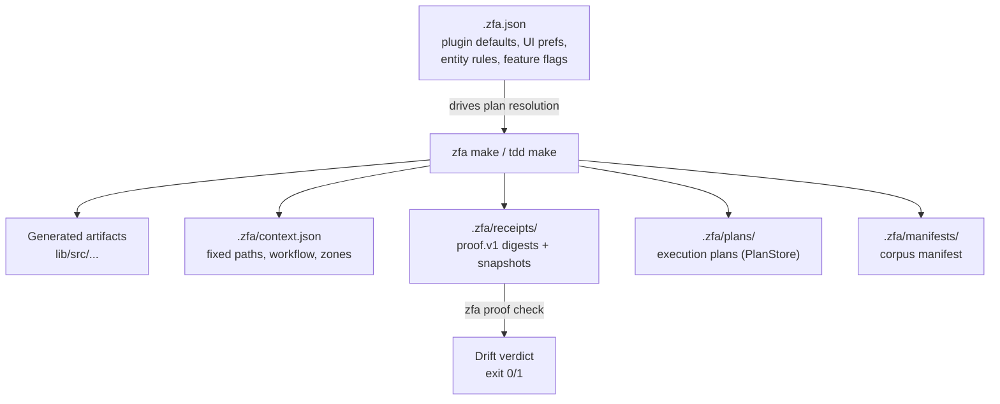

Zuraffa separates **project defaults** from **project memory**. `.zfa.json` at the project root declares what the project generates by default; the `.zfa/` directory is the canonical, machine-readable memory of what has been planned, generated, and decided over time. Together they let agents and humans reproduce builds, detect drift, and resume work across sessions.

Sources: [README.md](README.md#L162-L196), [AGENTS.md](AGENTS.md#L212-L232)

## Architecture Overview

The configuration layer is static intent; the memory layer is append-only provenance. `zfa make` is the bridge: it reads `.zfa.json` for plugin defaults, writes artifacts, and persists both a `ProjectContextStore` snapshot and a `proof.v1` receipt under `.zfa/`.



Sources: [ZfaConfig](lib/src/config/zfa_config.dart#L1-L120), [ProjectContextStore](lib/src/core/project/project_context_store.dart#L1-L99), [ReceiptStore](lib/src/core/project/receipt_store.dart#L248-L300), [PlanStore](lib/src/core/plugin_system/plan_store.dart#L1-L75), [ProjectPaths](lib/src/core/project/project_paths.dart#L1-L35)

## `.zfa.json` — Configuration Schema

`.zfa.json` is a JSON document parsed and serialized by `ZfaConfig` (`lib/src/config/zfa_config.dart`). All write paths (`config init`, `config set`, `make`) round-trip through this class, so the file is the single source of truth for project defaults.

| Section | Purpose | Key fields |
|---------|---------|------------|
| `mocking` | Canonical mock library signature | `library`, `import`, `marker`, `mockSources` |
| `plugins` | Default plugin enablement | `defaults` (plugin id → bool), `disabled` (list) |
| `planning` | Presets and aliases | `presets`, `aliases` (name → list of plugin ids) |
| `ui` | Adaptive layout preferences | `adaptiveLayouts`, `platformShells`, `layoutTargets`, `adaptivePreset` |
| `entity` | Entity-generation behavior | `entityFirst`, `jsonByDefault`, `compareByDefault`, `filterByDefault` |
| *top-level* | Build/format flags | `buildByDefault`, `formatByDefault` |
| *top-level (opt)* | Feature flags (raw) | `features`, `flavors` — preserved verbatim by `ZfaConfig` |
| *top-level (opt)* | TDD widget shell (raw) | `tdd` — carries `widgetShell` and `i18nExpansion` |

Sources: [ZfaConfig.fromJson](lib/src/config/zfa_config.dart#L334-L370), [ZfaConfig.toJson](lib/src/config/zfa_config.dart#L388-L434), [examples/todo_tdd/.zfa.json](examples/todo_tdd/.zfa.json#L1-L65)

### Plugin Defaults — The Clean-Architecture Tier

Issue #1496 established a two-tier model. After `zfa config init`, the default tier enables the clean-architecture stack so a bare `zfa make Product` scaffolds a runnable slice; the opt-in tier stays false and is enabled per project via `.zfa.json`, `--with=<plugin>`, or a preset.

| Plugin id | Default | Purpose |
|-----------|---------|---------|
| `repository` | true | Repository interface + implementation |
| `provider` | true | State management provider |
| `usecase` | true | Use case (interactor) |
| `presenter` | true | Presenter (MVVM) |
| `controller` | true | Controller (MVC) |
| `test` | true | Unit/integration test generation |
| `mock` | true | Mock data source / provider |
| `di` | true | Dependency injection wiring |
| `datasource` | true | Data source interface + impl |
| `service` | false | External service integration |
| `route` | true | Routing table |
| `cache` | true | Cache adapter |
| `method_append` | true | Method append capability |
| `view` | false | UI view layer |
| `feature` | false | Feature flag wiring |
| `state` | false | State management extras |
| `observer` | false | Observer pattern |
| `gym` | false | Gym/exercise scaffolding |
| `sqlite` | false | SQLite storage |
| `gql` / `graphql` | false | GraphQL client |
| `skin` | false | Skin contract |
| `xray` | false | XRay diagnostic overlay |
| `agent` | false | Agent plugin (dormant by default) |

Sources: [ZfaConfig._builtinPluginDefaults](lib/src/config/zfa_config.dart#L28-L60), [ZfaConfig.isPluginEnabledByDefault](lib/src/config/zfa_config.dart#L220-L225)

### Minimal Mode

`zfa config init --minimal` writes every plugin default as `false` — the pre-#1496 behavior — for teams that opt every default out and select plugins per command via `--preset=crud` or `--with=<plugin>`.

Sources: [ZfaConfig.minimal](lib/src/config/zfa_config.dart#L495-L499), [ConfigCommand._handleInit](lib/src/commands/config_command.dart#L58-L85)

## Configuration CLI

The `zfa config` command exposes four subcommands. Configuration keys fall into two families: top-level booleans (`buildByDefault`, `formatByDefault`, `filterByDefault`, `entityFirst`) and plugin-default keys derived by `ZfaConfig.pluginIdForConfigKey()` (e.g. `diByDefault` → `di`, `repositoryByDefault` → `repository`, `appendByDefault` → `method_append`).

| Subcommand | Behavior |
|------------|----------|
| `init [--minimal] [root]` | Creates `.zfa.json` with defaults; warns if an all-false config already exists |
| `show` / `get [root]` | Prints the resolved configuration as pretty JSON |
| `set <key> <value>` | Updates one key and persists; refuses to overwrite unparseable files |
| `help` | Prints usage |

Sources: [ConfigCommand.execute](lib/src/commands/config_command.dart#L10-L210), [ConfigCommand._supportedKeys](lib/src/commands/config_command.dart#L200-L213), [ZfaConfig.unparseableConfigMessage](lib/src/config/zfa_config.dart#L317-L332)

## `.zfa/` — Canonical Project Memory Layout

`ProjectPaths` (`lib/src/core/project/project_paths.dart`) is the single source of truth for the `.zfa/` directory shape. The layout is the public documentation contract; individual subsystems populate the subdirectories.

```text
.zfa/
├── plans/
├── runs/
├── blueprints/
├── decisions/
├── manifests/
├── receipts/
├── context.json
└── AGENT_CONTRACT.md   (reserved path)
```

| Path | Purpose | Writer / reader |
|------|---------|-----------------|
| `plans/` | Stored execution plans | `PlanStore` (save/load/delete) |
| `runs/` | Run records | Declared by `ProjectPaths.runFile()` |
| `blueprints/` | Blueprint artifacts | `ProjectArtifactStore` (blueprints) |
| `decisions/` | Decision artifacts | `ProjectArtifactStore` (decisions) |
| `manifests/` | Corpus manifest and related ledgers | `CorpusManifest` (read/write `corpus-manifest.json`) |
| `receipts/` | `proof.v1` generation receipts | `ReceiptStore` (save/loadAll) |
| `context.json` | Fixed paths, workflow, generated/manual zones | `ProjectContextStore` (default context on `make`) |
| `AGENT_CONTRACT.md` | Reserved agent contract path | Declared only; no writer exists today |

Sources: [ProjectPaths](lib/src/core/project/project_paths.dart#L1-L35), [PlanStore](lib/src/core/plugin_system/plan_store.dart#L1-L75), [ProjectArtifactStore](lib/src/core/project/project_artifact_store.dart#L1-L68), [CorpusManifest](lib/src/core/project/corpus_manifest.dart#L1-L105), [ReceiptStore](lib/src/core/project/receipt_store.dart#L248-L423), [ProjectContextStore](lib/src/core/project/project_context_store.dart#L1-L99)

### Project Context (`context.json`)

On a completed `make` run, `ProjectContextStore.save()` writes the default v5 agent contract context: fixed domain root (`lib/src/domain`), entity output (`lib/src/domain/entities`), Zorphy-only assumption, the required workflow (`zfa entity create` → `zfa make` → `zfa build`), and the generated vs. manual zones. Agents read this to know which directories are generated and which are hand-edited.

Sources: [ProjectContextStore.defaultContext](lib/src/core/project/project_context_store.dart#L60-L99), [PluginManager context save](lib/src/core/plugin_system/plugin_manager.dart#L798-L810)

## `.zfa/receipts/` — Proof Records

The receipts directory is the **project memory core**. Every generation run writes one JSON document with schema `proof.v1`. The store is append-only by default, with stable (last-write-wins) names available for per-entity/per-plugin surfaces.

### Receipt Naming

Two naming schemes coexist:

1. **Timestamped** (default): `{ISO8601stamp}-{command}-{target}.json` — e.g. `2026-09-16T01-37-55.097187Z-tdd_make-A8.json`. Colons are replaced with `-` for Windows portability. Append-only history.
2. **Stable** (per-entity/per-plugin): `{name}.json` — e.g. `mock-<entity>.json`, `provider-<entity>.json`, `routes-<entity>.json`, `state-<entity>.json`. Regeneration supersedes the previous document in place (last-write-wins).

Sources: [ReceiptStore.save](lib/src/core/project/receipt_store.dart#L274-L300), [ReceiptStore.saveNamed](lib/src/core/project/receipt_store.dart#L350-L361), [ReceiptStore.saveAs](lib/src/core/project/receipt_store.dart#L325-L332)

### Receipt Schema (`proof.v1`)

| Field | Type | Description |
|-------|------|-------------|
| `schema` | string | Always `"proof.v1"` |
| `command` | string | The generation command (e.g. `tdd gen`, `tdd make`) |
| `target` | string | What the run was about (usually an entity name or behavior id) |
| `repro` | string | One-line command a human/agent can paste to reproduce |
| `at` | string (ISO8601) | UTC timestamp of the run |
| `generator_version` | string | Template/generator version that produced the artifacts |
| `input` | object | Input context (flags, fields, plugin ids, feature name) |
| `spec` | object (opt) | The spec the run consumed: `{path, sha256, snapshot?}` |
| `files` | array | Each artifact: `{path, action, sha256, bytes, snapshot?}` |
| `plugin` | string (opt) | Plugin id for standalone capability receipts |
| `capability` | string (opt) | Capability name (`create`, `adapter`, `enable`, ...) |
| `entity` | string (opt) | Entity the capability operated on |
| `methodset` | array (opt) | Method list the invocation wired |
| `hash` | string (opt) | SHA-256 run digest binding entity + methodset + file tuples |
| `receipt_version` | int | Machine schema version (currently 1) |
| `min_core_version` | string (opt) | Oldest core the artifacts are guaranteed to compile against |
| `generated_against_core` | string (opt) | Core version actually resolved and generated against |

Sources: [GenerationReceipt](lib/src/core/project/receipt_store.dart#L94-L192), [GenerationReceipt.fromJson](lib/src/core/project/receipt_store.dart#L194-L228), [sample receipt](.zfa/receipts/2026-09-16T01-37-55.097187Z-tdd_make-A8.json#L1-L23)

### Snapshot Strategy

Artifacts at or below 16 KB keep a full content `snapshot` in their receipt entry, enabling precise line-level drift diffs. Larger artifacts verify by digest only.

Sources: [ReceiptStore.maxSnapshotBytes](lib/src/core/project/receipt_store.dart#L252-L255)

### Corruption Handling

`ReceiptStore.loadAll()` skips corrupted documents rather than failing — one broken receipt must not erase the provenance of every healthy artifact. Records are sorted oldest-first with ties broken by filename for deterministic latest-wins indexing.

Sources: [ReceiptStore.loadAll](lib/src/core/project/receipt_store.dart#L363-L403)

## Configuration ↔ Receipts Coupling

The configuration declares intent; the receipts record provenance. The coupling point is `zfa proof check`, which:

1. Loads every receipt via `ReceiptStore.loadAll()`
2. For each `(path, action, sha256)` tuple, re-derives the SHA-256 from the current filesystem
3. Fails on any artifact whose digest no longer matches, naming the exact delta
4. Cross-checks the `spec.sha256` binding — if the spec changed, the artifact is stale

Changing `.zfa.json` plugin defaults does **not** invalidate existing receipts (configuration is not an artifact), but changing an entity spec **does** — the spec digest is bound at generation time.

Sources: [ReceiptStore.latestForPath](lib/src/core/project/receipt_store.dart#L405-L418), [PluginManager._persistGenerationReceipt](lib/src/core/plugin_system/plugin_manager.dart#L806-L860), [PluginManager._entitySpecReceipt](lib/src/core/plugin_system/plugin_manager.dart#L862-L885)

## Speckit Memory (Separate Surface)

Speckit keeps its own project memory under `.specify/memory/` — `constitution.md`, `tdd-profile.md`, and md-doctor state. This is the spec-driven development surface, distinct from Zuraffa's runtime project memory in `.zfa/`. Treat `.specify/` as the TDD/spec contract layer and `.zfa/` as the generation/provenance layer.

Sources: [.specify/memory/constitution.md](.specify/memory/constitution.md#L1-L51), [ProjectContextStore](lib/src/core/project/project_context_store.dart#L1-L99)

## Next Steps

- **[Canonical CLI Workflow](4-canonical-cli-workflow)** — the entity → make → build pipeline that writes this memory
- **[Project Layout & Fixed Architecture Root](5-project-layout-and-fixed-architecture-root)** — where `.zfa.json` and `.zfa/` sit relative to `lib/src/domain`
- **[Code Generation Pipeline](9-code-generation-pipeline)** — how the engine produces receipts and provenance
- **[Proof & Provenance](17-proof-and-provenance)** — `zfa proof check` and the proof chain
- **[TDD & Spec-Driven Loop](16-tdd-and-spec-driven-loop)** — how TDD writes `tdd gen` / `tdd make` receipts
- **[Running Tests & Local CI](7-running-tests-and-local-ci)** — validate generated code before merging