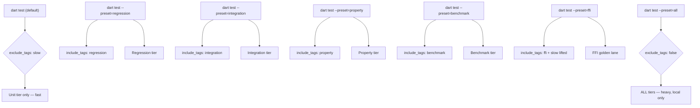
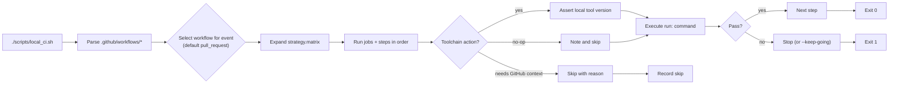

Zuraffa's validation story has two layers: a **multi-tier Dart test suite** (`dart_test.yaml`) that you run with ordinary `dart test` commands, and a **local CI runner** (`scripts/local_ci.sh`) that replays the exact job graph from `.github/workflows/*` on your own machine. This page is the operational manual for both — which commands to run, which tier to target, how to keep a small disk alive, and how to get a real answer to "is CI green?" when you have no GitHub Actions budget.

Sources: [dart_test.yaml](dart_test.yaml#L1-L128), [scripts/local_ci.sh](scripts/local_ci.sh#L1-L40), [test/README.md](test/README.md#L1-L40)

## Test Tiers and Selection

Tests are partitioned into a fast default tier plus four slow tiers. The default `dart test` invocation runs only the fast unit tier; every slow test also carries the `slow` tag, which `dart_test.yaml` excludes globally via `exclude_tags: slow`.

| Tier | Tag | Primary folders | Speed | Selection |
|---|---|---|---|---|
| unit (default) | — | `core`, `plugins`, `commands`, `state`, `graphql`, `config`, `domain`, `dda`, `cli`, `utils` | fast | `dart test` |
| regression | `regression` | `test/regression` | slow (E2E codegen) | `--preset=regression` |
| integration | `integration` | `test/integration` | slow (spawns CLI) | `--preset=integration` |
| property | `property` | `test/property` | slow | `--preset=property` |
| benchmark | `benchmark` | `test/benchmark` | slow | `--preset=benchmark` |

A fifth weight tag, `e2e`, marks heavyweight suites that drive the real CLI against throwaway temp projects **without** carrying `slow`. They stay honest under a direct `dart test <file>` invocation, but CI's fast lane excludes them with `--exclude-tags "flutter || e2e"`. The `ffi` preset is a dedicated lane (`include_tags: ffi`, with the `slow` exclusion lifted) used by the FFI golden fixture job.

Sources: [test/README.md](test/README.md#L9-L30), [dart_test.yaml](dart_test.yaml#L9-L25), [dart_test.yaml](dart_test.yaml#L95-L128)

### Tier Selection Logic



Sources: [dart_test.yaml](dart_test.yaml#L64-L90), [dart_test.yaml](dart_test.yaml#L95-L128)

## Running the Fast Suite

The fast tier is what CI and cloud agents run, and the tier to use for routine validation. Run it as a single command:

```bash
dart test
```

Target a semantic folder for fast feedback while working on one area:

```bash
dart test test/core
dart test test/plugins/route
dart test test/commands
dart test test/graphql
```

Run a single file:

```bash
dart test test/core/result_test.dart
```

For a Flutter-generation-only slice, use the Flutter SDK runner with the `flutter` tag (this is what CI's `test` job runs):

```bash
flutter test --tags flutter --coverage
```

Sources: [test/README.md](test/README.md#L38-L65), [.github/workflows/ci.yaml](.github/workflows/ci.yaml#L201-L209)

### Chunked Runner for Small Disks

A single `dart test test` invocation compiles the entire test tree's kernel into one cache that grows to roughly 6.5 GB (`.dart_tool/test/incremental_kernel.*` plus per-process `$TMPDIR/dart_test.kernel.*` / `/tmp/dart_test.kernel.*`). On a small disk that exhausts space and kills the run. Use the chunked runner instead — it runs the fast suite one folder at a time and clears the kernel cache between chunks:

```bash
tools/run_tests_chunked.sh
```

Preview the chunk list without running anything:

```bash
DRY_RUN=1 tools/run_tests_chunked.sh
```

Run a slice of the chunk list (1-based):

```bash
tools/run_chunks_range.sh 1 10
```

The chunked runner deliberately does **not** run `--preset=all`: the regression/integration/property/benchmark tiers spawn temp projects that run `dart pub get` + `build_runner` and fill several GB under `/tmp`.

Sources: [tools/run_tests_chunked.sh](tools/run_tests_chunked.sh#L1-L124), [tools/run_chunks_range.sh](tools/run_chunks_range.sh#L1-L46), [dart_test.yaml](dart_test.yaml#L18-L25)

## Running Slow Tiers

Run a single slow tier only when you explicitly need it (each spins up temp projects):

```bash
dart test --preset=regression
dart test --preset=integration
dart test --preset=property
dart test --preset=benchmark
```

The `ffi` golden fixture lane is tag-scoped (not `--preset=integration`, which is too heavy for CI):

```bash
dart test --preset=ffi
```

`--preset=all` runs every tier and is reserved for an explicit full-local baseline on a developer machine — never on cloud/CI agents.

Sources: [test/README.md](test/README.md#L42-L52), [dart_test.yaml](dart_test.yaml#L64-L90), [.github/workflows/ci.yaml](.github/workflows/ci.yaml#L262-L278)

### Slow Hardware: `ZFA_TEST_TIMEOUT_SCALE`

Suites that spawn the CLI carry subprocess timeout budgets sized for CI-class hardware (75 s child guard, 240 s cold source spawn, 100 s AOT compile). On older hardware (the 2019 Intel Mac baseline), the cold frontend-server compile alone can exceed both budgets. Stretch every budget proportionally without touching test semantics:

```bash
ZFA_TEST_TIMEOUT_SCALE=2 dart test test/feature_flags --preset=all
```

Rules: values are multipliers ≥ 1.0; blank/unparsable/NaN/infinite values and anything below 1.0 fall back to 1.0 (the scale relaxes budgets, never tightens them). Explicit `timeout:` arguments passed to `runZfaSource(...)` are **not** auto-scaled. When the enclosing `dart_test.yaml` tag ceilings (fixed factors that cannot read the environment) are also too tight, pair the scale with `--timeout xN`:

```bash
ZFA_TEST_TIMEOUT_SCALE=2 dart test --preset=integration --timeout x4 test/package_sdk
```

Sources: [test/README.md](test/README.md#L67-L156), [test/helpers/run_zfa_source.dart](test/helpers/run_zfa_source.dart#L24-L55)

### JIT Escape Hatch: `ZFA_ALLOW_JIT`

Zuraffa enforces a no-JIT policy: subprocess tests run a compiled AOT binary. If an environment cannot run `dart compile exe`, set the escape hatch — spawns go through the Dart VM and print a loud warning:

```bash
ZFA_ALLOW_JIT=1 dart test test/integration/day_zero_smoke_gate_test.dart
```

Any value other than `1` keeps the compiled-child policy in force. Under JIT, every source spawn takes the 240 s cold budget (84 s measured cold start, 71 s warm).

Sources: [test/helpers/run_zfa_source.dart](test/helpers/run_zfa_source.dart#L92-L115), [scripts/zfa](scripts/zfa#L1-L40)

## Local CI: `scripts/local_ci.sh`

`scripts/local_ci.sh` runs this repo's CI gate locally, executing the same steps GitHub Actions runs. It does **not** duplicate the workflow — it parses `.github/workflows/*` at run time, selects the workflow for the simulated event (default: `pull_request`), and executes its jobs and steps in order. Edit the workflow and the local run changes with it.

Usage:

```bash
./scripts/local_ci.sh                  # run the gate (every job, in order)
./scripts/local_ci.sh --plan           # print every step that would run
./scripts/local_ci.sh --list           # list workflows, triggers and jobs
./scripts/local_ci.sh --job test       # run one job (by job id)
./scripts/local_ci.sh --event push     # simulate the push-triggered workflow
./scripts/local_ci.sh --workflow .github/workflows/ci.yml
./scripts/local_ci.sh --keep-going     # do not stop at the first failure
./scripts/local_ci.sh -v               # echo each command before running
./scripts/local_ci.sh --allow-outside-clone
```

What it **cannot** reproduce, and says so out loud instead of guessing:

- **Linux**: CI runs `ubuntu-latest`; this runs on the local host. The step set is identical; the platform is not. `sudo apt-get install` is mapped to a local presence probe (`APT_EQUIVALENTS`), not silently passed.
- **GitHub context** (`secrets.*`, `inputs.*`, `vars.*`, `steps.*`, `needs.*`, `github.event.*`): a step needing one is SKIPPED with the reason printed, never run with a guessed value.
- **`uses:` actions**: toolchain setups become a version assertion against the local tool; known no-op actions (checkout/cache/artifacts) are noted; any other action is skipped by name.
- **`container:` jobs** run on the host, not in the declared image (noted).
- **`strategy.matrix`** is expanded as a cross product; `include`/`exclude` are not modelled, so a job using them is skipped with the reason.
- **`continue-on-error: true`** steps are advisory locally, exactly as in CI.

Exit status: 0 when every executed step passed, 1 otherwise. Set `LOCAL_CI_ROOT` to override the detected checkout root.

Sources: [scripts/local_ci.sh](scripts/local_ci.sh#L1-L80), [scripts/local_ci.sh](scripts/local_ci.sh#L80-L160)

### Local CI Flow



Sources: [scripts/local_ci.sh](scripts/local_ci.sh#L1-L80)

## CI Workflows and Jobs

The primary workflow is `.github/workflows/ci.yaml`. Its jobs, as run by CI (and replayable via `local_ci.sh`):

| Job | Purpose | Key command |
|---|---|---|
| `dart_core` | Pure-Dart fast suite + analyze | `dart analyze lib test --no-fatal-warnings`; `dart test test --exclude-tags "flutter \|\| e2e"` |
| `proof_smoke` | Proof-carrying generation smoke | `bash tools/proof_smoke.sh` |
| `spec_fuzz` | Spec-mutation arena CI smoke | `bash tools/spec_fuzz_demo.sh` |
| `template_publish_gate` | Template self-hosting gate (pure-Dart lane) | `SKIP_FLUTTER_LANE=1 bash tools/template_publish_gate.sh` |
| `analyze` | Flutter-SDK analyze | `flutter analyze lib test` |
| `format` | Formatter check | `dart format --set-exit-if-changed lib test` |
| `test` | Flutter-generation tests + coverage | `flutter test --tags flutter --coverage` |
| `flutter_consumer_smoke` | Flutter consumer resolve/compile gate | `bash tools/flutter_smoke_gate.sh` |
| `ffi_golden_lane` | FFI golden fixture lane | `dart test --preset=ffi` |

Companion workflows: `conformance.yml` (manifest verify + exit-code golden table), `generator-differential.yml` (behavioral differential on PRs), `provenance.yml`, `skew-matrix.yaml` (version-skew contract), `publish_drift.yml` (master vs pub.dev version), and `release.yml`.

Sources: [.github/workflows/ci.yaml](.github/workflows/ci.yaml#L14-L278), [.github/workflows/conformance.yml](.github/workflows/conformance.yml#L1-L40), [.github/workflows/skew-matrix.yaml](.github/workflows/skew-matrix.yaml#L1-L40)

## Environment Variables Reference

| Variable | Effect | Default |
|---|---|---|
| `ZFA_TEST_TIMEOUT_SCALE` | Multiplier (≥ 1.0) for subprocess timeout budgets (75 s guard, 240 s cold spawn, 100 s AOT compile) | 1.0 |
| `ZFA_ALLOW_JIT` | When `1`, spawn `dart bin/zfa.dart` instead of the AOT binary (degraded environments) | unset (AOT) |
| `LOCAL_CI_ROOT` | Override the checkout root detected by `local_ci.sh` | git toplevel |
| `SKIP_FLUTTER_LANE` | Skip the Flutter lane in `template_publish_gate.sh` | 0 (run) |
| `DRY_RUN` | Print chunk list only in `run_tests_chunked.sh` | unset |
| `TMPDIR` | Cleaned between chunks by the chunked runner; Dart falls back to `/tmp` | system default |

Sources: [test/README.md](test/README.md#L67-L100), [tools/run_tests_chunked.sh](tools/run_tests_chunked.sh#L1-L40), [scripts/local_ci.sh](scripts/local_ci.sh#L20-L30), [tools/template_publish_gate.sh](tools/template_publish_gate.sh#L30-L46)

## Disk and Memory Considerations

- `dart_test.yaml` sets `concurrency: 1`. Many suites spin up throwaway temp projects running `dart pub get` + `build_runner`; parallelism exhausts RAM (OOM-killed isolates surface as silent "Failed to load" errors) and disk.
- The chunked runner clears `.dart_tool/test/incremental_kernel.*` and `$TMPDIR`/`/tmp` `dart_test.kernel.*` between chunks; peak disk stays bounded to one chunk's kernel.
- Heavy folders (`test/plugins`, `test/core`) are recursed into subfolders so no single chunk's kernel blows the budget.
- Never run `--preset=all` on small/disposable agents — it pulls every slow tier.

Sources: [dart_test.yaml](dart_test.yaml#L26-L40), [tools/run_tests_chunked.sh](tools/run_tests_chunked.sh#L1-L40)

## Troubleshooting

| Symptom | Likely cause | Remedy |
|---|---|---|
| `No tests ran` (exit 79) | Folder contains only slow/flutter-tagged tests excluded by the fast lane | Expected skip in chunked runner; use the appropriate preset |
| AOT compile failure in `setUpAll` | Disk/SDK issue; budget exceeded | Raise `ZFA_TEST_TIMEOUT_SCALE`; free disk; or set `ZFA_ALLOW_JIT=1` |
| `Text file busy` (ETXTBSY) on Linux | Freshly written AOT binary still cached by kernel | Runner retries 3×; usually transient |
| CWD-contaminated failures across suites | Parallel `dart test` with chdir windows | Keep `concurrency: 1` (default); do not override with `-j` |
| `local_ci.sh` skips a step | Step needs GitHub context or an unmodelled action | Check printed reason; run that step manually if needed |
| Timeout failures on slow hardware | Cold compile exceeds 75 s/100 s budgets | `ZFA_TEST_TIMEOUT_SCALE=2` plus `--timeout xN` |

Sources: [test/README.md](test/README.md#L67-L156), [test/helpers/run_zfa_source.dart](test/helpers/run_zfa_source.dart#L200-L260), [tools/run_tests_chunked.sh](tools/run_tests_chunked.sh#L80-L124)

## Next Steps

- [TDD & Spec-Driven Loop](16-tdd-and-spec-driven-loop) — how generated tests fit the broader TDD workflow
- [Proof & Provenance](17-proof-and-provenance) — the receipt system that tests assert against
- [Exit Codes & Machine Verdicts](25-exit-codes-and-machine-verdicts) — the machine-actionable verdict protocol CI relies on
- [Contribution & Development Workflow](27-contribution-and-development-workflow) — development workflow beyond running tests