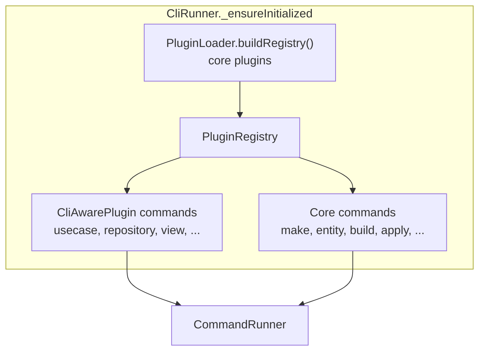
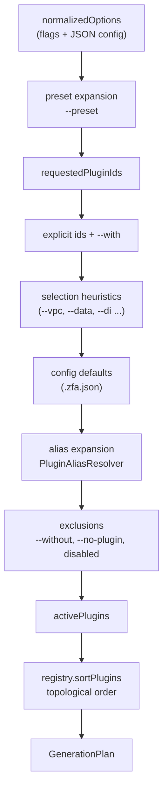
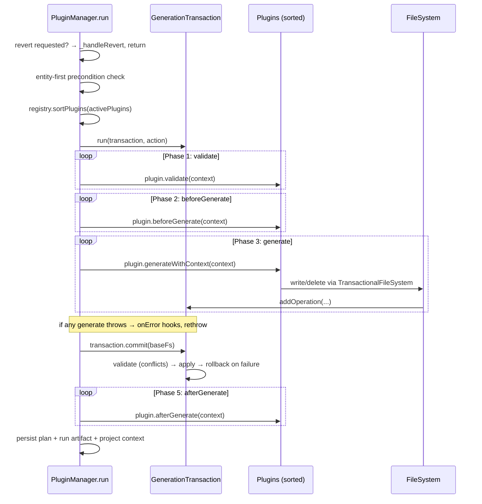
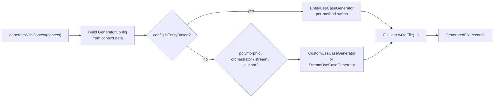

The code generation pipeline is the single architectural journey every Zuraffa invocation travels — from `zfa make User di` to the files landing on disk. It is not a single function; it is a staged contract where each stage has a narrow interface, produces a normalized artifact, and hands it to the next. Understanding the pipeline is the key to understanding why Zuraffa can preview a plan without writing anything (`--plan`), revert a run atomically, and replay a saved plan.

This page walks the pipeline end to end for advanced developers: entry points, plan resolution, context construction, the transactional execution lifecycle, the write path, and post-generation memory.

## Pipeline at a Glance

Every run traverses five stages. Each stage is pure with respect to the next — nothing is written until stage four.

```mermaid
flowchart LR
    A["bin/zfa.dart<br/>main()"] --> B["zfa_cli.dart<br/>run()"]
    B --> C["CliRunner<br/>dispatch"]
    C --> D["MakeCommand<br/>parse flags + JSON"]
    D --> E["PlanResolver<br/>normalize → select → sort"]
    E --> F["GenerationPlan"]
    F --> G["PluginManager.buildContext<br/>CoreConfig + data + FileSystem"]
    G --> H["PluginManager.run<br/>validate → before → generate → commit → after"]
    H --> I["GenerationTransaction<br/>validate → apply → rollback"]
    I --> J["DefaultFileSystem<br/>writes to disk"]
    J --> K["PlanStore / RunStore<br/>memory + artifacts"]
```

The entry point is deliberately thin: `bin/zfa.dart` contains only a three-line `main()` that forwards to `cli.run(arguments)`, and `lib/src/zfa_cli.dart` constructs a `CliRunner` and dispatches. All real behavior lives in the `lib/src` tree, which keeps the binary a stable, testable seam.

Sources: [bin/zfa.dart](bin/zfa.dart#L1-L13), [lib/src/zfa_cli.dart](lib/src/zfa_cli.dart#L1-L16)

## Entry Points: How a Command Reaches the Pipeline

`CliRunner` is the command hub. On first use it lazily builds the plugin registry and registers every command (see `_ensureInitialized`). The CLI and the generation engine share the same registry: plugins are loaded once, then contribute both their CLI commands (via `CliAwarePlugin`) and their generation capabilities. This is why `zfa make` and `zfa usecase create` agree on what a "usecase" is.

The plugin loader instantiates the core plugins (Repository, Provider, UseCase, Presenter, Controller, View, Feature, State, Test, Gym, Mock, Api, Di, DataSource, Service, Route, Cache, Sync, GraphQL, Skin, Strategy, MethodAppend, Module, Skeleton, Slice, and more) and registers each unless it is disabled in `.zfa.json`. The exact set is defined in `PluginLoader._plugins()`.

| Entry command | Path into the pipeline | Notes |
|---|---|---|
| `zfa make <Name> <plugins...>` | Direct: parses args → `resolvePlan` → `buildContext` → `manager.run` | The primary pipeline driver |
| `zfa feature <Name>` | Wrapper: translates flags into a `make` invocation | Adds a preset-like layer over `make` |
| `zfa entity create -n <Name>` | Separate path: Zorphy entity creation, then optional `build_runner` | Entity-first flow; downstream `zfa make` reads the created entity |
| `zfa apply --plan-id ...` | Replay: loads a saved plan → resolves capability → executes | Post-pipeline consumer, not a generator itself |
| `zfa generate` | Removed | Prints a migration message and exits with code 64 |

The `make` command is the canonical pipeline driver: it resolves a plan, optionally prints it (`--plan`/`--explain`), builds a context, and executes. If no entity name or JSON config is supplied, it aborts with usage guidance.

Sources: [lib/src/cli/cli_runner.dart](lib/src/cli/cli_runner.dart#L59-L181), [lib/src/cli/plugin_loader.dart](lib/src/cli/plugin_loader.dart#L154-L246), [lib/src/commands/make_command.dart](lib/src/commands/make_command.dart#L574-L640)

## Stage 1 — Plan Resolution: Deciding What Gets Generated

Before any file is touched, `PlanResolver.resolve()` produces a `GenerationPlan` — a normalized execution contract describing *which* plugins will run and *in what order*. This is a pure decision stage: nothing is written yet, which is why `zfa make --plan` can safely preview it.

The resolution algorithm is an ordered composition of seven inputs:

Two mechanisms deserve emphasis because they explain why a simple command produces a specific file set:

1. **Selection heuristics** — bare flags map to plugin groups. `--vpc` expands to `view + presenter + controller + state`; `--data` expands to `repository + datasource`; `--use-service` implies both `service` and `provider`. These are coded directly in `_selectionFromOptions`.
2. **Exclusion wins** — `--without`, explicit `--no-<plugin>` flags, and plugins disabled in `.zfa.json` all filter the expanded set *after* defaults are added. A plugin enabled by default can still be muted per-invocation.

Finally, `PluginRegistry.sortPlugins` performs a depth-first topological sort honoring each plugin's `dependsOn` and `runAfter` declarations, throwing `StateError` on circular dependencies. The resulting `GenerationPlan` exposes `requestedPluginIds`, `pluginIds`, `activePlugins`, `warnings`, and `normalizedOptions`.

The `make` command also applies two post-resolution filters: in engine mode it drops Flutter-importing presentation plugins, and in package mode (detected via the package-shape marker) it suppresses app-only plugins (`route`, `view`, `presenter`, `controller`, `app_shell`).

Sources: [lib/src/core/planning/plan_resolver.dart](lib/src/core/planning/plan_resolver.dart#L18-L120), [lib/src/core/planning/generation_plan.dart](lib/src/core/planning/generation_plan.dart#L1-L36), [lib/src/core/plugin_system/plugin_registry.dart](lib/src/core/plugin_system/plugin_registry.dart), [lib/src/commands/make_command.dart](lib/src/commands/make_command.dart#L774-L794), [lib/src/core/plugin_system/plugin_manager.dart](lib/src/core/plugin_system/plugin_manager.dart#L62-L90)

## Stage 2 — Context Construction: The Shared State Handed to Plugins

With an active plugin list in hand, `PluginManager.buildContext()` assembles the `PluginContext` that every plugin reads and writes during generation. It contains three coordinated pieces:

| Piece | Purpose | Construction |
|---|---|---|
| `CoreConfig` | Cross-cutting flags: `name`, `outputDir`, `dryRun`, `force`, `verbose`, `revert` | Merged from `overrideOutputDir` or `argResults`; output defaults to `lib/src` |
| `data` map | Plugin-visible parameters: `methods`, `domain`, `repo`, `variants`, custom schema properties | Merged from each plugin's `configSchema` properties + a hard-coded core param list |
| `fileSystem` | All disk access during generation | A `TransactionalFileSystem` wrapping `DefaultFileSystem(root: projectRoot)` |

The `data` map is the *only* channel through which plugins observe each other: after core params are merged, every active plugin id is written into `data` as `true` (or under `__active_<id>` when the plugin's own schema declares that id as a non-boolean type, to avoid type collisions), so a plugin can check "is `di` also running?" by reading `context.data['di']`. The merging also performs type coercion: comma-separated strings are split into lists, `integer` and `number` schema types are parsed, and `FormatException` is thrown for invalid values — so a typo fails fast at context construction rather than deep inside generation.

The `make` command additionally resolves the entity's actual id-like field from the entity source file and writes `id-field` / `id-field-type` / `query-field` into `context.data`, so generated code references a `Field` constant that actually exists on the entity's `Fields` class rather than a hardcoded `id`.

Sources: [lib/src/core/plugin_system/plugin_manager.dart](lib/src/core/plugin_system/plugin_manager.dart#L71-L346), [lib/src/core/plugin_system/plugin_context.dart](lib/src/core/plugin_system/plugin_context.dart), [lib/src/commands/make_command.dart](lib/src/commands/make_command.dart#L815-L957)

## Stage 3 — The Execution Lifecycle

`PluginManager.run()` orchestrates the actual generation as a **zone-scoped transaction** with five lifecycle phases. The transaction is installed via `GenerationTransaction.run(transaction, action)` using `runZoned`, which means every file operation performed anywhere inside the callback — including deep inside a plugin's generator — is captured into the same transaction.

Notable ordering decisions in the lifecycle:

- **Revert short-circuits everything**: if `--revert` is set, `run()` never enters the transaction — it loads the saved plan and reverses it.
- **Entity-first preconditions run before the transaction**: when `entityFirst` is enabled in config, methods are present, and entity-aware plugins are active, the pipeline verifies the entity file exists; otherwise it throws a guidance error.
- **Commit uses the *base* file system, not the transactional one**: the commit phase deliberately unwraps the `TransactionalFileSystem` to avoid the final writes being re-captured as new operations (which would recurse).
- **Validation is fail-fast**: the first plugin whose `validate()` returns invalid aborts the entire run with a `StateError` listing the reasons.
- **Progress reporting hooks** (`progress.started`, `progress.update`, `progress.completed`) fire around the phases; a null reporter (or the CLI's quiet mode) simply disables them.

Sources: [lib/src/core/plugin_system/plugin_manager.dart](lib/src/core/plugin_system/plugin_manager.dart#L643-L752), [lib/src/core/transaction/generation_transaction.dart](lib/src/core/transaction/generation_transaction.dart#L131-L137), [lib/src/core/plugin_system/plugin_interface.dart](lib/src/core/plugin_system/plugin_interface.dart#L43-L75)

## Inside a Plugin: From Context to Dart Code

Each active plugin is a `FileGeneratorPlugin`, whose single contract is `generateWithContext(context) → List<GeneratedFile>`. The `GeneratedFile` record is the pipeline's universal currency — `{path, type, action, content}` — and every phase of the pipeline either produces, aggregates, or persists these records.

The `usecase` plugin is a representative example of the internal dispatch pattern:

Within the entity generator, each method (`get`, `create`, `update`, `toggle`, `delete`, `watch`, `watchList`) is a case in a switch that selects the `UseCase` / `StreamUseCase` / `CompletableUseCase` base class, the parameter type, and the repository/service call expression. The final write goes through `FileUtils.writeFile`, which performs three duties before touching the transaction: it formats Dart source with `DartFormatter` (non-Dart content passes through), applies force/skip semantics (skip existing unless `--force`), and converts the outcome into a `GeneratedFile` record.

Sources: [lib/src/core/plugin_system/plugin_interface.dart](lib/src/core/plugin_system/plugin_interface.dart#L70-L84), [lib/src/models/generated_file.dart](lib/src/models/generated_file.dart), [lib/src/plugins/usecase/usecase_plugin.dart](lib/src/plugins/usecase/usecase_plugin.dart)

## Stage 4 — The Transactional Write Path

The pipeline's safety guarantee comes from `GenerationTransaction`. Rather than writing directly to disk, every plugin operation becomes a `FileOperation` — one of three types, each carrying the data needed for conflict detection and rollback:

| Operation | Records | Rollback behavior |
|---|---|---|
| `create` | content, `force` | deletes the created file |
| `update` | content, `previousContent`, `expectedHash` | rewrites `previousContent` |
| `delete` | `previousContent`, `expectedHash` | rewrites `previousContent` |

The `expectedHash` is a simple hash of the file content captured at operation-planning time. At commit, `ConflictDetector` re-hashes the current disk content and aborts the transaction if it changed since planning ("File modified since planning") — unless `--force` overrides. It also flags duplicate operations for the same path.

The `TransactionalFileSystem` wrapper makes these pending operations *visible* to plugins mid-run: `exists()`, `read()`, and `list()` all consult the current zone's transaction first, so a later plugin can see files created by an earlier plugin before anything hits disk. This is how plugin composition works without disk round-trips.

Commit is all-or-nothing: validate every operation, apply them in order, and on any failure roll back the already-applied operations in reverse. In `dryRun` mode, commit validates but never applies, returning a success result so plugins still complete their lifecycle with accurate accounting.

Sources: [lib/src/core/transaction/file_operation.dart](lib/src/core/transaction/file_operation.dart), [lib/src/core/transaction/conflict_detector.dart](lib/src/core/transaction/conflict_detector.dart), [lib/src/core/transaction/transactional_file_system.dart](lib/src/core/transaction/transactional_file_system.dart), [lib/src/core/transaction/generation_transaction.dart](lib/src/core/transaction/generation_transaction.dart#L78-L127)

## Stage 5 — Post-Generation: Memory, Artifacts, and What Makes Revert Possible

After a successful (non-dry-run, non-revert) run, `_persistProjectMemory` writes three durable records — this is the "plan store" that later enables both `zfa --revert` and `zfa apply`:

1. **EffectReport → PlanStore** (`.zfa/plans/`): the full change ledger under plan id `last_run_<Name>`, capturing each operation's file path, action (`create`/`update`/`delete`), and `previousContent`. This is the source of truth for revert.
2. **RunArtifact → RunStore** (`.zfa/runs/`): a timestamped JSON artifact with the generated file list, duration, success flag, and the normalized options — useful for auditing and comparing runs.
3. **ProjectContextStore**: refreshes project context metadata for downstream tooling.

The same normalized options that drove the run (`plugin_ids`, `execution_order`, `output_dir`) are embedded in the report, so a replayed plan is reproducible. The run also persists a `proof.v1` generation receipt binding every committed file's final on-disk bytes plus the entity spec it was generated from (best-effort; a receipt failure degrades to a warning rather than failing the run).

**Revert** then becomes a mechanical reversal: load the saved `EffectReport`, iterate `changes` in reverse, delete files whose action was `create`, and rewrite `previousContent` for `update`/`delete` — skipping files that no longer exist and honoring `dryRun`. The plan is deleted after successful reversal. `make` also performs a "deep revert" that walks canonical entity-snake-keyed paths and removes generated architecture regardless of the saved plan, which handles entities re-modeled as value objects.

**Apply** is the mirror image: `zfa apply --plan-id` loads the stored report, resolves the owning plugin's capability by name, and re-executes it with the saved args — then deletes the plan on success.

Sources: [lib/src/core/plugin_system/plugin_manager.dart](lib/src/core/plugin_system/plugin_manager.dart#L734-L870), [lib/src/core/plugin_system/plan_store.dart](lib/src/core/plugin_system/plan_store.dart), [lib/src/core/project/run_store.dart](lib/src/core/project/run_store.dart)

## Key Invariants and Guarantees

- **Nothing is written before commit.** Plugins operate on a `TransactionalFileSystem`; disk writes happen only during `commit()`.
- **Commit is all-or-nothing.** A failure mid-apply triggers reverse rollback of already-applied operations.
- **Dry-run is a first-class mode.** Commit validates but never applies; plugins still complete their lifecycle with accurate accounting.
- **Plan resolution is pure.** `PlanResolver.resolve()` touches no files, so `--plan`/`--explain` are safe to run anywhere.
- **Every run is reproducible.** Normalized options, plugin ids, and execution order are embedded in the persisted `EffectReport`.
- **Revert is deterministic.** It reverses the exact ledger the run recorded, plus a deep-revert sweep of canonical entity paths.

## Where to Go Next

You now understand the full journey from `zfa` invocation to files on disk: thin CLI entry, registry-driven command dispatch, pure plan resolution, shared context construction, a zone-scoped transactional lifecycle, and durable post-run memory. To go deeper, the natural next stops are:

- [Plugin System & Manifest](10-plugin-system-and-manifest) — the plugin contracts, capabilities, and lifecycle hooks that the pipeline orchestrates.
- [Architecture Overview](8-architecture-overview) — the broader structural picture the pipeline sits inside.
- [Entity & Zorphy Model](11-entity-and-zorphy-model) — the entity-first flow that feeds the pipeline its inputs.
- [Proof & Provenance](17-proof-and-provenance) — how the `proof.v1` generation receipt and verification fit in.
- [TDD & Spec-Driven Loop](16-tdd-and-spec-driven-loop) — the test-driven consumer of generated code.
- [Extending with Custom Plugins & Packages](26-extending-with-custom-plugins-and-packages) — adding your own plugins to the registry.
- [Project Layout & Fixed Architecture Root](5-project-layout-and-fixed-architecture-root) — what the produced file tree looks like once the pipeline finishes.
- [Configuration & Project Memory](6-configuration-and-project-memory) — how `.zfa.json` drives defaults, aliases, presets, and disabled plugins.
- [Canonical CLI Workflow](4-canonical-cli-workflow) — the day-to-day commands built on top of this pipeline.