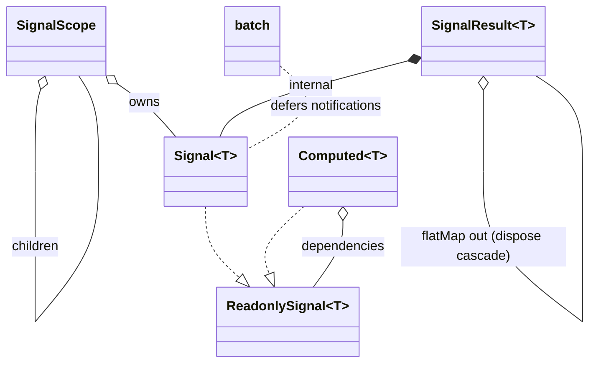

# Data Model: Signals Reactive Core Upgrades

**Feature**: 1725-signals-reactive-core | **Date**: 2026-11-11

All entities live in `lib/src/core/signals/`. No persistence, no storage.

## New entities

### `Computed<T>` (computed.dart)

| Field | Type | Purpose |
| -- | -- | -- |
| `dependencies` | `List<ReadonlySignal<dynamic>>` | explicit inputs; each listened once at construction |
| `_compute` | `T Function()` | user transform, never called while nobody reads and nothing changed |
| `_cache` | `T?` + `_hasCache` | last computed value |
| `_dirty` | `bool` | set true on any dependency change; cleared on recompute |
| `_computing` | `bool` | recursion guard: reading `.value` inside `compute` throws `StateError` |
| `_listeners` | `List<void Function(T)>` | subscribers; non-empty switches the computed to push mode |

Lifecycle states: `fresh` (cache valid, not dirty) → `dirty` (dep changed,
unread) → recompute on read. `dispose()` cancels dependency subscriptions and
releases listeners; idempotent.

### `SignalScope` (signal.dart)

| Field | Type | Purpose |
| -- | -- | -- |
| `_owned` | `List<Signal<dynamic>>` | signals whose constructors ran inside this scope's `run` |
| `_children` | `List<SignalScope>` | scopes CONSTRUCTED while this scope was active (nesting) |
| `static _active` | `SignalScope?` | current innermost `run` boundary; `Signal` constructor registers into it |

`run<T>(callback)` pushes `this` onto `_active` for the duration of the
callback (restored in `finally`). `dispose()` disposes children first, then
owned signals; idempotent.

### Batch state (signal.dart, library-private)

| Field | Type | Purpose |
| -- | -- | -- |
| `_batchDepth` | `int` | 0 = no batch; nested batches only flush at outermost exit |
| `_pendingSignals` | `LinkedHashSet<Signal<dynamic>>` | signals written inside the batch, in write order; flush calls `_notify()` (reads final `_value`) |

## Changed entities

### `Signal<T>` (signal.dart)

- `_defaultEquals`: `identical(a, b) || a == b` (was `a == b`).
- `set value`: unchanged write; when `_batchDepth > 0`, adds `this` to
  `_pendingSignals` instead of notifying.
- `_notify()`: snapshot loop gains two guards — stop entirely if the signal
  became disposed mid-notification; skip listeners no longer in
  `_listeners` (cancelled mid-notification).
- Constructor: registers into `SignalScope._active` if a scope boundary is
  active.

### `SignalResult<T>` (signal_result.dart)

- `flatMap`: registers `out.dispose()` on the PARENT's `_disposables` so
  parent disposal cascades to the derived output (was orphaned).

## Relationships

No entity touches storage, serialization, or platform code.
